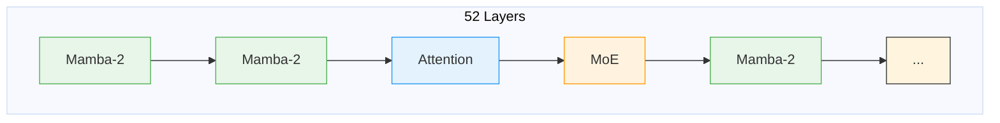
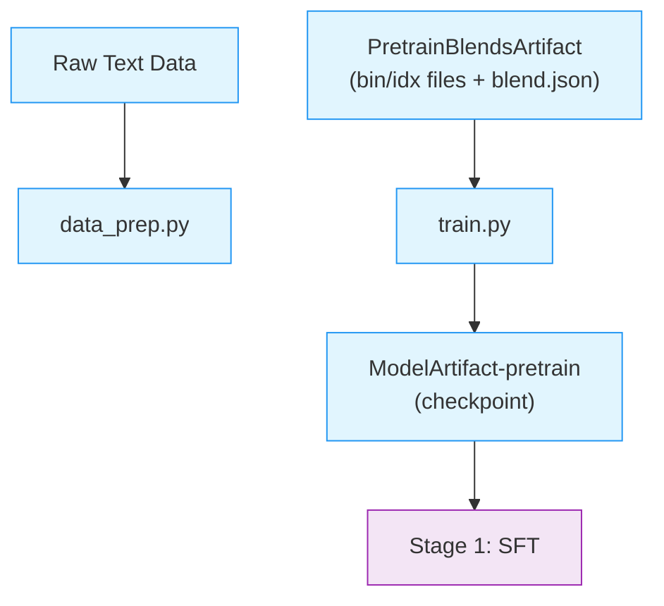

# Stage 0: Pretraining

This stage pretrains a model with the Nemotron 3.5 Lightning architecture from scratch on open data, using [Megatron-Bridge](../nvidia-stack.md#megatron-bridge)'s released `nemotron_3_5_lightning_pretrain_config` recipe.

Nemotron 3.5 Lightning is a **hybrid Mamba-Transformer-MoE** model with 52 layers and a native Multi-Token Prediction (MTP) head, combining state-space models for efficiency, attention for global context, and mixture-of-experts for capacity.

> **Open-Source Data Only**: This recipe uses exclusively open-sourced training data from the [Nemotron Pre-training Datasets](https://huggingface.co/collections/nvidia/nemotron-pre-training-datasets) collection. The recipe includes datasets from Nemotron-CC-Math-v1, Nemotron-CC-v2, Nemotron-CC-v2.1, and Nemotron-Pretraining-Specialized-v1. It is not how the released base model was produced (see [How the Released Base Was Built](#how-the-released-base-was-built)), so results will differ from the published benchmarks on the [model card](https://huggingface.co/nvidia/NVIDIA-Nemotron-3.5-Lightning-30B-A3B-Base-BF16). Use this recipe as a reference implementation to apply the methodology with your own data.

---

## Training Methodology

> **Training Framework**: Pretraining is implemented using [Megatron-Bridge](https://docs.nvidia.com/nemo/megatron-bridge/latest/), which provides the training loop, distributed training primitives, and checkpoint management. See [Training Entry Points](https://docs.nvidia.com/nemo/megatron-bridge/latest/training/entry-points.html) for details on how `pretrain()` works.
>
> **Tech report**: Lightning's base-model recipe is described in *Nemotron 3.5 Super and Lightning: Open, Efficient Mixture-of-Experts Hybrid Mamba-Transformer Models for Agentic AI* (NVIDIA, 2026; link pending publication). Section and table references (§, Table) on this page point to that report. The recipe configs in this repository are the reference for what `lightning35 pretrain` runs.

### How the Released Base Was Built

Per the tech report, the released Nemotron 3.5 Lightning 30B-A3B Base was **not** pretrained from scratch. It starts from Nemotron 3 Nano Base and adds an MTP head, distillation, and long-context training:

| # | Stage | Tokens | Details | Report |
|---|-------|--------|---------|--------|
| 0 | Initialize from Nemotron 3 Nano Base | — | Backbone settings match Nano 3 Base | §1, §2.2 |
| 1 | MTP head from Nemotron 3 Super Base's head | — | Latent MoE projections fused into the experts' up/down projections, then pruned: hidden 4096 → 2688, MoE intermediate 2688 → 1856, routed experts 512 → 128 | §2.1 |
| 2 | MTP warm-up | 100B | Backbone frozen, only the MTP head trained, standard 2-step recursive MTP training | §1, §2.1 |
| 3 | Distillation from Nemotron 3 Super Base | 1T | See settings below | §2.2 |
| 4 | Long-context training | not reported | The report gives no Lightning-specific long-context settings | §1 |

Distillation settings for Lightning (§2.2):

- **Teacher signal**: top-128 logits from Super 3 Base on 1T tokens of the Nemotron 3 Ultra Phase 2 data
- **Loss**: forward KL with an extra sink token for the probability mass outside the top 128, combined with cross-entropy (weights 0.9 KL / 0.1 CE)
- **Learning rate**: starts at 1e-5 (Nano 3 Base's minimum LR), ramps to 1e-4 over the first 200B tokens, then decays linearly back to 1e-5 over the remaining 800B
- **MTP loss scaling factor**: 0.1
- **MoE sequence load-balancing loss coefficient**: 1e-4
- All other hyperparameters match Nano 3 Base, except for the added MTP layers

The released model did not include an Indic continued-pretraining stage (§2.3). Nemotron 3 Nano Base itself came from Nano 3's own two-phase pretraining; see [Nemotron 3 Nano pretraining](../nano3/pretrain.md).

> **Note**: The [Base model card](https://huggingface.co/nvidia/NVIDIA-Nemotron-3.5-Lightning-30B-A3B-Base-BF16) describes this checkpoint differently: pre-trained for more than 20T tokens with an NVFP4 recipe, with a continued-pretraining phase for the MTP layers, and with no distillation applied. This page follows the tech report.

**What this recipe runs instead.** `lightning35 pretrain` trains the Lightning architecture (including its MTP head) from random initialization with a standard language-modeling loss on the open data blend below. It does not reproduce the MTP warm-up, the distillation from Super 3 Base (which needs the teacher's logits on Ultra 3 Phase 2 data), or the long-context stage.

### Model Architecture

The recipe builds a 52-layer **hybrid Mamba-Transformer-MoE** model (layer pattern from the Megatron-Bridge config, inherited from Nemotron 3 Nano):

| Layer Type | Count | Role |
|------------|-------|------|
| Mamba-2 | 23 | Efficient sequence modeling via state space |
| Attention | 6 | Global context at key positions |
| MoE | 23 | Sparse computation: 128 routed experts (top-6) plus 1 shared expert per layer |

The hybrid pattern interleaves these layer types to balance efficiency and capability:



**Design choices:**

- **Mamba-2 layers** provide linear-time sequence processing, making long-context inference practical
- **Attention layers** (grouped-query attention, 32 heads / 2 KV groups) appear at six positions spread through the stack for global information mixing
- **MoE layers** use 128 routed experts plus 1 shared expert, with 6 experts activated per token. This keeps active parameters at ~3B while total parameters reach ~30B
- **MTP head**: a repeated-layer module with an attention + MoE block (`mtp_hybrid_override_pattern: "*E"`), used for speculative decoding at inference

> For implementation details, see [Megatron-Bridge Nemotron 3 Nano](https://docs.nvidia.com/nemo/megatron-bridge/latest/models/nemotron/nemotron3-nano.html); `nemotron_3_5_lightning_pretrain_config` extends Megatron-Bridge's Nemotron 3 Nano pretraining config.

### Pretraining Data

The recipe's open blend (`config/data_prep/data_blend_raw.json`) has 23 subsets from four dataset families:

| Dataset Family | Subsets in the blend |
|----------------|----------------------|
| **Nemotron-CC-Math-v1** | `3`, `4plus`, `4plus_MIND` |
| **Nemotron-CC-v2** | Diverse-QA, High-Quality, High-Quality-Synthetic, Medium-High-Quality, Medium-Quality, Translated-Diverse-QA |
| **Nemotron-CC-v2.1** | High-Quality, High-Quality-Synthetic, Medium-High-Quality, Medium-High-Quality-Synthetic, Medium-Quality, plus three Translated-To-English subsets (High-Quality, High-Quality-Synthetic, Medium-High-Quality) |
| **Nemotron-Pretraining-Specialized-v1** | InfiniByte-Reasoning, Math-Textbooks, RQA, STEM-SFT, Scientific-Coding, Wiki-Rewrite |

### Data Mixture

Every subset in the blend has weight 1.0, and the recipe trains on this single mix; it does not implement a multi-phase curriculum. The uniform weights say nothing about the mixtures used for the released model (Nano 3's pretraining mixture for the initialization, then Ultra 3 Phase 2 data for distillation), neither of which this blend reproduces.

### Hyperparameters

These values come from Megatron-Bridge main's released
`nemotron_3_5_lightning_pretrain_config` — the recipe function is the source
of truth for anything not listed here.

| Parameter | Value |
|-----------|-------|
| **Global Batch Size** | 512 sequences |
| **Sequence Length** | 8,192 tokens |
| **Context Parallelism** | CP=2 (P2P comms; halves each MTP head's vocab-loss workspace per rank) |
| **MTP** | Repeated-layer module, depth 2 (`mtp_hybrid_override_pattern: "*E"`), loss scaling 0.3 |
| **MoE Load Balancing** | `seq_aux_loss` (coefficient 1e-4), sigmoid router score, expert bias enabled |

> The MTP loss scaling differs from the report: the recipe uses 0.3, while the report's
> distillation of the released base used 0.1 (§2.2). The remaining settings (learning-rate
> schedule, iteration count) are inherited from Megatron-Bridge's Nemotron 3 Nano pretraining
> config; they are not the released model's distillation schedule described above.

### MoE Load Balancing

The recipe combines two load-balancing mechanisms:

- **Sequence-level auxiliary loss** (`moe_router_load_balancing_type: seq_aux_loss`, `moe_aux_loss_coeff: 1e-4`). The report likewise uses a MoE sequence load-balancing loss coefficient of 1e-4 for Lightning's distillation (§2.2).
- **Router expert bias** (`moe_router_enable_expert_bias: true`), the bias-update mechanism from DeepSeek's aux-loss-free load balancing:
  - Track expert utilization during training
  - Increase bias for underutilized experts (more tokens routed to them)
  - Decrease bias for overloaded experts
  - No gradient flows through the bias adjustment

> For details on the bias mechanism, see the [Auxiliary-Loss-Free Load Balancing paper](https://arxiv.org/abs/2408.15664).

## Recipe Execution

### Quick Start

<div class="termy">

```console
// 1. Prepare data (tokenize to bin/idx format)
$ uv run nemotron lightning35 data prep pretrain --run YOUR-CLUSTER

// 2. Run pretraining
$ uv run nemotron lightning35 pretrain --run YOUR-CLUSTER
```

</div>

> **Note**: The `--run YOUR-CLUSTER` flag submits jobs via [NeMo-Run](../../nemo_runspec/nemo-run.md). See [Execution through NeMo-Run](../../nemo_runspec/nemo-run.md) for setup.

#### Direct Script Execution (Megatron-Bridge)

For direct execution outside this CLI, use the scripts in the [Megatron-Bridge](https://github.com/NVIDIA-NeMo/Megatron-Bridge) repository:

```bash
# Clone Megatron-Bridge main (the Lightning recipes live on main)
git clone https://github.com/NVIDIA-NeMo/Megatron-Bridge.git
cd Megatron-Bridge

# Run pretraining via the recipe runner (inside a 26.08-generation container)
python scripts/training/setup_experiment.py \
    --recipe nemotron_3_5_lightning_pretrain_config \
    --account ACCOUNT --partition PARTITION --container-image IMAGE
```

See the [Nemotron 3.5 Lightning verification card](https://github.com/NVIDIA-NeMo/Megatron-Bridge/blob/main/examples/model_verification_cards/nemotron-3.5-lightning/card.yaml) for the exact
validated invocations (convergence, performance, and FSDP variants).

### Configuration

| File | Purpose |
|------|---------|
| `config/default.yaml` | Production configuration |
| `config/data_prep/default.yaml` | Data preparation settings |
| `config/data_prep/data_blend_raw.json` | Dataset blend definition |

**Blend Configuration**

Data blends are defined in `config/data_prep/data_blend_raw.json`. Each entry specifies:

```json
{
  "name": "dataset-name",
  "path": "hf://nvidia/...",
  "subset": "subset-name",
  "weight": 1.0
}
```

Weights control sampling probability during data preparation. To run a phase curriculum, use a different blend configuration for each phase.

### Data Preparation

The `data_prep.py` script tokenizes raw text datasets into Megatron's binary format. See [Data Preparation Module](../data-prep.md) for detailed documentation.

#### CLI Command

```bash
uv run nemotron lightning35 data prep pretrain [options]
```

| Option | Description |
|--------|-------------|
| `--run <profile>` | Execute on Slurm via [NeMo-Run](../../nemo_runspec/nemo-run.md) |
| `sample=N` | Limit rows per dataset (for testing) |
| `force=true` | Force re-run, ignoring cache |

#### Output

```
output/lightning35/stage0_pretrain/
├── blend.json                          # Per-split blend {"train": [...], "valid": [...], "test": [...]}
├── splits/
│   ├── train/
│   │   ├── shard_000000.bin/.idx
│   │   └── ...
│   ├── valid/
│   │   └── shard_000000.bin/.idx
│   └── test/
│       └── shard_000000.bin/.idx
└── runs/<run_hash>/                    # Raw shard outputs (splits/ symlinks here)
```

The output is registered as a [W&B Artifact](../artifacts.md) (`PretrainBlendsArtifact-<config_name>`) for lineage tracking.

### Training

#### CLI Command

```bash
uv run nemotron lightning35 pretrain [options] [overrides...]
```

| Option | Description |
|--------|-------------|
| `--run <profile>` | Attached—submits and waits, streaming logs ([NeMo-Run](../../nemo_runspec/nemo-run.md)) |
| `--batch <profile>` | Detached—submits and exits immediately ([NeMo-Run](../../nemo_runspec/nemo-run.md)) |
| `--dry-run` | Preview execution plan |
| `key=value` | Override config values ([CLI Framework](../cli.md#dotlist-overrides)) |

#### Override Examples

```bash
# More training iterations
uv run nemotron lightning35 pretrain train.train_iters=5000

# Larger batch size
uv run nemotron lightning35 pretrain train.global_batch_size=64

# Different checkpoint location
uv run nemotron lightning35 pretrain checkpoint.save=/path/to/checkpoints
```

### Running with NeMo-Run

Configure execution profiles in `env.toml`:

```toml
[wandb]
project = "nemotron"
entity = "YOUR-TEAM"

[YOUR-CLUSTER]
executor = "slurm"
account = "YOUR-ACCOUNT"
partition = "batch"
nodes = 2
ntasks_per_node = 8
gpus_per_node = 8
mounts = ["/lustre:/lustre"]
```

See [Execution through NeMo-Run](../../nemo_runspec/nemo-run.md) for complete configuration options.

### Checkpoint & Resume

Training automatically saves checkpoints at regular intervals. To resume from a checkpoint:

```bash
# Resume from a specific checkpoint
uv run nemotron lightning35 pretrain checkpoint.load=/path/to/checkpoint

# Resume from latest checkpoint in a directory
uv run nemotron lightning35 pretrain checkpoint.load=/path/to/checkpoints/
```

**Checkpoint Configuration:**

| Option | Description |
|--------|-------------|
| `checkpoint.save` | Directory for saving checkpoints |
| `checkpoint.load` | Path to checkpoint for resuming |
| `checkpoint.save_interval` | Steps between saves (default: 1000) |

Checkpoints use Megatron's distributed format, which handles model parallelism automatically. Each checkpoint contains model weights, optimizer state, and training progress.

> For checkpoint format and advanced options, see [Megatron-Bridge Checkpointing](https://docs.nvidia.com/nemo/megatron-bridge/latest/training/checkpointing.html).

### Artifact Lineage



---

## Infrastructure

This stage uses the following components from the [NVIDIA AI Stack](../nvidia-stack.md):

| Component | Role | Documentation |
|-----------|------|---------------|
| [Megatron-Core](../nvidia-stack.md#megatron-core) | Distributed training primitives (TP, PP, DP, EP, CP, SP) | [GitHub](https://github.com/NVIDIA/Megatron-LM) |
| [Megatron-Bridge](../nvidia-stack.md#megatron-bridge) | Model definitions, training loop, checkpoint management | [Docs](https://docs.nvidia.com/nemo/megatron-bridge/latest/) |

### Parallelism Configuration

Pretraining uses multiple parallelism strategies for efficient scaling:

| Parallelism | Value | Config Key |
|-------------|-------|------------|
| Tensor (TP) | 1 | `model.tensor_model_parallel_size` |
| Pipeline (PP) | 1 | `model.pipeline_model_parallel_size` |
| Expert (EP) | 8 | `model.expert_model_parallel_size` |
| Context (CP) | 2 | `model.context_parallel_size` |
| Data (DP) | Auto | Computed from world size |

- **CP=2** splits the 8K sequence across two ranks so each MTP head
  materializes only half of its vocabulary-loss workspace on an 80-GiB H100
- **EP=8** distributes the 128 experts with HybridEP token dispatch
  (`moe_flex_dispatcher_backend: hybridep`; EP groups must align to the
  8-rank NVLink domain)

> For parallelism concepts, see [NVIDIA AI Stack: Parallelism](../nvidia-stack.md#parallelism-strategies).

### Container

```
nvcr.io/nvidian/nemo:26.08.rc2   # public nvcr.io/nvidia/nemo:26.08 at launch
```

The rc container's bundled Megatron-Bridge predates the Lightning recipes, so the
config mounts Megatron-Bridge main (`@0c565c9a0`) and its pinned Megatron-LM
(`@d12f6c8c9`) over the container's copies via `${auto_mount:...}` (Slurm executor
only). These mounts disappear once the launch container ships with the recipes built in.

---

## Next Steps

After pretraining completes, proceed to [Stage 1: SFT](./sft.md) for instruction tuning.

## Reference

- *Nemotron 3.5 Super and Lightning* tech report (NVIDIA, 2026; link pending publication) – §2.1–§2.2 for the released base model
- [Base model card](https://huggingface.co/nvidia/NVIDIA-Nemotron-3.5-Lightning-30B-A3B-Base-BF16) – architecture and pretraining reference
- [NVIDIA AI Stack](../nvidia-stack.md) – Megatron-Core, Megatron-Bridge
- [Artifact Lineage](../artifacts.md) – W&B artifact system
- **Recipe Source:** `src/nemotron/recipes/lightning35/stage0_pretrain/`
- [Back to Overview](./README.md)
