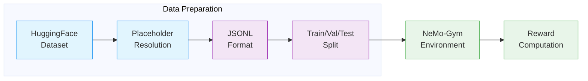
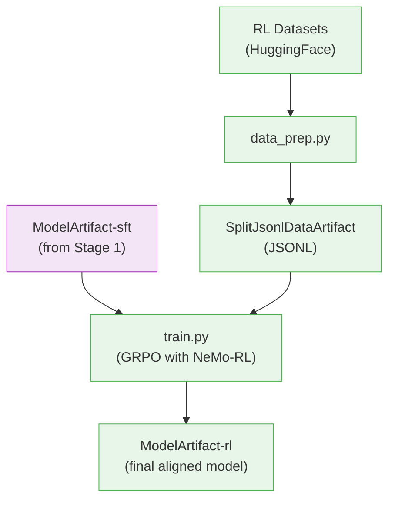

# Stage 2: Reinforcement Learning (RL)

This stage aligns the instruction-tuned model using GRPO (Group Relative Policy Optimization) with [NeMo-RL](../nvidia-stack.md#nemo-rl).

> **Open-Source Data Only**: This recipe uses exclusively open-sourced RL data from the [Nemotron Post-training Datasets](https://huggingface.co/collections/nvidia/nemotron-post-training-v3) collection, which is a subset of the full data used to train the released model. The recipe uses the [Nemotron-3.5-Lightning-RL-Training-Blend](https://huggingface.co/datasets/nvidia/Nemotron-3.5-Lightning-RL-Training-Blend) dataset. The release also includes **Nemotron-RL Agentic Terminal Pivot**, an open agentic RL dataset used to train some of the coding-agent capabilities (see the [release blog](https://developer.nvidia.com/blog/nvidia-nemotron-3-5-lightning-delivers-fast-accurate-specialized-task-execution-for-long-running-agents/)). Results will differ from the published benchmarks on the [model card](https://huggingface.co/nvidia/NVIDIA-Nemotron-3.5-Lightning-30B-A3B-BF16). Use this recipe as a reference implementation to apply the methodology with your own data.

---

## Training Methodology

> **Training Framework**: RL alignment is implemented using [NeMo-RL](https://docs.nvidia.com/nemo/rl/latest/) with Ray for distributed actor coordination and vLLM for fast rollout generation. The Megatron backend handles distributed policy training with tensor, pipeline, context, and expert parallelism. See [NeMo-RL Documentation](https://docs.nvidia.com/nemo/rl/latest/) for implementation details.
>
> Lightning is covered by the joint tech report *Nemotron 3.5 Super and Lightning: Open, Efficient Mixture-of-Experts Hybrid Mamba-Transformer Models for Agentic AI* (NVIDIA, 2026). The report does not give Lightning's RL environments, data, or hyperparameters; the values on this page come from the recipe configs in this repository.

### RL Pipeline Overview

**Released model (tech report):** Lightning follows "a lighter post-training pipeline consisting of single-stage text-only SFT and RLVR" (§1, §3). Unlike Super 3.5, Lightning has no MOPD stage (§3.6). After RL, the report runs MTP boosting for 48k steps against the final backbone, updating only the MTP head (§3.7).

**Released model (model card):** The [model card](https://huggingface.co/nvidia/NVIDIA-Nemotron-3.5-Lightning-30B-A3B-BF16) describes multi-environment RL with GRPO in NeMo RL and NeMo Gym, using an asynchronous RL architecture that uses MTP to accelerate rollouts.

**This recipe:** a single GRPO run over six NeMo Gym environments with verifiable rewards (see [Multi-Environment RLVR](#multi-environment-rlvr)). It runs synchronously (`grpo.async_grpo.enabled: false`) and has no RLHF, reward-model, or DPO stage. MTP boosting is not a recipe stage; the MTP heads are only kept training alongside GRPO (`mtp_num_layers: 5`, loss scale 0.3).

### Data Preparation Pipeline

Before training, the RL dataset is transformed into JSONL format compatible with NeMo-Gym:



| Stage | What Happens |
|-------|--------------|
| **HuggingFace Dataset** | Load [Nemotron-3.5-Lightning-RL-Training-Blend](https://huggingface.co/datasets/nvidia/Nemotron-3.5-Lightning-RL-Training-Blend) from HuggingFace Hub |
| **Placeholder Resolution** | Resolve `_hf_placeholder` records by fetching from external datasets (DAPO, Skywork) and applying template restoration |
| **JSONL Format** | Convert to JSONL with `question`, `expected_answer`, and `responses_create_params` fields |
| **Train/Val/Test Split** | Write one JSONL per split published by the HF dataset (`train`, `validation`, `test` become `train`, `val`, `test`); no split ratio is applied |
| **NeMo-Gym Environment** | Route samples to appropriate reward environments based on task type |
| **Reward Computation** | Compute verifiable rewards (math correctness, code execution, schema adherence) |

**Placeholder Resolution:**

The [Nemotron-3.5-Lightning-RL-Training-Blend](https://huggingface.co/datasets/nvidia/Nemotron-3.5-Lightning-RL-Training-Blend) dataset contains placeholder records that reference external HuggingFace datasets. The `data_prep.py` script resolves these by:

1. Detecting placeholder records by the presence of `_hf_placeholder` field
2. Fetching actual data from external HF datasets:
   - [BytedTsinghua-SIA/DAPO-Math-17k](https://huggingface.co/datasets/BytedTsinghua-SIA/DAPO-Math-17k) — Math reasoning problems
   - [Skywork/Skywork-OR1-RL-Data](https://huggingface.co/datasets/Skywork/Skywork-OR1-RL-Data) — Open reasoning data
3. Applying template restoration (DAPO prefix/suffix, Skywork `{question}` replacement)

> For data preparation implementation, see **Recipe Source**: `src/nemotron/recipes/lightning35/stage2_rl/data_prep.py`

### GRPO Algorithm

GRPO (Group Relative Policy Optimization) optimizes the policy using group-relative advantages:

1. **Generate responses** from the current policy using vLLM
2. **Evaluate** responses using NeMo-Gym reward environments
3. **Compute group-relative advantages** across response groups per prompt
4. **Update the policy** to favor higher-reward responses with clipped gradients

**Loss Function:**

The GRPO loss uses clipped policy gradients with KL regularization:

$$
L(\theta) = E_{x \sim \pi_{\theta_{\text{old}}}} \Big[ \min \Big(\frac{\pi_\theta(x)}{\pi_{\theta_{\text{old}}}(x)}A_t, \text{clip} \big( \frac{\pi_\theta(x)}{\pi_{\theta_{\text{old}}}(x)}, 1 - \varepsilon, 1 + \varepsilon \big) A_t \Big) \Big] - \beta D_{\text{KL}} (\pi_\theta \| \pi_\text{ref})
$$

Where:
- $\pi_\theta$ is the policy being optimized
- $\pi_{\theta_{\text{old}}}$ is the policy from the beginning of this step
- $A_t$ is the advantage estimate (group-relative)
- $\varepsilon$ is the clipping hyperparameter (0.2–0.28)
- $\beta$ is the KL penalty coefficient
- $\pi_{\text{ref}}$ is the reference policy (frozen SFT checkpoint)

**Stability Improvements:**

| Improvement | Description |
|-------------|-------------|
| **On-Policy KL Approximation** | Uses importance weights to correct for off-policy samples. This gives an unbiased and guaranteed-positive KL estimator |
| **Importance Sampling Correction** | Corrects for discrepancies between inference (vLLM) and training (Megatron) token probabilities |
| **Overlong Filtering** | Available in NeMo-RL (excludes sequences that hit max length without EOS from the loss) but **disabled** in this recipe (`grpo.overlong_filtering: false`) |
| **Asymmetric Clipping** | Uses `ratio_clip_min=0.2` and `ratio_clip_max=0.28` for asymmetric policy update bounds |

> For detailed loss function derivations, see the [NeMo-RL GRPO Guide](https://docs.nvidia.com/nemo/rl/latest/guides/grpo.html#loss).

### Multi-Environment RLVR

The recipe config (`env.nemo_gym.config_paths`) trains on 6 NeMo Gym reward environments simultaneously, plus the `vllm_model_for_training` policy model server:

| Environment | Description | Reward Type |
|-------------|-------------|-------------|
| **math_with_judge** | Mathematical reasoning (DAPO, Skywork math); LLM judge disabled (`should_use_judge: false`) | Answer correctness verification |
| **code_gen** | Code correctness with test case execution (1024 processes, 10 s unit-test timeout) | Unit test pass rate |
| **mcqa** | STEM multiple choice questions | Answer matching |
| **instruction_following** | Instruction constraint compliance | Constraint satisfaction |
| **workplace_assistant** | Agentic tool use | Task completion |
| **structured_outputs_json** | JSON schema adherence | Schema validation |

Rollouts are single-turn (`max_rollout_turns: 1`).

> For environment implementation details, see [NeMo-RL Environments Guide](https://docs.nvidia.com/nemo/rl/latest/guides/environments.html).

### Reasoning Control

Per the [model card](https://huggingface.co/nvidia/NVIDIA-Nemotron-3.5-Lightning-30B-A3B-BF16), reasoning can be switched on (the default) or off through the chat template (`enable_thinking=True/False`). Neither the report nor the model card describes how reasoning on/off or reasoning-budget data was prepared for Lightning, and this recipe adds no reasoning-control step.

### Hyperparameters

**GRPO Settings:**

| Parameter | Value | Description |
|-----------|-------|-------------|
| `num_prompts_per_step` | 512 | Prompts sampled per training step |
| `num_generations_per_prompt` | 16 | Rollouts generated per prompt |
| `train_global_batch_size` | 8192 | = prompts x generations per step |
| `max_total_sequence_length` | 73728 | Maximum sequence length (~72K tokens) |
| `mtp_num_layers` | 5 | Repeated-layer MTP kept training during RL (loss scaling 0.3) |
| `reasoning_parser` | `nano_v3` | vLLM reasoning parser (plugin shipped in NeMo-RL) |
| `normalize_rewards` | true | Normalize rewards across batch |
| `use_leave_one_out_baseline` | true | Variance reduction for advantage estimation |
| `overlong_filtering` | false | Truncated generations are kept in the loss |
| `val_period` | 5 | Validation every N steps |
| `max_num_epochs` | 1 | Single epoch over data |
| `seed` | 42 | Random seed for reproducibility |

**Loss Function:**

| Parameter | Value | Description |
|-----------|-------|-------------|
| `ratio_clip_min` | 0.2 | Lower bound for importance ratio clipping |
| `ratio_clip_max` | 0.28 | Upper bound for importance ratio clipping |
| `use_on_policy_kl_approximation` | true | Use unbiased on-policy KL estimator |
| `use_importance_sampling_correction` | true | Correct for inference/training mismatch |
| `token_level_loss` | true | Per-token loss normalization |
| `reference_policy_kl_penalty` | 0 | KL regularization weight (disabled) |

**Optimizer:**

| Parameter | Value |
|-----------|-------|
| `optimizer` | AdamW |
| `lr` | 4e-6 (constant) |
| `min_lr` | 4e-6 |
| `lr_warmup_iters` | 10 (from 4e-7) |
| `weight_decay` | 0.0 |
| `adam_beta1` | 0.9 |
| `adam_beta2` | 0.999 |
| `adam_eps` | 1e-8 |
| `clip_grad` | 1.0 |

**Sequence Packing:**

| Parameter | Value |
|-----------|-------|
| `enabled` | true |
| `algorithm` | modified_first_fit_decreasing |
| `sequence_length_round` | 64 |

---

## Recipe Execution

### Quick Start

<div class="termy">

```console
// 1. Prepare data (convert to JSONL format)
$ uv run nemotron lightning35 data prep rl --run YOUR-CLUSTER

// 2. Run RL training
$ uv run nemotron lightning35 rl --run YOUR-CLUSTER
```

</div>

> **Note**: The `--run YOUR-CLUSTER` flag submits jobs via [NeMo-Run](../../nemo_runspec/nemo-run.md). See [Execution through NeMo-Run](../../nemo_runspec/nemo-run.md) for setup.

### Running in NeMo-RL Repository

For direct execution with NeMo-RL (without the nemotron CLI wrapper), follow the
[NeMo-RL Nemotron 3.5 Lightning guide](https://github.com/NVIDIA-NeMo/RL/blob/main/docs/guides/models/nemotron/nemotron-3.5-lightning.md).
Its RLVR section reproduces the reference run on GB200 NVL72 (aarch64) hardware with
asynchronous GRPO and NeMo Gym, using the files under
`examples/nemo_gym/nemotron-3.5-lightning/` in the NeMo-RL repository:

- `rlvr.yaml` — training, generation, reward, and Gym configuration
- `lightning35_launch.sh` — Slurm submission, code snapshots, persistent caches, container
  mounts, and run-specific paths

That upstream run differs from this recipe: it is asynchronous, uses an 86-node GB200
topology with external GenRM and NL2Bash judge pools, and reads the blend from
[`nvidia/Nemotron-RL-Lightning-Training-Blend`](https://huggingface.co/datasets/nvidia/Nemotron-RL-Lightning-Training-Blend)
(`rlvr.jsonl`, restored with the bundled `fill_placeholders.py`). The recipe in this
repository runs synchronous GRPO from
`src/nemotron/recipes/lightning35/stage2_rl/config/default.yaml` through
`uv run nemotron lightning35 rl` (see [Training](#training) below).

### Configuration

| File | Purpose |
|------|---------|
| `config/default.yaml` | Production GRPO configuration |
| `config/data_prep/default.yaml` | Data preparation settings |
| `config/data_prep/data_blend_raw.json` | RL dataset blend |

### Data Preparation

The `data_prep.py` script converts datasets to JSONL format compatible with [NeMo-RL](../nvidia-stack.md#nemo-rl)'s NeMo-Gym interface. See [Data Preparation Module](../data-prep.md) for detailed documentation.

#### CLI Command

```bash
uv run nemotron lightning35 data prep rl [options]
```

| Option | Description |
|--------|-------------|
| `--run <profile>` | Execute on Slurm via [NeMo-Run](../../nemo_runspec/nemo-run.md) |
| `sample=N` | Limit rows per dataset (for testing) |
| `force=true` | Force re-run, ignoring cache |

#### Output

```
output/stage2_rl_resolved/
├── manifest.json                       # {"train": "<path>", "val": "<path>", "test": "<path>", "source_splits": [...]}
└── runs/<run_hash>/
    ├── <dataset>__train/
    │   └── shard_000000.jsonl
    ├── <dataset>__val/
    │   └── shard_000000.jsonl
    └── <dataset>__test/
        └── shard_000000.jsonl
```

One `<dataset>__<split>` directory is written for each split the HF dataset publishes; a split the dataset does not publish is left empty in `manifest.json`. Training reads `train` and `val` from the manifest.

The output is registered as a [W&B Artifact](../artifacts.md) (`SplitJsonlDataArtifact-<config_name>`) for lineage tracking.

### Training

#### CLI Command

```bash
uv run nemotron lightning35 rl [options] [overrides...]
```

| Option | Description |
|--------|-------------|
| `--run <profile>` | Attached—submits and waits, streaming logs ([NeMo-Run](../../nemo_runspec/nemo-run.md)) |
| `--batch <profile>` | Detached—submits and exits immediately ([NeMo-Run](../../nemo_runspec/nemo-run.md)) |
| `--dry-run` | Preview execution plan |
| `key=value` | Override config values ([CLI Framework](../cli.md#dotlist-overrides)) |

#### Override Examples

```bash
# Cap the run at fewer training steps (default: 1000000)
uv run nemotron lightning35 rl grpo.max_num_steps=200000

# Different temperature for generation
uv run nemotron lightning35 rl policy.generation.temperature=0.8

# Different learning rate
uv run nemotron lightning35 rl policy.megatron_cfg.optimizer.lr=5e-7

# Disable sequence packing
uv run nemotron lightning35 rl policy.sequence_packing.enabled=false
```

### Running with NeMo-Run

Configure execution profiles in `env.toml`:

```toml
[wandb]
project = "nemotron"
entity = "YOUR-TEAM"

[YOUR-CLUSTER]
executor = "slurm"
account = "YOUR-ACCOUNT"
partition = "batch"
nodes = 32
ntasks_per_node = 8
gpus_per_node = 8
mem = "0"
exclusive = true
mounts = ["/lustre:/lustre"]
```

See [Execution through NeMo-Run](../../nemo_runspec/nemo-run.md) for complete configuration options.

### Checkpoint & Resume

Training automatically saves checkpoints based on validation reward. To resume from a checkpoint:

```bash
# Resume from a specific checkpoint
uv run nemotron lightning35 rl policy.model_name=/path/to/checkpoint

# Resume from latest checkpoint in results directory
uv run nemotron lightning35 rl checkpointing.checkpoint_dir=/path/to/results
```

**Checkpoint Configuration:**

| Option | Value | Description |
|--------|-------|-------------|
| `save_period` | 10 | Steps between checkpoint saves |
| `metric_name` | val:total_reward/mean | Metric for best checkpoint selection |
| `higher_is_better` | true | Higher reward = better checkpoint |
| `keep_top_k` | 1000000 | Number of checkpoints to retain |

### Troubleshooting

Common errors and solutions:

| Error | Cause | Solution |
|-------|-------|----------|
| High `token_mult_prob_error` | Mismatch between vLLM and Megatron probabilities | Check weight refitting; ensure vLLM compilation settings match |
| KL divergence spikes | Single token probability errors in MoE | Monitor `gen_kl_error` metric; values above 1e-3 indicate issues |
| OOM during generation | vLLM memory allocation too high | Reduce `gpu_memory_utilization` (default 0.5) |
| Slow convergence | Learning rate too low or high | Adjust `policy.megatron_cfg.optimizer.lr` |

**Debugging tips:**

- Monitor `token_mult_prob_error` for inference/training consistency (should stay below ~2%)
- Watch `sampling_importance_ratio` (should hover around 1.0)
- Check `approx_entropy` for entropy collapse during training
- Use `sample=N` in data prep for quick iteration

---

## Artifact Lineage



---

## Infrastructure

This stage uses the following components from the [NVIDIA AI Stack](../nvidia-stack.md):

| Component | Role | Documentation |
|-----------|------|---------------|
| [NeMo-RL](../nvidia-stack.md#nemo-rl) | GRPO algorithm, policy training, reward computation | [Docs](https://docs.nvidia.com/nemo/rl/latest/) |
| [Megatron-Core](../nvidia-stack.md#megatron-core) | Distributed training primitives (TP, PP, CP, EP) | [GitHub](https://github.com/NVIDIA/Megatron-LM) |
| [Ray](https://ray.io/) | Distributed actor coordination | [Docs](https://docs.ray.io/) |
| vLLM | Fast rollout generation | [GitHub](https://github.com/vllm-project/vllm) |

### Parallelism Configuration

Training uses multiple parallelism strategies for efficient scaling:

| Parallelism | Value | Config Key |
|-------------|-------|------------|
| Tensor (TP) | 4 | `policy.megatron_cfg.tensor_model_parallel_size` |
| Pipeline (PP) | 1 | `policy.megatron_cfg.pipeline_model_parallel_size` |
| Context (CP) | 4 | `policy.megatron_cfg.context_parallel_size` |
| Expert (EP) | 16 | `policy.megatron_cfg.expert_model_parallel_size` |
| Sequence (SP) | Yes | `policy.megatron_cfg.sequence_parallel` |

**Generation (vLLM):**

| Parameter | Value | Description |
|-----------|-------|-------------|
| `tensor_parallel_size` | 4 | TP for vLLM generation |
| `gpu_memory_utilization` | 0.5 | GPU memory fraction for KV cache |
| `colocated` | true | Share GPUs with training |
| `enforce_eager` | false | Use torch.compile |

**Cluster:**

| Parameter | Value |
|-----------|-------|
| `num_nodes` | 32 |
| `gpus_per_node` | 8 |

### Features Used

| Feature | Purpose |
|---------|--------|
| GRPO algorithm | Group Relative Policy Optimization with clipped gradients |
| Megatron backend | Distributed training with TP/PP/CP/EP parallelism |
| Sequence Packing | Efficient batch utilization for variable-length generations |
| vLLM Generation | Fast rollout with tensor parallelism |
| MoE Router Bias | Aux-loss-free load balancing (`freeze_moe_router=true`) |
| Per-token Loss | Consistent gradient signal (`calculate_per_token_loss=true`) |

### NeMo-Gym Environments

The training configuration includes these reward environment configs:

```yaml
env:
  nemo_gym:
    config_paths:
      - responses_api_models/vllm_model/configs/vllm_model_for_training.yaml
      - resources_servers/math_with_judge/configs/math_with_judge.yaml
      - resources_servers/code_gen/configs/code_gen.yaml
      - resources_servers/workplace_assistant/configs/workplace_assistant.yaml
      - resources_servers/mcqa/configs/mcqa.yaml
      - resources_servers/instruction_following/configs/instruction_following.yaml
      - resources_servers/structured_outputs/configs/structured_outputs_json.yaml
```

### Architecture

NeMo-RL uses a Ray-based actor model:

| Actor | Function |
|-------|----------|
| **Policy Model** | Trainable policy weights (Megatron backend) |
| **Generator** | vLLM-backed rollout generation (colocated) |
| **Reward Environments** | NeMo-Gym environments for reward computation |
| **Reference Model** | Frozen SFT checkpoint for KL divergence (KL penalty is 0 in the default config) |

### Container

```
nvcr.io/nvidia/nemo-rl:v0.4.0.nemotron_3_5_lightning
```

---

## Next Steps

After RL completes, proceed to [Stage 3: Evaluation](./evaluate.md) to benchmark the aligned model.

## Reference

- [Instruct model card](https://huggingface.co/nvidia/NVIDIA-Nemotron-3.5-Lightning-30B-A3B-BF16) – post-training reference
- [NeMo-RL Documentation](https://docs.nvidia.com/nemo/rl/latest/) – GRPO, environments
- [NeMo-RL Nemotron 3.5 Lightning Guide](https://github.com/NVIDIA-NeMo/RL/blob/main/docs/guides/nemotron-3.5-lightning.md) — upstream training guide
- [NVIDIA AI Stack](../nvidia-stack.md) – NeMo-RL, Megatron-Core
- [Artifact Lineage](../artifacts.md) – W&B artifact system
- [Stage 0: Pretraining](./pretrain.md) – pretrain the base model
- [Stage 1: SFT](./sft.md) – instruction tuning
- **Recipe Source:** `src/nemotron/recipes/lightning35/stage2_rl/`
- [Back to Overview](./README.md)
