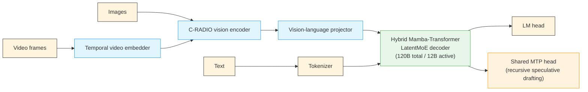
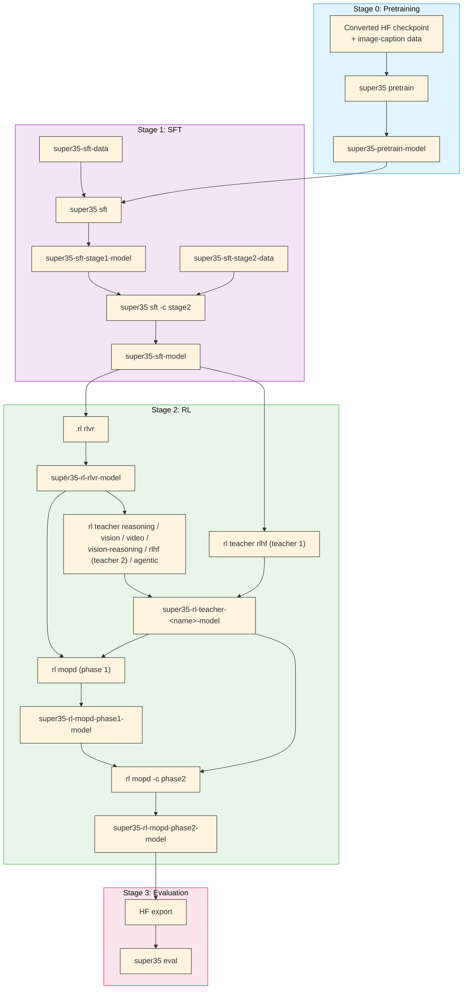

# Nemotron 3.5 Super Training Recipe

Training recipes for Nemotron 3.5 Super, an open 120B-total / 12B-active Mixture-of-Experts hybrid Mamba-Transformer **vision-language** model with native Multi-Token Prediction (MTP). The released checkpoints are named Nemotron-3.5-Super-VL. Super 3.5 is initialized from Nemotron 3 Super and pretrained on text only. SFT turns it into a vision-language model; RLVR, a panel of specialist teachers, and two phases of Multi-teacher On-Policy Distillation (MOPD) then post-train it into a multimodal agent.


> **Pending open-source release**: The SFT and RL data used for Super 3.5 are not yet published, so every stage runs on your own data. The RL stack is public, but the agentic teacher and vision-reasoning stage 2 depend on NeMo Gym components that are not. See [Open-Source Status](#open-source-status) for what is public, what is blocked, and what has been verified.

## Quick Start

### Prerequisites

- **Slurm cluster** with GPU nodes. See [Execution through NeMo-Run](../../nemo_runspec/nemo-run.md).
  - Pretrain and SFT defaults: 8 nodes × 8 H100 (LoRA: 2 nodes × 8 H100; long-context SFT: 32 nodes × 4 GB200).
  - RL: GB200 nodes with 4 GPUs each; 16 to 144 nodes depending on the stage (see [RL](./rl/index.md#per-stage-parameters)).
- **[Weights & Biases](../wandb.md) account** for experiment tracking and [artifact lineage](../artifacts.md).
- **Containers**:
  - Pretrain and SFT: the NeMo 26.08 container (`nvcr.io/nvidia/nemo:26.08`). Until a public image ships the Super-VL recipes (`megatron.bridge.recipes.nemotronh_multimodal`), the configs mount a pinned Megatron-Bridge commit into the container with `${auto_mount:...}`, which **requires the Slurm executor**.
  - RL: built from the stage-owned Dockerfile with `nemotron kit slurm build` (see [RL](./rl/index.md#container)).
  - Eval: `vllm/vllm-openai:v0.30.0`.

### Installation

```bash
git clone https://github.com/NVIDIA-NeMo/Nemotron
cd Nemotron
uv sync
```

### Configuration

Create an `env.toml` file (see [Execution through NeMo-Run](../../nemo_runspec/nemo-run.md) for details):

```toml
[wandb]
project = "nemotron"
entity = "YOUR-TEAM"

[YOUR-CLUSTER]
executor = "slurm"
account = "YOUR-ACCOUNT"
partition = "batch"
nodes = 8
ntasks_per_node = 8
gpus_per_node = 8
mounts = ["/path/to/shared:/path/to/shared"]
```

The RL configs set their own node counts (`run.env.nodes`) and 4 GPUs per node.

### Run the Pipeline

<div class="termy">

```console
// Stage 0: Vision-language pretraining (optional; Megatron-Bridge image-caption recipe)
$ uv run nemotron super35 pretrain --run YOUR-CLUSTER

// Stage 1: Supervised fine-tuning (two SFT stages on your Energon data)
$ uv run nemotron super35 data import sft /path/to/energon/stage1
$ uv run nemotron super35 data import sft /path/to/energon/stage2 --name super35-sft-stage2-data
$ uv run nemotron super35 sft --run YOUR-CLUSTER
$ uv run nemotron super35 sft -c stage2 --run YOUR-CLUSTER

// Stage 2: Reinforcement learning (RLVR -> teachers -> MOPD)
$ uv run nemotron kit slurm build YOUR-CLUSTER --recipe super35 --stage rl
$ uv run nemotron super35 data import rl /data/rlvr/train.jsonl --val /data/rlvr/val.jsonl
$ uv run nemotron super35 rl rlvr --run YOUR-CLUSTER
$ uv run nemotron super35 rl teacher reasoning --run YOUR-CLUSTER
// ...then the remaining teachers (six teachers, ten configs); see the RL guide
$ uv run nemotron super35 rl mopd --run YOUR-CLUSTER
$ uv run nemotron super35 rl mopd -c phase2 --run YOUR-CLUSTER

// Stage 3: Evaluation (export the RL checkpoint to HF first; see Evaluation)
$ uv run nemotron super35 eval --run YOUR-CLUSTER run.model=super35-rl-mopd-phase2-hf-model:latest
```

</div>

Each RL stage reads its own data artifact; [RL](./rl/index.md#data) lists the names.

> **Note**: Stages never chain automatically to a newly trained checkpoint. Each config reads `:latest` of its input artifact, which you can override (for example `run.model=super35-rl-rlvr-model:v3`). To start from an existing checkpoint, register it with `nemotron super35 model import {pretrain,sft,rl}`.

## Resources

- **Tech report**: *Nemotron 3.5 Super and Lightning: Open, Efficient Mixture-of-Experts Hybrid Mamba-Transformer Models for Agentic AI* (NVIDIA, 2026; link pending publication). Section and table references (§, Table) in this guide point to that report.
- **Model weights**:
  - [NVIDIA-Nemotron-3.5-Super-VL-120B-A12B-Base-BF16](https://huggingface.co/nvidia/NVIDIA-Nemotron-3.5-Super-VL-120B-A12B-Base-BF16) (base: text-only, after distillation, Indic CPT, long-context extension, agentic mid-training, and long-context recovery)
  - [NVIDIA-Nemotron-3.5-Super-VL-120B-A12B-BF16](https://huggingface.co/nvidia/NVIDIA-Nemotron-3.5-Super-VL-120B-A12B-BF16) (post-trained vision-language model: MOPD output plus MTP boosting)
  - [NVIDIA-Nemotron-3.5-Super-VL-120B-A12B-NVFP4](https://huggingface.co/nvidia/NVIDIA-Nemotron-3.5-Super-VL-120B-A12B-NVFP4) (post-trained, NVFP4: aggressive PTQ recipe + QAD)
- **Data**: see [Open-Source Status](#open-source-status).
- **Megatron-Bridge**: Super-VL conversion, pretraining, SFT, and PEFT recipes in [`megatron.bridge.recipes.nemotronh_multimodal`](https://github.com/NVIDIA-NeMo/Megatron-Bridge).
- **NeMo-RL / NeMo Gym**: [NeMo-RL](https://github.com/NVIDIA-NeMo/RL) (`super-v3.5-posttraining` branch) and [NeMo Gym](https://github.com/NVIDIA-NeMo/Gym).

## Training Pipeline

| Stage | Name | What the report did | What `nemotron super35` runs | Guide |
|-------|------|---------------------|------------------------------|-------|
| 0 | Pretraining | Text-only: MTP warm-up, 1T-token distillation, Indic CPT, 1M context, agentic mid-training | Megatron-Bridge vision-language image-caption pretraining (`super35 pretrain`); the text pipeline is not reproducible | [pretrain.md](./pretrain.md) |
| 1 | SFT | Projector warm-up, then two SFT stages that add vision | Two SFT stages (`sft`, `sft -c stage2`), plus LoRA and long-context variants | [sft.md](./sft.md) |
| 2.1 | RLVR | Joint RLVR + RLHF over a broad environment mix | `super35 rl rlvr` | [rl/rlvr.md](./rl/rlvr.md) |
| 2.2 | Teachers | Specialist teachers for agentic, reasoning, vision, video, vision reasoning, alignment | `super35 rl teacher <name> [-c variant]` (agentic: blocked) | [rl/teachers.md](./rl/teachers.md) |
| 2.3 | MOPD | Two-phase multi-teacher on-policy distillation | `super35 rl mopd [-c phase2 \| single_stage]` | [rl/mopd.md](./rl/mopd.md) |
| — | MTP boosting | MTP-only knowledge distillation on the final backbone | Not included | [rl/index.md](./rl/index.md#mtp-boosting) |
| 3 | Evaluation | NeMo Gym evaluation on the Table 10 suite | NeMo Evaluator on five supported benchmarks (`super35 eval`) | [evaluate.md](./evaluate.md) |
| — | Quantization | NVFP4 PTQ + QAD (released NVFP4 checkpoint) | Not a CLI stage; Model Optimizer tutorial | [quantization.md](./quantization.md) |

**Terms used in this guide**

- **Reference run**: the internal training run that produced a released or selected checkpoint. The RL configs are ported from its configs (the **reference config**); each stage page lists where they differ, and where the reference run's choices go beyond what the report states (for example which checkpoint step was selected).
- **Teacher**: a short RL run, started from a shared checkpoint, that pushes one capability further than the generalist model.
- **MOPD** (Multi-teacher On-Policy Distillation): distills the teachers into one student; the teacher that owns a prompt's domain scores every student token.
- **Self-anchor**: a frozen copy of the MOPD student's starting checkpoint, used as the teacher for prompts no specialist owns (`general` in the configs).
- **Megatron-Bridge verification**: the verification records published with the Megatron-Bridge Super-VL recipes.


Vision tool use is distilled in both MOPD phases; every other teacher in one. The [RL guide](./rl/index.md#why-three-sub-stages) shows the full checkpoint lineage with the selected steps, including two places where this recipe follows the reference run rather than the report (RLHF teacher 1 starts from SFT; the vision-reasoning teacher starts from RLVR step 120). See [Teachers](./rl/teachers.md) for how the report's description differs.

## Architecture

Super 3.5 combines the Nemotron 3 Super language backbone (a hybrid Mamba-Transformer with LatentMoE and an MTP head) with the Nemotron Omni image and video stack, without an audio encoder:



## Model Specifications

| Specification | Value |
|---------------|-------|
| **Total parameters** | 120B (124.453B counted with the vision encoder, projector, and MTP module, §4.1) |
| **Active parameters** | 12B per forward pass |
| **Language backbone** | Hybrid Mamba-Transformer LatentMoE, 512 routed experts per MoE layer, initialized from Nemotron 3 Super Base |
| **Vision** | C-RADIO vision encoder, vision-language projector, temporal video embedder |
| **MTP** | One recursively shared MTP head, initialized from the first of Nemotron 3 Super Base's two heads (§2.1) |
| **Context length** | Up to 1M tokens |
| **Modalities** | Text, image, video (no audio) |
| **Reasoning modes** | Reasoning-off, regular, medium-effort; regular and medium-effort support inference-time budget control (§3.9) |

The Megatron-Bridge model provider exposes independent freeze controls for the language model, vision encoder, and vision projector. See [SFT](./sft.md#freeze-controls).

The recipes use `nvidia/NVIDIA-Nemotron-3.5-Super-VL-120B-A12B-BF16` as `run.hf_architecture` and as the source of the Hugging Face processor and tokenizer.

## Key Results

From the tech report (post-trained BF16 model unless noted):

| Result | Value | Source |
|--------|-------|--------|
| SWE-bench Pro (OpenCode) | 51.78%, above Nemotron 3 Ultra (49.66%) with about 4.6× fewer active parameters | Table 10 |
| Terminal-Bench 2.1 (Terminus 2) | 60.67% | Table 10 |
| Test-time scaling, Terminal-Bench 2.1 | 62.7% → 71.9% with five parallel agents and self-verification | §3.11 |
| Indic continued pretraining | +4.98 to +9.82 points on five Indic benchmarks | Table 2 |
| MTP boosting | Average acceptance length 4.287 → 4.718 (greedy) and 3.787 → 4.612 (sampled), draft length 7 | Table 8 |
| NVFP4 quantization | 99.52% median accuracy recovery over 35 benchmarks at 4.82 bits per element | §4.1 |
| Serving throughput | Up to 4,632 output tokens/s/GPU on GB200 at ≥ 50 tokens/s/user ([vs. Figure 11](./quantization.md#deployment-and-serving)) | Abstract, §5, Table 23 |

See [Evaluation](./evaluate.md) for the full results.

## Stage Summaries

### Stage 0: Pretraining

The report's pretraining is **text-only** and continues from Nemotron 3 Super Base: an MTP warm-up, 1T tokens of distillation from Nemotron 3 Ultra Base, Indic continued pretraining, and long-context and agentic mid-training ([details](./pretrain.md#training-methodology)). It depends on teacher logits and data that are not public, so this repository does not reproduce it. `super35 pretrain` instead runs Megatron-Bridge's **vision-language image-caption pretraining** recipe (`nemotron_35_super_vl_pretrain_config`), warm-started from converted released weights. Most users can skip this stage and start SFT from a converted checkpoint.

→ [Pretraining Guide](./pretrain.md)

### Stage 1: Supervised Fine-Tuning

The base model is text-only, so SFT is where Super 3.5 becomes a vision-language model. After a vision-projector warm-up, the report runs a broad SFT stage (vision, reasoning, chat, long-context, safety, and agentic data) and then a smaller second stage that re-weights the blend. It uses packed 524,288-token sequences, a global batch of 32, and two shared-weight MTP layers at loss scale 0.3. The recipe maps the two stages to `-c default` and `-c stage2`. Their defaults are the Megatron-Bridge verified configuration (sequence length 4,096), not the report's production settings.

→ [SFT Guide](./sft.md)

### Stage 2: Reinforcement Learning

Three sub-stages on NeMo-RL with NeMo Gym environments:

1. **RLVR**: joint RLVR and RLHF across a broad environment mix from the SFT checkpoint. Step 120 is the MOPD phase-1 student and the starting point of every teacher except RLHF teacher 1.
2. **Specialist teachers**: agentic, reasoning, vision tool use, video reasoning and tracking, vision reasoning, and alignment (RLHF). All branch from RLVR step 120 except RLHF teacher 1, which branches from SFT.
3. **MOPD**: two phases that route each prompt to the teacher that owns its domain, with a frozen self-anchor for the rest. Phase 2's step-30 checkpoint, after MTP boosting, is the released model.

→ [RL Guide](./rl/index.md)

### Stage 3: Evaluation

The report evaluates every post-trained result with NeMo Gym; to compare against Table 10, run NeMo Gym's Super 3.5 reproducibility recipes against a vLLM endpoint. `super35 eval` runs the five Table 10 benchmarks that NeMo Evaluator supports out of the box: enough to check training runs, not to reproduce Table 10.

→ [Evaluation Guide](./evaluate.md)

### Quantization

The released NVFP4 checkpoint uses the predefined **aggressive** PTQ recipe (4.82 bits per element) followed by 200 iterations of SFT-based Quantization-Aware Distillation. It reaches **99.52% median accuracy recovery** relative to BF16 across 35 benchmarks and deploys as W4A4 on Blackwell and W4A16 on other GPUs. This is not a `nemotron super35` stage: the guide runs the same precision recipe with Model Optimizer's [NemotronH Omni VL W4A4 tutorial](https://github.com/NVIDIA/Model-Optimizer/tree/main/examples/megatron_bridge/tutorials/NemotronH-Omni-W4A4-QAD).

→ [Quantization Guide](./quantization.md)

## Execution Options

All commands support [NeMo-Run](../../nemo_runspec/nemo-run.md) execution modes:

| Option | Behavior | Use Case |
|--------|----------|----------|
| `--run <profile>` | Attached—submits job and streams logs | Interactive development |
| `--batch <profile>` | Detached—submits and exits immediately | Long-running jobs |
| `--dry-run` | Preview execution plan | Validation |

See [Execution through NeMo-Run](../../nemo_runspec/nemo-run.md) for profile configuration and advanced options.

## Artifact Lineage

The pipeline tracks lineage via [W&B Artifacts](../artifacts.md). Every stage reads its starting checkpoint from `run.model` and its data from `run.data`, and publishes a model artifact that the next stage consumes. MOPD also reads one `run.teacher_<role>` artifact per teacher.



| Stage | Input model (`run.model`) | Data (`run.data`) | Output artifact |
|-------|---------------------------|-------------------|-----------------|
| `pretrain` | Converted checkpoint (`SUPER35_INIT_CHECKPOINT`) | Energon image-caption data (`SUPER35_PRETRAIN_DATA`) | `super35-pretrain-model` |
| `sft` | `super35-pretrain-model` (or an imported checkpoint) | `super35-sft-data` | `super35-sft-stage1-model` |
| `sft -c stage2` | `super35-sft-stage1-model` | `super35-sft-stage2-data` | `super35-sft-model` |
| `sft -c peft` / `-c long_context` | `super35-pretrain-model` | `super35-sft-data` / built-in dataset | `super35-sft-peft-model` / `super35-sft-long-context-model` |
| `rl rlvr` | `super35-sft-model` | `super35-rl-rlvr-data` | `super35-rl-rlvr-model` |
| `rl teacher <name>` | `super35-rl-rlvr-model` (RLHF teacher 1: `super35-sft-model`) | per teacher, see [Teachers](./rl/teachers.md#data-artifacts) | `super35-rl-teacher-<name>-model` |
| `rl mopd` | `super35-rl-rlvr-model` + teacher artifacts | `super35-rl-mopd-phase1-data` | `super35-rl-mopd-phase1-model` |
| `rl mopd -c phase2` | `super35-rl-mopd-phase1-model` + teacher artifacts | `super35-rl-mopd-phase2-data` | `super35-rl-mopd-phase2-model` |
| `eval` | An HF export of the RL output (see [Evaluation](./evaluate.md#exporting-checkpoints)) | — | Evaluation results |

MOPD runs past its selected step; pin the step-30 artifact version when you hand off (see [RL](./rl/index.md#using-nemotron-cli-recommended)).

→ [Artifact Lineage & W&B Integration](../artifacts.md)

## Open-Source Status

These recipes are reference implementations. The configs, CLI, and training stack are public, but the data used for Super 3.5 is not, so every stage runs on your own data. Results from your own data will differ from the report's benchmarks.

### Data

| Data | Status |
|------|--------|
| SFT and RL data used for Super 3.5 (SFT blends, RLVR, teacher, alignment, and MOPD blends) | Not yet published; NeMo-RL's guide says the RL data will be released at a later date. The recipes take your own data, registered under the artifact names each stage expects |
| Nemotron-Pretraining-Indic-v1 (~2.83T tokens of synthetic Indic text, 22 languages, 34 language-script configurations) | Announced for release with the report |
| Human-verified Indic LLM evaluation suite (with AI4Bharat) | Announced for release |
| [Nemotron-Post-Training-Dataset-v2](https://huggingface.co/datasets/nvidia/Nemotron-Post-Training-Dataset-v2), [Nemotron-RL-Super-Training-Blends](https://huggingface.co/datasets/nvidia/Nemotron-RL-Super-Training-Blends) | Public; the report uses them as seed prompts for MTP boosting (§3.7) |

### Software

- **RL stack**: public. NeMo-RL `super-v3.5-posttraining` at commit `f299847f1`, which pins NeMo Gym `e24db4e6` (see [RL → Container](./rl/index.md#container)).
- **GenRM**: the length-penalized GenRM variant used in the report is not public. NeMo-RL's public Super 3.5 recipe uses [`nvidia/NVIDIA-Nemotron-3-Ultra-550B-A55B-GenRM`](https://huggingface.co/nvidia/NVIDIA-Nemotron-3-Ultra-550B-A55B-GenRM) instead.
- **Blocked stages**: the agentic teacher and vision-reasoning stage 2 depend on NeMo Gym components that are not public (an environment and a verifier). Their configs are provided for reference and cannot be launched, so the report's two MOPD phases cannot run end to end; `super35 rl mopd -c single_stage` can.
- **Tech report and evaluation**: the tech report link is pending publication. NeMo Gym's [Super 3.5 evaluation recipes](https://github.com/NVIDIA-NeMo/Gym/blob/jakub/marlin/nemotron_recipes/super-3.5/reproducibility.md) are on the `jakub/marlin` branch until they are merged to `main`.

### Verification

| Component | Checked | Result |
|-----------|---------|--------|
| HF ↔ Megatron conversion | Megatron-Bridge verification: GPU import and export, 1 node × 4 GPUs | Verified: all 43,079 tensors round-trip exactly; exported package reloads in Transformers |
| `pretrain` (default) | Megatron-Bridge verification: 64 × H100, DataComp image-caption, 200 steps | Verified (loss 3.37 → 1.92). GB200 layout not verified |
| `sft` (default) | Megatron-Bridge verification: 64 × H100 and 64 × GB200, DataComp image-caption, 200 steps | Verified for image-caption training (loss 3.38 → 1.96 and 3.43 → 1.93); not video training or convergence |
| `sft -c stage2` | Same Megatron-Bridge recipe as `default`, different input artifacts | Not run separately |
| `sft -c peft` | Megatron-Bridge verification: 16 × H100 and 16 × GB200, 500 LoRA steps | Verified; merged HF reload passes, some stronger post-merge numerical checks do not |
| `sft -c long_context` | Megatron-Bridge verification | Not verified |
| RLVR, reasoning, video, alignment (RLHF), MOPD phase 1 and 2 configs | Ported from the reference configs; schema checks on the pinned NeMo-RL stack and CLI dry runs | Not re-run from this repository; each stage page lists where the config differs from the reference run |
| MOPD single stage | Port of NeMo-RL's `mopd.yaml`; same settings as phase 1 apart from the agentic teacher. Schema checks on the pinned NeMo-RL stack | Not run |
| Vision tool-use and vision-reasoning teacher configs | Ported from the reference runs | Full GPU validation on the shared RL stack pending |
| Agentic teacher, vision-reasoning stage 2 | — | **Blocked**: environment / verifier not in public NeMo Gym |
| SFT → RL hand-off | Automatic Megatron → HF conversion in the RL runner | Not tested end to end |
| Full pipeline (pretrain → eval) | — | Not run end to end; no RL config has run end to end on GPUs from this repository |
| `eval` | Config compiles | Not compared against Table 10; use the [NeMo Gym recipes](./evaluate.md#reproducing-table-10-with-nemo-gym) for that |
| CLI, configs, artifact lineage | Unit tests under `tests/recipes/super35/` | Pass on CPU (no GPU jobs) |

## CLI Reference

<div class="termy">

```console
// Show available commands
$ uv run nemotron super35 --help
Usage: nemotron super35 [OPTIONS] COMMAND [ARGS]...

 Super35 (Nemotron 3.5 Super VL) training recipe

╭─ Commands ───────────────────────────────────────────────────────────────╮
│ data       Data import commands (the Super 3.5 blends are not public;    │
│            bring your own)                                               │
│ model      Model import commands                                         │
│ rl         Reinforcement learning sub-stages (RLVR, specialist teachers, │
│            MOPD)                                                         │
╰──────────────────────────────────────────────────────────────────────────╯
╭─ Training Stages ────────────────────────────────────────────────────────╮
│ pretrain   Run vision-language pretraining with Megatron-Bridge (stage0).│
│ sft        Run supervised fine-tuning with Megatron-Bridge (stage1).     │
╰──────────────────────────────────────────────────────────────────────────╯
╭─ Evaluation ─────────────────────────────────────────────────────────────╮
│ eval       Run evaluation with NeMo-Evaluator (stage3).                  │
╰──────────────────────────────────────────────────────────────────────────╯

// RL sub-stages
$ uv run nemotron super35 rl --help
╭─ Commands ───────────────────────────────────────────────────────────────╮
│ teacher   Specialist teachers distilled into the student by MOPD         │
╰──────────────────────────────────────────────────────────────────────────╯
╭─ RL Sub-Stages ──────────────────────────────────────────────────────────╮
│ rlvr      Run text-only RLVR (RL stage 1) with NeMo-RL GRPO and NeMo-Gym.│
│ mopd      Run multi-teacher on-policy distillation (RL stage 3).         │
╰──────────────────────────────────────────────────────────────────────────╯
```

</div>

| Command | Built-in configs (`-c`) | Default |
|---------|-------------------------|---------|
| `super35 pretrain` | `default`, `tiny` | `default` |
| `super35 sft` | `default`, `stage2`, `peft`, `long_context`, `tiny` | `default` |
| `super35 rl rlvr` | `default` | `default` |
| `super35 rl teacher reasoning` / `vision` / `video` / `agentic` | `default` | `default` |
| `super35 rl teacher vision-reasoning` | `stage1`, `stage2` | `stage1` |
| `super35 rl teacher rlhf` | `teacher1_stage1`, `teacher1_stage2`, `teacher2_stage1`, `teacher2_stage2` | `teacher1_stage1` |
| `super35 rl mopd` | `phase1`, `phase2`, `single_stage` | `phase1` |
| `super35 eval` | `default` | `default` |
| `super35 data import sft` / `rl` | — | artifact `super35-sft-data` / `super35-rl-rlvr-data`; set others with `--name` |
| `super35 model import pretrain` / `sft` / `rl` | — | artifact `super35-pretrain-model` / `super35-sft-model` / `super35-rl-rlvr-model` |

## Troubleshooting

**W&B authentication**: See [W&B Integration](../wandb.md) for setup.
```bash
wandb login
```

**RL container not found**: Build it with `uv run nemotron kit slurm build <profile> --recipe super35 --stage rl`. The RL configs expect it at `~/.cache/nemotron/containers/super35-rl.sqsh`.

**Pretrain or SFT fails on a non-Slurm executor**: the Megatron-Bridge mounts (`${auto_mount:...}`) are cloned on the cluster side and need the Slurm executor.

**Job submission fails**: Check Slurm account and partition in `env.toml`. See [Execution through NeMo-Run](../../nemo_runspec/nemo-run.md).

## Further Reading

- [Stage 0: Pretraining](./pretrain.md)
- [Stage 1: SFT](./sft.md)
- [Stage 2: RL](./rl/index.md)
- [Stage 3: Evaluation](./evaluate.md)
- [Quantization](./quantization.md)
- [Nemotron 3 Super](../super3/README.md): the language backbone this model is initialized from
- [Nemotron 3 Ultra](../ultra3/README.md): the post-training pipeline Super 3.5 follows
- [Artifact Lineage](../artifacts.md)
- [Execution through NeMo-Run](../../nemo_runspec/nemo-run.md)
- [W&B Integration](../wandb.md)
- [NVIDIA AI Stack](../nvidia-stack.md)

```{toctree}
:hidden:

pretrain.md
sft.md
rl/index.md
evaluate.md
quantization.md
```
