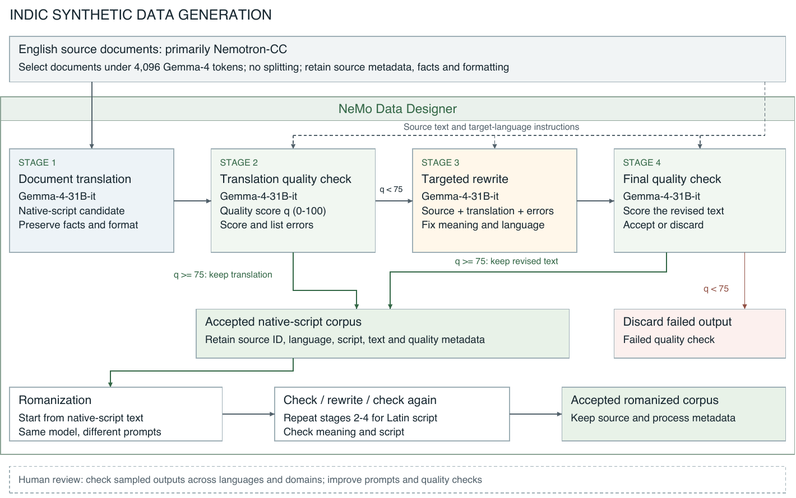
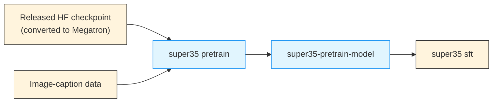

# Stage 0: Pretraining

The released Nemotron 3.5 Super Base checkpoint comes from a text-only continued-pretraining program (§2). It needs Nemotron 3 Ultra Base teacher logits, the full pretraining and mid-training mixtures, and internal long-context blends, none of which are public, so this repository does not reproduce it. Start from the released [Base](https://huggingface.co/nvidia/NVIDIA-Nemotron-3.5-Super-VL-120B-A12B-Base-BF16) checkpoint (the report's SFT starting point) or the [post-trained](https://huggingface.co/nvidia/NVIDIA-Nemotron-3.5-Super-VL-120B-A12B-BF16) checkpoint instead.

`nemotron super35 pretrain` runs Megatron-Bridge's **vision-language image-caption pretraining** recipe, warm-started from converted released weights. Use it to adapt the vision-language stack to your own image–text data before SFT.

---

## Training Methodology

Super 3.5 is initialized from Nemotron 3 Super Base and trained on text only before post-training. The stages, in order:

| Stage | Tokens | Context | What it does |
|-------|--------|---------|--------------|
| MTP initialization + warm-up (§2.1) | 100B | — | Initialize a single, recursively shared MTP head from the first of Nemotron 3 Super Base's two MTP heads (the second is discarded); train only the MTP head with the backbone frozen, using hidden-state mixing (which exposes the head to its own drafted states) to reduce the train–inference mismatch of recursive drafting |
| Distillation (§2.2) | 1T | — | Distill from Nemotron 3 Ultra Base (see below) |
| Indic continued pretraining (§2.3) | 100B | — | 10% (10B tokens) synthetic and natural Indic text; 90% (90B tokens) keeps the preceding mixture's source proportions |
| Long-context phase (§2.4) | 35B | 1M | Constant LR 4.5e-6; Nemotron 3 Ultra long-context blend; CP16 / TP8 / EP64 on GB300 |
| Agentic SWE mid-training (§2.5) | 65.4B | 256K | Natural software-engineering data (issue–PR pairs, repositories, commits, CI logs) plus a small share of agent traces; LR reset, warmed up to 1e-5, then constant |
| Long-context recovery (§2.4) | ~9B | 1M | Same recipe as the long-context phase. Mid-training had dropped RULER-1M from 79.9 to 33.5; recovery restores it to 81.0 |

**Distillation.** Following the Lightning 3.5 recipe, the report distills with Skew Reverse KL (α = 0.1) plus cross-entropy on top-128 teacher logits, with an MoE sequence load-balancing coefficient of 1e-5. The LR ramps from 4.5e-6 to 4.5e-5 over the first 200B tokens, then decays linearly back to 4.5e-6.

### Indic Continued Pretraining

The report generates **Nemotron-Pretraining-Indic-v1**, about 2.83T tokens of Indic text translated from English source documents (mostly Nemotron-CC) across 22 Indian languages and 34 language-script configurations:

- **Twelve priority languages** (native script and romanized, about 2.50T tokens) go through a four-stage NeMo Data Designer pipeline with Gemma-4-31B-it: translate whole documents under 4,096 tokens, score each translation from 0 to 100, rewrite translations that score below 75, and check the rewrite again.
- **Ten lower-resource languages** (native script only, about 327B tokens) use Bodhan-MT for translation and Gemma-4-31B-it for quality checks.

The corpus is much larger than what Super 3.5 used: the CPT stage allocates 10B tokens to selected synthetic text and natural Indic text combined. The report plans to release the corpus, the generation pipelines, and (with AI4Bharat) a human-verified Indic evaluation suite.



Indic CPT improves all five evaluated Indic benchmarks (Table 2; MILU and human-verified Indic translations of MMLU-Pro, ARC, and GSM8K, with the number of languages in parentheses):

| Checkpoint | MILU (10) | Indic MMLU-Pro (12) | Indic ARC-C (12) | Indic ARC-E (12) | Indic GSM8K strict (11) |
|------------|-----------|---------------------|------------------|------------------|-------------------------|
| Before Indic CPT | 72.48 | 51.83 | 84.17 | 90.73 | 72.67 |
| After Indic CPT | 77.90 | 56.81 | 92.83 | 96.77 | 82.49 |
| Change (pp) | +5.42 | +4.98 | +8.66 | +6.04 | +9.82 |

Twelve-language IGB/FLORES translation also improves (chrF++ English→Indic 35.43 → 47.47, Indic→English 58.75 → 64.30). The report saw no regressions on the English benchmarks it tested, and the later mid-trained checkpoint largely keeps the Indic gains. The 10% Indic share came from separate 200B-token Lightning 3.5 ablations (10%, 20%, 30% Indic: four-benchmark mean 63.1, 64.6, 65.6); the report notes these do not establish an optimal share for Super 3.5.

### Agentic Mid-Training

Mid-training bridges pretraining (short context, almost no agent interactions) and SFT (mostly synthetic). It trains at 256K context on natural software-engineering data kept in its original format, with tool responses loss-masked in the agent traces. The LR is reset, warmed up to 1e-5, and held constant. Every source is decontaminated against SWE-bench and Terminal-Bench and has secrets removed.

Mid-training blend (Table 4, shares of training tokens):

| Data source | Share |
|-------------|-------|
| Issue–PR (GitHub issues with repository context and merged patch) | 41% |
| Repositories (whole repos, importing files placed together) | 20% |
| Agentic traces (tool responses loss-masked) | 10% |
| Commit diffs | 3% |
| Build and CI logs | 1% |
| Pretraining replay (phase-2 blend) | 20% |
| Long-context data | 5% |

To measure the effect, the report runs the same experimental agentic SFT (about 33B tokens, 2K steps; not the Section 3 SFT) on the base and on the mid-trained checkpoint (Table 5, pass@1 %):

| Benchmark | Base | Mid-trained |
|-----------|-----:|------------:|
| DeepSWE (average of 4 runs) | 6.4 | 10.4 |
| BrowseComp (subset) | 64.2 | 65.0 |
| SWE-bench Multilingual (OpenHands) | 65.9 | 65.6 |
| SWE-bench Pro (OpenHands) | 52.1 | 51.7 |
| SWE-bench Verified: OpenHands / Pi / OpenCode / Hermes / Codex / Claude Code | 71.3 / 57.4 / 54.4 / 59.8 / 48.4 / 53.8 | 71.9 / 67.8 / 65.8 / 63.2 / 61.8 / 58.0 |
| Terminal-Bench 2.1: Pi / OpenCode / Hermes / Codex / Claude Code | 30.3 / 35.2 / 44.2 / 27.0 / 39.7 | 35.2 / 38.2 / 53.9 / 39.7 / 43.5 |

The clearest gain on the standard benchmarks is DeepSWE. SWE-bench under OpenHands, the harness of the report's standard evaluations, stays within run-to-run variation (about one point). The larger effect is robustness across harnesses: on the five non-OpenHands harnesses the mid-trained model averages +8.6 points on SWE-bench Verified and +6.8 points on Terminal-Bench 2.1.

### Base Model Results

Selected results for the base model (Table 6 of the report; [Evaluation](./evaluate.md#base-model-results) has the full table):

| Task | Metric | Nemotron 3.5 Super Base |
|------|--------|------------------------:|
| MMLU | exact match | 84.14 |
| MMLU-Pro | exact match | 76.25 |
| GPQA Diamond | 5-shot CoT | 66.16 |
| GSM8K | 8-shot CoT | 91.74 |
| MATH-500 | 4-shot, pass@1 (n=32) | 81.56 |
| HumanEval | pass@1 (n=32), EvalPlus | 81.31 |
| LiveCodeBench CodeGen | pass@1 | 47.61 |
| ARC-Challenge | 25-shot | 95.99 |
| Global MMLU | avg. 8 languages | 86.56 |
| MGSM | avg. 6 languages | 87.53 |

Base-model results were collected with the NeMo Evaluator SDK and its LM Evaluation Harness container.

---

## Recipe Execution

`nemotron super35 pretrain` runs Megatron-Bridge's `nemotron_35_super_vl_pretrain_config` recipe: image-caption training of the full Super 3.5 model with every component trainable (C-RADIO vision encoder, temporal video embedder, projector, and hybrid language decoder with its shared MTP head), warm-started from converted pretrained weights. The report warms up only the vision projector before SFT. This recipe is a heavier step in which every component trains, and the natural place to adapt the vision-language stack to your own image–text data.

### Quick Start

<div class="termy">

```console
// Preview the compiled config
$ uv run nemotron super35 pretrain --dry-run

// Smoke test
$ uv run nemotron super35 pretrain -c tiny --run YOUR-CLUSTER

// Full run
$ uv run nemotron super35 pretrain --run YOUR-CLUSTER
```

</div>

#### Direct Script Execution (Megatron-Bridge)

For direct execution outside this CLI, use the launcher in the [Megatron-Bridge](https://github.com/NVIDIA-NeMo/Megatron-Bridge) repository. It submits the same Megatron-Bridge recipes as this stage to Slurm (set `--account`, `--partition` and `--container-image`, or `SLURM_ACCOUNT`, `SLURM_PARTITION` and `CONTAINER_IMAGE`):

```bash
git clone https://github.com/NVIDIA-NeMo/Megatron-Bridge.git
cd Megatron-Bridge

# Convert the released checkpoint first (see Starting Checkpoint)

# Vision-language pretraining on 8 × 8 H100 (the verified layout)
./scripts/training/train.sh --wait --nodes 8 --gpus-per-node 8 \
    --recipe nemotron_35_super_vl_pretrain_64gpu_h100_bf16_config --mode pretrain \
    --pretrained_checkpoint /path/to/super35-megatron/iter_0000000 \
    --max_steps 200 --save_interval 100 --save_dir /path/to/checkpoints \
    dataset.path=/path/to/energon_dataset
```

`nemotron_35_super_vl_pretrain_config`, which this repository's `default` config uses, is an alias of the H100 recipe above. Trailing `key=value` arguments override the recipe config, as in the CLI. The checkpoints are not W&B artifacts, so register the result with `nemotron super35 model import pretrain` to continue with this repository's SFT stage.

See the [Megatron-Bridge Super-VL guide](https://github.com/NVIDIA-NeMo/Megatron-Bridge/blob/main/docs/models/nemotron/nemotron3.5-super-vl.md) for the exact verified commands, expected losses, and the GB200 variants.

### Inputs

The stage reads two cluster-visible paths from environment variables:

| Variable | Contents |
|----------|----------|
| `SUPER35_PRETRAIN_DATA` | Megatron-Energon WebDataset root with image-caption samples (text, image, or video; no audio) |
| `SUPER35_INIT_CHECKPOINT` | Megatron-format Super 3.5 checkpoint converted from Hugging Face (the `iter_0000000` directory) |

```bash
export SUPER35_PRETRAIN_DATA=/path/to/energon/image-caption-dataset
export SUPER35_INIT_CHECKPOINT=/path/to/super35-megatron/iter_0000000
uv run nemotron super35 pretrain --run YOUR-CLUSTER
```

### Starting Checkpoint

The stage loads a Megatron checkpoint converted from Hugging Face. Megatron-Bridge's verified conversion imports `nvidia/NVIDIA-Nemotron-3.5-Super-VL-120B-A12B-BF16` with exact round-trip parity across all 43,079 tensors (language model, MTP, image encoder, projector, temporal embedder). Convert it once:

```bash
# From a Megatron-Bridge checkout
./scripts/conversion/convert.sh import \
  --executor slurm --device gpu --nodes 1 --gpus-per-node 4 \
  --hf-model nvidia/NVIDIA-Nemotron-3.5-Super-VL-120B-A12B-BF16 \
  --megatron-path /path/to/super35-megatron \
  --torch-dtype bfloat16 --tp 1 --pp 2 --ep 2 --etp 1 --trust-remote-code
```

To start from the released Base checkpoint, pass `--hf-model nvidia/NVIDIA-Nemotron-3.5-Super-VL-120B-A12B-Base-BF16`; Megatron-Bridge verified the round trip on the post-trained checkpoint only.

### Configuration

| File | Purpose |
|------|---------|
| `config/default.yaml` | The Megatron-Bridge verified H100 layout: 8 nodes × 8 GPUs, TP2 + sequence parallel / PP2 / EP32, sequence length 4096, GBS 1280, 200 steps |
| `config/tiny.yaml` | 10-step smoke test on the same 8-node layout (the model is still the full 120B-A12B), to validate container, mounts, data, and checkpoint paths |

The 8 × 8 GPU footprint comes from the stage's runspec (`stage0_pretrain/train.py`); the configs do not override `run.env.nodes`.

Common overrides:

```bash
# Longer run (keep the LR decay in step with the iteration count)
uv run nemotron super35 pretrain --run YOUR-CLUSTER train.train_iters=1000 scheduler.lr_decay_iters=1000

# Your own image-caption dataset
uv run nemotron super35 pretrain --run YOUR-CLUSTER dataset.path=/path/to/dataset
```

### Megatron-Bridge Verification

Megatron-Bridge's verification record for this recipe (the `default` config reproduces it):

| Setting | Value |
|---------|-------|
| Hardware | 64 × H100 (8 nodes × 8 GPUs), BF16 |
| Data | DataComp image-caption subset |
| Sequence length | 4096 |
| Global / micro batch size | 1280 / 1 |
| Parallelism | TP2 / PP2 / EP32 / ETP1 |
| Run | 200 steps, no skipped or NaN iterations, checkpoints at steps 100 and 200 |
| Loss | 3.37 → 1.92 |

This is bounded support verification, not a convergence run. A GB200 configuration (64 GPUs, TP2 / PP1 / EP64, sequence length 8,192) has been exercised but is not recorded as verified, because its pretrain/resume comparison is not yet passing.

### Artifact Lineage

The stage publishes `super35-pretrain-model`, which `super35 sft` consumes by default:



To skip this stage, import an existing checkpoint as the pretrain artifact:

```bash
uv run nemotron super35 model import pretrain /path/to/megatron_checkpoint
```

---

## Infrastructure

| Component | Role | Documentation |
|-----------|------|---------------|
| [Megatron-Bridge](../nvidia-stack.md#megatron-bridge) | Super-VL model provider, conversion, and pretrain recipe (`megatron.bridge.recipes.nemotronh_multimodal`) | [GitHub](https://github.com/NVIDIA-NeMo/Megatron-Bridge) |
| [Megatron-Core](../nvidia-stack.md#megatron-core) | Distributed training primitives (TP, PP, EP) | [GitHub](https://github.com/NVIDIA/Megatron-LM) |

### Container

The configs use the NeMo 26.08 container (`nvcr.io/nvidia/nemo:26.08`) and mount a pinned Megatron-Bridge commit (plus the Megatron-LM revision it pins) over the container's copy with `${auto_mount:...}`, because the Super-VL recipes are newer than the container's bundled Megatron-Bridge. These mounts are cloned on the cluster side and **require the Slurm executor**. Once a public container ships the Super-VL recipes, the mounts can be dropped.

## Next Steps

Proceed to [Stage 1: SFT](./sft.md).

## Reference

- Nemotron 3.5 tech report, §2 (Pretraining), Tables 1–6
- [Megatron-Bridge](https://github.com/NVIDIA-NeMo/Megatron-Bridge) — Super-VL recipes and verification records
- [Artifact Lineage](../artifacts.md) — W&B artifact system
- **Recipe Source**: `src/nemotron/recipes/super35/stage0_pretrain/` — Implementation details
- [Back to Overview](./README.md)
