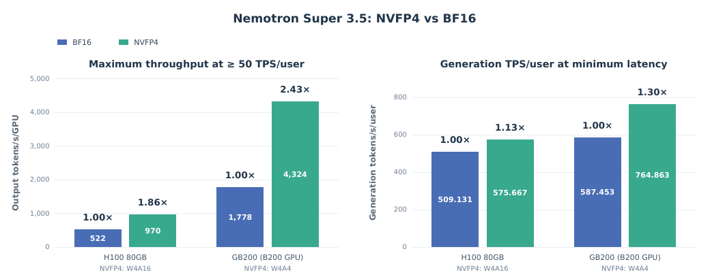

# Quantization (PTQ + QAD)

The released Nemotron 3.5 Super VL NVFP4 checkpoint is produced with [NVIDIA Model Optimizer](https://github.com/NVIDIA/Model-Optimizer): post-training quantization (PTQ) with a predefined **aggressive** recipe, followed by **200 iterations** of SFT-based Quantization-Aware Distillation (QAD). It reaches **99.52% median accuracy recovery** relative to BF16 across 35 benchmarks, with a mean per-benchmark verbosity increase of 0.49%.

This page summarizes §4 of the tech report. Quantization is not a `nemotron super35` CLI stage.

:::{admonition} Pending open-source release
:class: warning

The NVFP4 checkpoint and the Super 3.5 VL Model Optimizer recipe files are pending public release. For the general PTQ → QAD → export workflow on Megatron-Bridge, see the Model Optimizer [`examples/megatron_bridge/`](https://github.com/NVIDIA/Model-Optimizer/tree/main/examples/megatron_bridge) and the [Nemotron 3.5 Lightning quantization guide](../lightning35/quantization.md), which uses the same tooling.
:::

---

## Deployment Targets

| Platform | Mode | Notes |
|----------|------|-------|
| Blackwell (B200, GB200, GB300) | **W4A4** | NVFP4 weights and activations |
| Non-Blackwell (for example H100) | **W4A16** | NVFP4 weights, 16-bit activations |

On a 20-turn agentic proxy workload (2K input / 1K output tokens per turn) served with vLLM (Figure 10):

| Platform | Max throughput at ≥ 50 tokens/s/user, BF16 → NVFP4 (output tokens/s/GPU) | Generation tokens/s/user at minimum latency, BF16 → NVFP4 |
|----------|------------------------------|------------------------------|
| H100 80GB (W4A16) | 522 → 970 (1.86×) | 509 → 576 (1.13×) |
| GB200 (W4A4) | 1,778 → 4,324 (2.43×) | 587 → 765 (1.30×) |

### Acceptance criteria

Recipes are developed between conservative and aggressive bookends and must meet:

- **Median accuracy recovery ≥ 99%** — the median over benchmarks of the NVFP4 / BF16 score ratio, averaged over repeats.
- **Verbosity increase ≤ 5%** relative to BF16.

## Precision Recipes

The released checkpoint uses the **Aggressive** column (Table 12 of the report). Bits per element (BPE) counts stored payload including scales over all original parameters, including vision, MTP, and unquantized modules: 74.987 GB over 124.453B parameters gives 4.82 BPE.

| Layer | BF16 | FP8 | Conservative | **Aggressive (released)** | Very aggressive (not released) |
|-------|------|-----|--------------|---------------------------|--------------------------------|
| C-RADIO encoder | BF16 | BF16 | BF16 | BF16 | BF16 |
| VL connector | BF16 | BF16 | BF16 | BF16 | BF16 |
| MoE + shared-expert GEMMs | BF16 | FP8 | NVFP4 | **NVFP4** | NVFP4 |
| Latent down/up projection | BF16 | FP8 | BF16 | **BF16** | NVFP4 |
| Router / gate (compute) | FP32 | FP32 | FP32 | **FP32** | FP32 |
| Attention QKV / out projection | BF16 | FP8 | BF16 | **FP8** | NVFP4 |
| KV cache | BF16 | FP8 | FP8 | **FP8** | FP4 |
| BMM1 (QKᵀ) | BF16 | FP8 | FP8 | **FP8** | FP4 |
| BMM2 (PV) | BF16 | FP8 | FP8 | **FP8** | FP8 |
| Mamba linear | BF16 | FP8 | BF16 | **FP8** | NVFP4 |
| Mamba SSM cache | FP32 | FP32 | FP32 | **FP16 + stochastic rounding** | FP16 + stochastic rounding |
| Mamba convolution | BF16 | BF16 | BF16 | **BF16** | BF16 |
| Embedding | BF16 | BF16 | BF16 | **BF16** | BF16 |
| lm_head | BF16 | FP8 | BF16 | **FP8** | W4A16 |
| Avg. BPE | 16.00 | 8.10 | 5.15 | **4.82** | 4.64 |

The released checkpoint also contains the quantized, boosted MTP head. It was evaluated with an FP8 KV cache; ablations showed comparable accuracy with an NVFP4 KV cache (99.36% vs. 99.52% median recovery).

## PTQ

| Aspect | Choice |
|--------|--------|
| Calibration data | 1,024 image–text samples from the post-training SFT data; images go through the vision encoder so the language model sees projected visual tokens |
| Calibration parallelism | Data parallel × expert parallel across 4 ranks (256 samples each), routed and MTP experts split evenly; vision, attention, and Mamba layers replicated |
| Weight-scale selection | **MSE** (per-block scale search over FP8 values) — better recovery than max-based or MSE 4-over-6 scales |

ModelOpt **AutoQuantize** was also explored as a sensitivity-driven alternative: it assigns NVFP4, FP8, or BF16 per module to minimize total sensitivity under a target bitwidth. The sensitivity profile is highly non-uniform — the `lm_head` accounts for nearly half the NVFP4 sensitivity, attention and Mamba projections come next, and MoE experts are comparatively robust.

## QAD

QAD starts from the calibrated PTQ student and distills the BF16 model into it with a KL-divergence objective.

| Parameter | Value |
|-----------|-------|
| Trainable | Weights of language-model GEMMs with enabled quantizers only (embeddings, norms, vision encoder, projector, MTP, router bias frozen) |
| Quantizer state | Restored from PTQ, not recalibrated |
| Losses | KL only (no hard-target CE, MTP CE, load-balancing, or feature distillation) |
| Optimizer | Distributed AdamW, β₁ = 0.9, β₂ = 0.95, ε = 1e-8, weight decay 0.1, clip 1.0 |
| Learning rate | Linear warm-up to 5e-6 over ~9,100 source records, then constant |
| Data | 100% SFT blend (a 75/25 SFT/RL-rollout mix gave only modest benefits) |
| Scale | 128 nodes × 4 GB200 (512 GPUs); about 2 hours per 100 iterations |
| Selected | 4.82-BPE aggressive recipe at **200 iterations** |

Additional QAD iterations were not uniformly helpful: the best iteration count depended on the recipe, and gains largely saturated by 300 iterations.

## Results

Selected rows from the BF16 vs. released NVFP4 comparison (Table 22 of the report):

| Benchmark | BF16 | NVFP4 | Recovery |
|-----------|-----:|------:|---------:|
| SWE-bench Verified | 71.10 | 71.07 | 99.95% |
| SWE-bench Pro | 51.78 | 51.30 | 99.08% |
| Terminal-Bench 2.1 | 60.67 | 62.78 | 103.47% |
| LiveCodeBench v6 | 88.22 | 87.41 | 99.08% |
| GPQA-Diamond (no tools) | 89.52 | 89.90 | 100.42% |
| HLE (no tools, text) | 31.79 | 31.44 | 98.91% |
| CharXiv (RQ) | 80.82 | 79.88 | 98.85% |
| MathVision | 78.16 | 77.79 | 99.52% |
| Video-MME-v2 | 32.85 | 32.54 | 99.05% |
| MMLongBench-Doc | 62.82 | 62.82 | 100.00% |
| AA-LCR | 68.62¹ | 67.69 | 98.63% |
| IFBench | 70.86 | 71.50 | 100.90% |
| MMLU-ProX | 76.91 | 73.76 | 95.90% |
| **Median recovery (35 benchmarks)** | | | **99.52%** |
| **Verbosity change (ratio of totals)** | | | **+0.49%** |

¹ Table 22 lists the BF16 AA-LCR score as 68.62; Table 10 lists 68.63.

Verbosity excludes non-completed Terminal-Bench rollouts: about 4.5% runaway trajectories of roughly 700K tokens each dominate that benchmark's mean, and including them raises the ratio-of-totals change to 2.99%.

### MTP drafter precision

The MTP module (one attention layer and one MoE layer) shares the checkpoint's single `lm_head`. Profiling shows the MTP experts and the `lm_head` dominate drafting latency, so the released checkpoint quantizes the MTP experts to NVFP4 W4A4 (MTP attention weights stay BF16) and the shared `lm_head` to FP8. This barely changes acceptance length while speeding up drafting (Table 20; SPEED-Bench, temperature 1; speedup projected at draft length 5 on one GB200 relative to the NVFP4 backbone with unquantized MTP and `lm_head`):

| Backbone / LM head | MTP experts / MTP LM head | AL, draft length 5 | AL, draft length 7 | Projected speedup |
|--------------------|---------------------------|-------------------:|-------------------:|------------------:|
| BF16 / BF16 | BF16 / BF16 | 4.115 | 4.612 | — |
| NVFP4 / BF16 | BF16 / BF16 | 4.109 | 4.592 | 1.000 |
| NVFP4 / BF16 | NVFP4 / BF16 | 4.066 | 4.518 | 1.043 |
| NVFP4 / BF16 | NVFP4 / FP8 | 4.069 | 4.514 | 1.114 |
| NVFP4 / BF16 | NVFP4 / W4A16 | 4.031 | 4.469 | 1.136 |
| **NVFP4 / FP8** | **NVFP4 / FP8 (released)** | **4.063** | **4.520** | **1.127** |
| NVFP4 / FP8 | NVFP4 / W4A16 | 4.025 | 4.471 | 1.150 |

The MTP KV cache must use the backbone's precision. The released checkpoint was built by quantizing the boosted MTP separately and splicing it into the quantized backbone; the report recommends co-quantizing both in future releases.

## Serving Notes

The report's inference work (§5) targets interactive, long-context agentic serving in vLLM:

- **Prefix caching + speculative decoding**: an extra Mamba cache checkpoint near the speculative-decoding replay boundary avoids replaying a whole Mamba cache block to recover the drafter's hidden state.
- **Per-quantization GEMM backend selection** for mixed-precision checkpoints at intermediate batch sizes.
- **Internal prefill checkpoints** write reusable Mamba states without splitting the prefill forward pass.
- **ReplaySSM** (checkpointing replay for the Mamba state) stores a checkpointed state plus a small buffer of recent inputs instead of writing every speculative state. On one GB200 with a 16-step buffer it raises output throughput by 4.7–6.4% and per-user generation speed by 6.4–12.5% (Table 23).

Headline numbers:

- The report's abstract and conclusion quote up to **4,632 output tokens/s/GPU** on GB200 at ≥ 50 tokens/s/user (Table 23: one GB200, concurrency 64, 5 speculative tokens, ReplaySSM off; 4,856 with ReplaySSM on), and **2.88×** the throughput of Qwen3.8 Flash-Next under the evaluated interactive agentic workload. Figure 11, at the same ≥ 50 tokens/s/user threshold, shows 4,331.88 output tokens/s/GPU on GB200 against 2,282.73 for Qwen3.8 Flash-Next (1.90×) and 1,854.35 for Qwen3.5-122B-A10B (2.34×); the report does not reconcile the 2.88× figure with Figure 11.
- **Disaggregated serving** of the NVFP4 checkpoint with NVIDIA Dynamo and vLLM on 11 Vera Rubin (VR200) GPUs, replaying SWE-bench Pro agentic sessions (Table 24):

| Deployment | Concurrency | Output tokens/s/GPU | Tokens/s/user (median) | TTFT (median) |
|------------|------------:|--------------------:|-----------------------:|--------------:|
| Aggregated (11 instances) | 616 | 2,969 | 96.6 | 0.49 s |
| Disaggregated (7 prefill + 4 decode GPUs) | 528 | 3,276 (+10.3%) | 155.9 (+61%) | 1.12 s |

## Reference

- Nemotron 3.5 tech report, §4 (Quantization), §5 (Inference)
- [NVIDIA Model Optimizer](https://github.com/NVIDIA/Model-Optimizer) — PTQ, AutoQuantize, QAD
- [Nemotron 3.5 Lightning quantization](../lightning35/quantization.md) — PTQ + QAD workflow with the same tooling
- [Nemotron 3 Super quantization](../super3/quantization.md) — Mamba-MoE quantization configs and Megatron-Bridge scripts
- [Back to Overview](./README.md)
