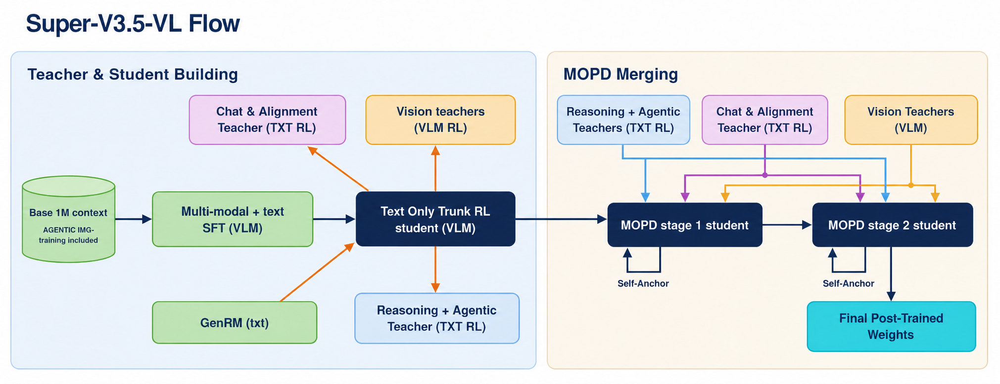
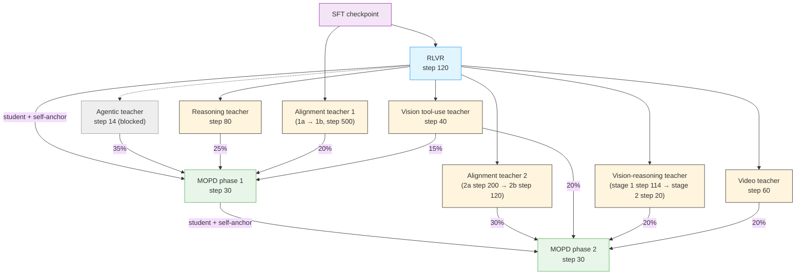
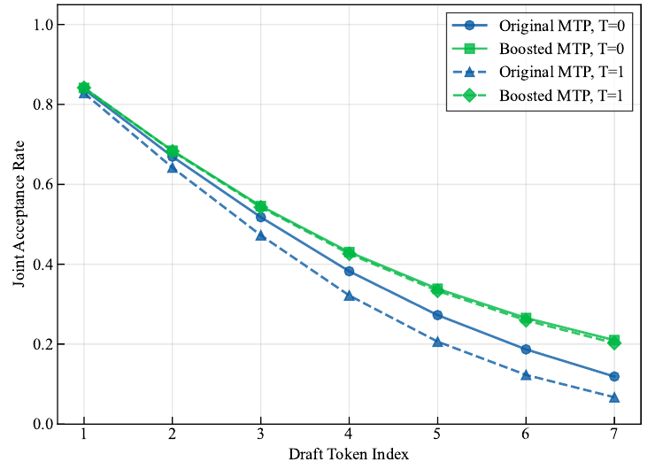

# Stage 2: Reinforcement Learning (RL)

This stage post-trains the SFT model with [NeMo-RL](../../nvidia-stack.md#nemo-rl) and NeMo Gym environments: a broad RLVR stage, a panel of specialist teachers, and two phases of Multi-teacher On-Policy Distillation (MOPD) that merge the teachers back into one student.

:::{admonition} Pending open-source release
:class: warning

- Every RL stage runs on the public NeMo-RL `super-v3.5-posttraining` branch at commit `f299847f1`, which pins NeMo Gym `e24db4e6` (see `src/nemotron/recipes/super35/stage2_rl/Dockerfile`).
- The RL data used for Super 3.5 (RLVR, teacher, and MOPD blends) is not yet published. NeMo-RL's guide says this data will be released at a later date. The report's length-penalized GenRM variant is not public either; NeMo-RL's public recipe uses [`nvidia/NVIDIA-Nemotron-3-Ultra-550B-A55B-GenRM`](https://huggingface.co/nvidia/NVIDIA-Nemotron-3-Ultra-550B-A55B-GenRM) instead.
- The **agentic teacher** is blocked: its Terminal-Bench agent environment is not in public NeMo Gym. The config is provided for reference only.
- The **vision** and **vision-reasoning** teachers have not yet been fully GPU-validated on the shared RL stack.
:::

---

## Training Methodology

> For the full methodology, see §3.2–3.7 of the Nemotron 3.5 tech report. The post-training pipeline follows Nemotron 3 Ultra's: SFT → RLVR → specialist teachers → MOPD (Figure 4).



### Why three sub-stages

A single RL run over every domain trades capabilities off against each other. The report instead builds a strong generalist first, pushes individual capabilities further in short specialist runs, and then distills the specialists back into one model:

1. **[RLVR](rlvr.md)**: joint RLVR and RLHF across a broad environment mix, from the SFT checkpoint. Its step-120 checkpoint is both the MOPD student and the root of the teachers.
2. **[Specialist teachers](teachers.md)**: short asynchronous GRPO runs, each optimized for one domain: agentic, reasoning, vision tool use, video reasoning and tracking, vision reasoning, and alignment (RLHF).
3. **[MOPD](mopd.md)**: two phases of on-policy distillation. Each prompt is routed to the teacher that owns its environment; environments with no specialist go to a frozen self-anchor (the student's starting checkpoint).



Edge labels are MOPD prompt shares; the self-anchor takes the remaining 5% (phase 1) and 10% (phase 2). The step numbers are the checkpoints selected in the reference run. The report gives the RLVR, reasoning, video, vision-reasoning, and MOPD phase-1 steps; the agentic, vision tool-use, alignment, and MOPD phase-2 steps come from the reference run (the report says only that phase 2 ran 40 steps). The dashed edge marks lineage the reference run could not fully confirm: the agentic run started from a text-only RLVR export.

### Per-Stage Parameters

| Stage | CLI | Start from | Nodes (`run.env.nodes`) | External servers (reference run) | Prompts × gens | Max sequence | LR | Selected step |
|-------|-----|------------|------:|----------------------------------|----------------|--------------|----|---------------|
| RLVR | `rl rlvr` | SFT | 144 | 26 nodes: GenRM, general judge, safety judge | 512 × 16 | 80K | 4e-6 | 120 |
| Reasoning teacher | `rl teacher reasoning` | RLVR | 64 | Hosted DeepSeek-V4-Flash judge | 256 × 16 | 128K generation, 256K total | 4e-6 | 80 |
| Vision tool-use teacher | `rl teacher vision` | RLVR | 16 | — | 16 × 8 | 32K | 3e-6 | 40 |
| Video teacher | `rl teacher video` | RLVR | 32 | — | 128 × 16 | 64K (16K generation) | 3e-6 | 60 |
| Vision-reasoning teacher | `rl teacher vision-reasoning [-c stage2]` | RLVR → stage 1 | 32 / 33 | — | 256 × 16 | 32K | 3e-6 | 114 → 20 |
| Alignment teacher 1 | `rl teacher rlhf [-c teacher1_stage2]` | SFT | 32 / 32 | 32 nodes GenRM | 32 × 32 | 48K (16K generation) | 2e-6 | 120 → 500 |
| Alignment teacher 2 | `rl teacher rlhf -c teacher2_stage1 \| teacher2_stage2` | RLVR | 64 / 32 | 64 / 32 nodes GenRM, plus 4 nodes abstention judge (2b) | 32 × 32 | 48K (16K generation) | 2e-6 | 200 → 120 |
| Agentic teacher | `rl teacher agentic` | RLVR | 128 | Hosted search judge | 64 × 16 | 192K | 3e-6 | 14 |
| MOPD phase 1 | `rl mopd` | RLVR | 128 | — (teachers inside the allocation) | 512 × 1 | 48K generation, 128K context | 2e-6 | 30 |
| MOPD, single stage | `rl mopd -c single_stage` | RLVR | 112 | — (teachers inside the allocation) | 512 × 1 | 48K generation, 128K context | 2e-6 | — |
| MOPD phase 2 | `rl mopd -c phase2` | MOPD phase 1 | 128 | — (teachers inside the allocation) | 1024 × 1 | 128K | 3e-6 | 30 |

All nodes are GB200 with 4 GPUs. `run.env.nodes` is the Slurm allocation each config requests (training plus generation, and for MOPD the teacher fleets). External judge and GenRM servers run outside it; the column lists what the reference run used. A slash separates the two substages of a two-stage teacher. Prompts × generations, sequence lengths, and learning rates are the config values. The report states the batch shapes for RLVR, MOPD, and the reasoning, video, vision-reasoning, and agentic teachers, and is silent on the vision tool-use and alignment teachers.

### Shared Settings

- **Algorithm** (report): asynchronous GRPO as in Nemotron 3 Ultra; training and generation run on separate GPUs, with a bounded maximum trajectory age.
- **Train–inference mismatch** (report): router replay and an FP32 LM head on top of the Nemotron 3 Ultra algorithm cut the KL error between the training and inference engines by more than an order of magnitude. In the configs, router replay is per stage (on for the video teacher and vision-reasoning stage 2; off for RLVR, the reasoning teacher, and vision-reasoning stage 1).
- **MTP** (recipe): every config trains **five repeated, detached MTP heads** with loss coefficient **0.3**. This standardizes the MTP setting; the reference runs varied by stage (several trained one head, used coefficient 0.1, or turned MTP loss off), and each stage page lists the difference. Policy MTP speculative decoding is off except in the reasoning teacher (one speculative token).
- **Serving** (recipe): policy generation uses vLLM with `max_num_seqs=256` and `max_num_batched_tokens=32768`.
- **Checkpoint format**: every stage loads its policy and teachers as Hugging Face checkpoints. A Megatron checkpoint from `super35 sft` is converted to HF automatically using `run.hf_architecture`.

### MTP Boosting (not included)

The report trains the MTP head separately from the backbone at two points (§3.7): a 4K-step MTP-only run on the SFT checkpoint, and **MTP boosting** after MOPD, which starts from that SFT-stage head and trains it for 25K more steps against the final backbone. In both, the backbone is frozen, hidden-state mixing exposes the head to its own drafted states, and the loss is knowledge distillation from the frozen backbone (the LK loss, replacing the temperature-scaled forward KL used for Nemotron 3 Ultra). Training data are on-policy rollouts from the corresponding backbone, at temperature 1 and up to 8K tokens, seeded with prompts from [Nemotron-Post-Training-Dataset-v2](https://huggingface.co/datasets/nvidia/Nemotron-Post-Training-Dataset-v2) and [Nemotron-RL-Super-Training-Blends](https://huggingface.co/datasets/nvidia/Nemotron-RL-Super-Training-Blends).

Average acceptance length on the SPEED-Bench qualitative split at draft length 7 (Table 8):

| Model | Greedy (temp 0) | Sampled (temp 1) |
|-------|----------------:|-----------------:|
| SFT checkpoint, native MTP | 4.589 | 4.048 |
| SFT checkpoint + 4K MTP-only steps | 5.080 | 4.730 |
| Final model, native MTP | 4.287 | 3.787 |
| Final model + MTP head from the SFT-stage run | 4.528 | 4.436 |
| Final model + 25K MTP boosting steps (released) | **4.718** | **4.612** |



Boosting raises acceptance length by 10.1% (greedy) and 21.8% (sampled), with the largest per-position gains at deeper draft positions. Across the models in Table 9, the boosted head has the highest average acceptance length under sampled drafting (4.612, against 4.565 for Gemma-4 31B, 4.331 for Qwen3.5-122B-A10B, and at most 4.213 for Qwen3.8-Flash-Next); under greedy decoding Gemma-4 31B (4.837) and Qwen3.5-122B-A10B (4.799) are higher. MTP boosting is not part of this recipe.

### Relation to NeMo-RL's Super 3.5 guide

NeMo-RL publishes its own [Nemotron 3.5 Super VL guide](https://github.com/NVIDIA-NeMo/RL/blob/super-v3.5-posttraining/docs/guides/models/nemotron/nemotron-3.5-super-vl.md) on the same branch, with five standalone configs in [`examples/nemo_gym/nemotron-3.5-super/`](https://github.com/NVIDIA-NeMo/RL/blob/super-v3.5-posttraining/examples/nemo_gym/nemotron-3.5-super) and a Slurm launcher that also starts the judge servers. That guide is a shorter lineage: Student RLVR, three teachers (RLHF, reasoning, vision), and one MOPD stage. This recipe ports the full reference-run lineage that the report describes. Where both have the same stage, the training settings are the same except for the differences below.

| Stage | This recipe | NeMo-RL guide |
|---|---|---|
| Student RLVR | `stage1_rlvr` | `student_rlvr.yaml`. Same settings; the guide stops at 120 steps (`grpo.max_num_steps`), this config has no step limit |
| RLHF teacher | Two teachers, each with two sub-stages (`rlhf1`, `rlhf2`) | One `rlhf_teacher.yaml`, started from Student RLVR. Same shape as `teacher2_stage2` (GenRM comparison plus abstention), with a group reasoning-length penalty of 0.12 instead of 0.06 |
| Reasoning teacher | `reasoning` | `reasoning_teacher.yaml`. Same settings; the guide uses 44 generation nodes instead of 48 |
| Vision teacher | `vision` | `vision_teacher.yaml`. Same training settings |
| Video, vision-reasoning, and agentic teachers | Included (agentic is config-only) | Not included |
| MOPD | Two phases; `-c single_stage` is the port of the guide's stage | One `mopd.yaml` stage, close to phase 1. The agentic environments are routed to the general teacher (Student RLVR), so it needs no agentic teacher. It runs on 112 nodes instead of 128 |

The guide's NeMo-RL commit is newer than the one this recipe's configs were ported from. Both use NeMo Gym `e24db4e6`, and every config here validates against the pinned commit's GRPO config schema. The guide also says the training data will be released at a later date.

---

## Quick Start

### Container

All RL stages share one container built from `src/nemotron/recipes/super35/stage2_rl/Dockerfile`:

```bash
uv run nemotron kit slurm build YOUR-CLUSTER --recipe super35 --stage rl
```

The RL configs expect the image at `~/.cache/nemotron/containers/super35-rl.sqsh` (`run.env.container`). Stages with code-execution environments (RLVR, the reasoning teacher, MOPD) also need a NeMo-Skills sandbox image (`run.env.sandbox.container`).

### Data

Each RL stage reads its own data artifact. Register NeMo Gym JSONL (a training file and an optional validation file) under the name the stage expects:

```bash
uv run nemotron super35 data import rl /data/rlvr/train.jsonl --val /data/rlvr/val.jsonl
uv run nemotron super35 data import rl /data/mopd1/train.jsonl --name super35-rl-mopd-phase1-data
```

| Stage | Data artifact (`run.data`) |
|-------|----------------------------|
| RLVR | `super35-rl-rlvr-data` (the `data import rl` default) |
| Teachers | one per config; see [Teachers](teachers.md#data-artifacts) |
| MOPD phase 1 / phase 2 | `super35-rl-mopd-phase1-data` / `super35-rl-mopd-phase2-data` |

The JSONL files are referenced in place, so keep them on storage the cluster can see.

### Using nemotron CLI (Recommended)

```bash
# 1. RLVR from SFT
uv run nemotron super35 rl rlvr --run YOUR-CLUSTER

# 2. Teachers (independent of each other, except the two-substage teachers)
uv run nemotron super35 rl teacher reasoning --run YOUR-CLUSTER
uv run nemotron super35 rl teacher vision --run YOUR-CLUSTER
uv run nemotron super35 rl teacher video --run YOUR-CLUSTER
uv run nemotron super35 rl teacher vision-reasoning --run YOUR-CLUSTER            # stage 1
uv run nemotron super35 rl teacher vision-reasoning -c stage2 --run YOUR-CLUSTER  # stage 2
uv run nemotron super35 rl teacher rlhf --run YOUR-CLUSTER                        # teacher 1, substage 1a
uv run nemotron super35 rl teacher rlhf -c teacher1_stage2 --run YOUR-CLUSTER     # teacher 1, substage 1b
uv run nemotron super35 rl teacher rlhf -c teacher2_stage1 --run YOUR-CLUSTER     # teacher 2, substage 2a
uv run nemotron super35 rl teacher rlhf -c teacher2_stage2 --run YOUR-CLUSTER     # teacher 2, substage 2b

# 3. MOPD
uv run nemotron super35 rl mopd --run YOUR-CLUSTER
uv run nemotron super35 rl mopd -c phase2 --run YOUR-CLUSTER run.model=super35-rl-mopd-phase1-model:vN
# or, without the agentic teacher: NeMo-RL's single-stage MOPD
uv run nemotron super35 rl mopd -c single_stage --run YOUR-CLUSTER

# Preview any stage's resolved config
uv run nemotron super35 rl mopd -c phase2 --dry-run
```

Only the reasoning and alignment configs stop at their selected step; the others run longer (MOPD phase 2, for example, stops at step 40 and its selected step is 30). Stop a run with `grpo.max_num_steps=<step>`, or pin the artifact version saved at the selected step when you start the next stage.

To start RL from the released post-trained checkpoint or another external checkpoint, register it first (`nemotron super35 model import rl /path/to/hf_checkpoint`, which creates `super35-rl-rlvr-model` unless you pass `--name`) and pass it with `run.model=...`.

### Using super35_launch.sh (Direct)

Alternatively, run NeMo-RL's own launcher inside the NeMo-RL repo. It covers the [shorter lineage](#relation-to-nemo-rls-super-35-guide) (Student RLVR, RLHF, reasoning and vision teachers, one MOPD stage), takes checkpoints and data as paths instead of W&B artifacts, and starts the judge servers in the same Slurm allocation. The [NeMo-RL Nemotron 3.5 Super VL guide](https://github.com/NVIDIA-NeMo/RL/blob/super-v3.5-posttraining/docs/guides/models/nemotron/nemotron-3.5-super-vl.md) is the reference for this path.

```bash
git clone --recursive --branch super-v3.5-posttraining https://github.com/NVIDIA-NeMo/RL.git
cd RL
```

Build the ARM64 NeMo-RL image and the NeMo-Skills sandbox image as described in the guide, and convert both to `.sqsh`. Each stage is one launcher call; for example, Student RLVR from your SFT checkpoint:

```bash
SHARED_ROOT=/shared \
CONTAINER=/shared/images/nemo-rl-super35.sqsh \
SANDBOX_CONTAINER=/shared/images/nemo-skills-sandbox.sqsh \
DATA_ROOT=/shared/data/super35 \
SLURM_ACCOUNT=<your-account> \
SLURM_PARTITION=<your-partition> \
WALLTIME=4:00:00 \
GENRM_CHECKPOINT=nvidia/NVIDIA-Nemotron-3-Ultra-550B-A55B-GenRM \
NL2BASH_CHECKPOINT=Qwen/Qwen3-235B-A22B-Instruct-2507-FP8 \
SAFETY_CHECKPOINT=nvidia/Nemotron-Content-Safety-Reasoning-4B \
MODEL_PATH=/shared/checkpoints/super35-sft \
TRAIN_PATH=/shared/data/super35/rlvr.jsonl \
EXP_NAME=super35-student-rlvr \
bash examples/nemo_gym/nemotron-3.5-super/super35_launch.sh student_rlvr
```

The other stages are `rlhf_teacher`, `reasoning_teacher`, `vision_teacher` and `mopd`; the guide lists the variables each one needs. Prepend `DRY_RUN=1` to print the allocation and command without submitting. The training data for this path is not yet published either.

### External services

Several stages score rollouts with external model servers (GenRM, LLM judges, safety and NL2Bash judges). The configs read each server's endpoint and model from environment variables (for example `GENRM_BASE_URL`), with public Hugging Face model ids where one exists. Each stage README under `src/nemotron/recipes/super35/stage2_rl/` lists the variables it needs. MOPD skips reward verification and needs no judges.

---

## Verification Status

| Stage | Status |
|-------|--------|
| RLVR, reasoning, video, alignment teachers, MOPD phase 1 and 2 | Configs ported from the reference-run configs and checked for schema and startup on the pinned NeMo-RL stack. The selected checkpoints come from the reference runs; each stage page lists where the config differs from the run that produced its checkpoint. Not re-run from this repository |
| Vision tool-use, vision-reasoning teachers | Ported; full GPU validation on the shared stack pending |
| MOPD single stage | Port of NeMo-RL's `mopd.yaml`; same settings as phase 1 apart from the agentic teacher. Checked for schema on the pinned NeMo-RL stack; not run |
| Agentic teacher | Blocked |
| SFT → RLVR hand-off (Megatron → HF conversion) | Not tested end to end |

## Infrastructure

| Component | Role | Documentation |
|-----------|------|---------------|
| [NeMo-RL](../../nvidia-stack.md#nemo-rl) | Asynchronous GRPO and on-policy distillation; every stage runs `examples/nemo_gym/run_grpo_nemo_gym.py` | [GitHub](https://github.com/NVIDIA-NeMo/RL) |
| [NeMo Gym](https://github.com/NVIDIA-NeMo/Gym) | Reward environments, verifiers, and agent harnesses | [GitHub](https://github.com/NVIDIA-NeMo/Gym) |
| [Megatron-Core](../../nvidia-stack.md#megatron-core) | Policy training backend (TP, CP, EP) | [GitHub](https://github.com/NVIDIA/Megatron-LM) |
| [vLLM](https://github.com/vllm-project/vllm) | Rollout generation and teacher serving | [GitHub](https://github.com/vllm-project/vllm) |

## Next Steps

After MOPD phase 2, [evaluate](../evaluate.md) the step-30 checkpoint. The report then applies MTP boosting and [quantizes](../quantization.md) the result to NVFP4.

## Reference

- Nemotron 3.5 tech report, §3.2–3.7 (RL, teachers, MOPD, MTP boosting), Tables 8–9
- [NeMo-RL Nemotron 3.5 Super VL guide](https://github.com/NVIDIA-NeMo/RL/blob/super-v3.5-posttraining/docs/guides/models/nemotron/nemotron-3.5-super-vl.md): NeMo-RL's own launcher and configs for a shorter lineage
- [Nemotron 3 Ultra MOPD](../../ultra3/mopd.md): the pipeline Super 3.5 builds on
- [Artifact Lineage](../../artifacts.md): W&B artifact system
- **Recipe Source**: `src/nemotron/recipes/super35/stage2_rl/`
- [Back to Overview](../README.md)

```{toctree}
:hidden:

rlvr.md
teachers.md
mopd.md
```
