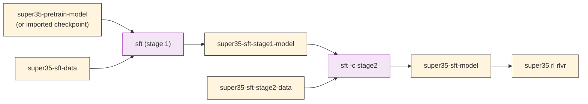

# Stage 1: Supervised Fine-Tuning (SFT)

This stage turns the text-only base model into a vision-language model while building reasoning, chat, safety, long-context, and agentic skills. It runs Megatron-Bridge's Super-VL SFT recipes.

> **Data**: The SFT data used for Super 3.5 is not yet published. Bring your own multimodal SFT data in Energon format; results will differ from the report.

---

## Training Methodology

> For the full methodology, see §3.1 of the Nemotron 3.5 tech report.

### Two-stage SFT

Learning vision and text capabilities at the same time is hard, so after warming up the vision projector the report uses two SFT stages:

| Stage | Blend | Recipe config |
|-------|-------|---------------|
| SFT stage 1 | General mix of vision, reasoning, chat, long-context, safety, and agentic data | `-c default` |
| SFT stage 2 | Small second stage with a re-weighted blend that boosts capabilities stage 1 did not learn adequately | `-c stage2` |

The language and vision components are fine-tuned jointly (see [freeze controls](#freeze-controls) for what the recipe trains by default).

### Data Domains

| Domain | Highlights |
|--------|------------|
| **Vision** | Nemotron 3 Nano Omni corpus (charts, tables, OCR, multi-page documents, grounding, GUI, video), augmented with data generated with open models such as Qwen3.5 for chart understanding, grounded perception, multi-hop reasoning, GUI/web navigation, and multimodal coding. Reasoning traces are organized as concise steps, each grounded in visual evidence, and filtered for unsupported questions, hallucinated values, and unproductive self-correction. A chart-understanding version of this pipeline is published as a [NeMo Data Designer recipe](https://docs.nvidia.com/nemo/datadesigner/recipes/chart-qa/chart-question-answering). |
| **Agentic vision** | Image tool use (crop, rotate, zoom, flip on high-resolution images) generated with Kimi K2.6 and K3, and executable SpatialClaw video-agent demonstrations generated with Kimi K2.6: 14,169 trajectories with 81,366 assistant actions that inspect frames, run SAM3 segmentation, and reconstruct scene geometry before answering. On 20 spatial and video benchmarks with the SpatialClaw harness, agentic vision training raises the average from 50.5 (no agentic vision training) to 54.8 (+4.3, Table 7). |
| **Reasoning** | Nemotron 3 Ultra problem sets (math, STEM, coding, proofs). Math and STEM chain-of-thought and tool-integrated trajectories regenerated with Kimi K3; proofs with DeepSeek V4 Pro; competitive programming with GLM-5.2. Responses shorter than 5,000 tokens removed. Unlike the DeepSeek V4 Pro traces used for Nemotron 3 Ultra, which plateaued after one pass, the Kimi K3 traces kept improving over multiple passes. |
| **Chat and safety** | Nemotron 3 Ultra recipe with chat responses refreshed from recent Qwen, Kimi, and Gemma models, plus extra dual-risk CBRNE and demographic-bias safety data. |
| **Long context** | 512K-token Nemotron 3 Ultra long-context data, synthetic graph-tracing data, long-horizon search and coding agent trajectories, long-document translation (PG19 and FinePDFs-Edu documents translated in chunks with DeepSeek V4 Flash), synthetic transduction tasks, and multi-page vision documents of up to hundreds of pages. |
| **Finance agent** | SEC filing search, document parsing, and evidence retrieval trajectories from the same NeMo Gym environment used for RL. |

### Reasoning Modes

SFT introduces the three reasoning modes the model supports: **reasoning-off**, **regular**, and **medium-effort** (§3.9). Medium-effort data comes from Kimi K3's low-effort mode and is optimized further in RL. Following the Nemotron 3 Ultra recipe, a small fraction of SFT samples have reasoning traces truncated to random budgets (with `</think>` masked from the loss) so the model can follow inference-time budget control.

### Hyperparameters

Values from the report (§3.1); the recipe defaults differ (see [Configurations](#configurations)):

| Parameter | Value |
|-----------|-------|
| Packed sequence length | 524,288 tokens |
| Global batch size | 32 packed sequences |
| Learning rate | Warm up over ~9,100 original records to 1e-5, then constant |
| Optimizer | Adam, β₁ = 0.9, β₂ = 0.95, weight decay 0.1 |
| Gradient clipping | 1.0 |
| MTP | Two shared-weight MTP layers, auxiliary loss scale 0.3 |

### Decontamination

Post-training data is checked against 30 benchmarks with a four-step pipeline: normalize each sample to its problem statement, retrieve candidates by n-gram and embedding overlap, verify each candidate pair with an LLM judge, and remove severely contaminated samples. It removed 20,671 samples (about 0.09%; 14,793 SFT and 5,878 RL), matching 1,808 benchmark questions (6.0%) in 22 of the 30 benchmarks. On synthetic contamination of Terminal-Bench 2.1 and GPQA Diamond questions, the judge caught 87.5% and 79.1% of contaminated variants while flagging one distractor. The report says the pipeline will be released as part of NeMo Curator.

---

## Recipe Execution

### Quick Start

<div class="termy">

```console
// Import your SFT data as artifacts
$ uv run nemotron super35 data import sft /path/to/sft_stage1_data
$ uv run nemotron super35 data import sft /path/to/sft_stage2_data --name super35-sft-stage2-data

// SFT stage 1
$ uv run nemotron super35 sft --run YOUR-CLUSTER

// SFT stage 2 (continues from the stage-1 checkpoint)
$ uv run nemotron super35 sft -c stage2 --run YOUR-CLUSTER

// LoRA instead of full fine-tuning
$ uv run nemotron super35 sft -c peft --run YOUR-CLUSTER

// Smoke test
$ uv run nemotron super35 sft -c tiny --run YOUR-CLUSTER
```

</div>

#### Direct Script Execution (Megatron-Bridge)

For direct execution outside this CLI, use the launcher in the [Megatron-Bridge](https://github.com/NVIDIA-NeMo/Megatron-Bridge) repository. It submits the same Megatron-Bridge recipes as this stage to Slurm (set `--account`, `--partition` and `--container-image`, or `SLURM_ACCOUNT`, `SLURM_PARTITION` and `CONTAINER_IMAGE`):

```bash
git clone https://github.com/NVIDIA-NeMo/Megatron-Bridge.git
cd Megatron-Bridge

# Convert the released Hugging Face checkpoint to Megatron format (once)
./scripts/conversion/convert.sh import --executor slurm --device gpu --nodes 1 --gpus-per-node 4 \
    --hf-model nvidia/NVIDIA-Nemotron-3.5-Super-VL-120B-A12B-BF16 \
    --megatron-path /path/to/super35-megatron \
    --torch-dtype bfloat16 --tp 1 --pp 2 --ep 2 --etp 1 --trust-remote-code
# (the report's SFT starts from the Base model: use
#  --hf-model nvidia/NVIDIA-Nemotron-3.5-Super-VL-120B-A12B-Base-BF16)

# SFT on 8 x 8 H100 (the verified layout)
./scripts/training/train.sh --wait --nodes 8 --gpus-per-node 8 \
    --recipe nemotron_35_super_vl_sft_64gpu_h100_bf16_config --mode sft \
    --pretrained_checkpoint /path/to/super35-megatron/iter_0000000 \
    --max_steps 200 --save_interval 100 --save_dir /path/to/checkpoints \
    dataset.path=/path/to/energon_dataset

# LoRA on 2 x 8 H100
./scripts/training/train.sh --wait --nodes 2 --gpus-per-node 8 \
    --recipe nemotron_35_super_vl_peft_16gpu_h100_bf16_config --mode lora \
    --pretrained_checkpoint /path/to/super35-megatron/iter_0000000 \
    --max_steps 500 --save_interval 250 --save_dir /path/to/lora_checkpoints \
    dataset.path=/path/to/energon_dataset
```

This repo's `default` and `peft` configs use the aliases `nemotron_35_super_vl_sft_config` and `nemotron_35_super_vl_peft_config` for these two recipes. The two-stage SFT sequence is this repo's: run stage 2 as a second `--mode sft` job from the stage-1 checkpoint on your stage-2 data. RL starts from a Hugging Face checkpoint, so export the final checkpoint first and then register it with `nemotron super35 model import sft` to continue with this repo's RL stage:

```bash
./scripts/conversion/convert.sh export --executor slurm --device gpu --nodes 1 --gpus-per-node 4 \
    --hf-model nvidia/NVIDIA-Nemotron-3.5-Super-VL-120B-A12B-BF16 \
    --megatron-path /path/to/checkpoints --hf-path /path/to/super35-sft-hf \
    --torch-dtype bfloat16 --tp 1 --pp 2 --ep 2 --etp 1 --trust-remote-code --distributed-save
uv run nemotron super35 model import sft /path/to/super35-sft-hf
```

See the [Megatron-Bridge Nemotron 3.5 Super VL guide](https://github.com/NVIDIA-NeMo/Megatron-Bridge/blob/main/docs/models/nemotron/nemotron3.5-super-vl.md) for the exact verified commands, expected losses, and the GB200 variants.

### Configurations

| Config | Megatron-Bridge recipe | Purpose | Input → output artifact |
|--------|------------------------|---------|-------------------------|
| `default` | `nemotron_35_super_vl_sft_config` | SFT stage 1; Megatron-Bridge verified H100 layout (8 × 8 H100, TP2 / PP2 / EP32, seq 4096, GBS 1280, 200 steps) | `super35-pretrain-model` + `super35-sft-data` → `super35-sft-stage1-model` |
| `stage2` | `nemotron_35_super_vl_sft_config` | SFT stage 2: 100-step constant-LR continuation (10 warm-up steps) on a re-balanced blend, same layout as `default` (the report does not publish stage-2 steps or LR; tune for your data) | `super35-sft-stage1-model` + `super35-sft-stage2-data` → `super35-sft-model` |
| `peft` | `nemotron_35_super_vl_peft_config` | LoRA, rank 32 / alpha 32, language-model-only targets; TP4 / PP2 / EP8 on 16 H100 GPUs | `super35-pretrain-model` + `super35-sft-data` → `super35-sft-peft-model` |
| `long_context` | `nemotron_35_super_vl_sft_long_context_128gpu_gb200_bf16_config` | Text-only 128K-token SFT on 128 GB200 GPUs (CP32 ring attention, EP64); the recipe builds its own dataset. **Not yet verified** in Megatron-Bridge | `super35-pretrain-model` → `super35-sft-long-context-model` |
| `tiny` | `nemotron_35_super_vl_sft_config` | 10-step smoke test on the full 8-node layout | `super35-pretrain-model` + `super35-sft-data` |

`super35-sft-model` (the stage-2 output) is what RL starts from. For the report's production settings (512K packed sequences, GBS 32, LR 1e-5), see the comments at the top of `config/default.yaml`; they need the full SFT blend and long-sequence packing.

> **PEFT export**: standalone HF adapter export does not preserve the trained router expert-bias buffers. Reload natively and merge into the full model before exporting to Hugging Face.

### Megatron-Bridge verification

| Recipe | Hardware | Setup | Result |
|--------|----------|-------|--------|
| SFT | 64 × H100 | DataComp image-caption, seq 4096, GBS 1280 | 200 steps, loss 3.38 → 1.96 |
| SFT | 64 × GB200 | DataComp image-caption, seq 4096, GBS 1280 | 200 steps, loss 3.43 → 1.93 |
| LoRA | 16 × H100 | rank 32, alpha 32, GBS 16 | 500 steps, merged HF reload and bounded image generation passed |
| LoRA | 16 × GB200 | rank 32, alpha 32, GBS 16 | 500 steps, merged HF reload and bounded image generation passed |
| Long-context SFT | — | — | Not yet verified |

These verification runs use a public image-caption set to validate the recipe mechanics. They verify image-caption training, not video training or convergence, and they do not reproduce the report's SFT blend. For LoRA, Megatron-Bridge notes that some stronger post-merge numerical checks are not all passing. The `stage2` config uses the same recipe and layout as `default` but has not been run separately.

### Freeze Controls

The Megatron-Bridge model provider has independent freeze switches. The standard SFT recipe freezes the vision encoder and trains the language model and projector:

| Setting | Component | SFT default |
|---------|-----------|-------------|
| `model.freeze_language_model` | Language decoder and its language-side weights | `false` (train) |
| `model.freeze_vision_model` | C-RADIO vision tower, including image and temporal-video embedding paths | `true` (frozen) |
| `model.freeze_vision_projection` | Vision-to-language projector | `false` (train) |

Other useful policies:

| Policy | Language model | Vision model | Projector |
|--------|----------------|--------------|-----------|
| Language only | train | freeze | freeze |
| Language + projector (default) | train | freeze | train |
| Projector only | freeze | freeze | train |
| Full multimodal | train | train | train |

```bash
# Language-only SFT
uv run nemotron super35 sft --run YOUR-CLUSTER \
  model.freeze_vision_model=true \
  model.freeze_vision_projection=true
```

Freezing a base component does not stop LoRA from placing adapters inside it: adapter placement is controlled by `peft.target_modules`. The PEFT recipes use language-model-qualified target patterns (decoder and MTP, excluding `vision_model` and `vision_projection`); keep that qualification in custom PEFT configs if you want language-only adapters.

### Data

`nemotron super35 data import sft` registers an existing, already-prepared multimodal SFT dataset as an artifact (`super35-sft-data` by default; pass `--name super35-sft-stage2-data` for the stage-2 blend). The Super-VL recipes read Megatron-Energon WebDatasets through the Omni task encoder (image and video; no audio). The Megatron-Bridge verification runs use a DataComp image-caption subset in Energon format.

### Container

Like [pretraining](./pretrain.md#container), the SFT configs use the NeMo 26.08 container (`nvcr.io/nvidia/nemo:26.08`) with a pinned Megatron-Bridge commit mounted through `${auto_mount:...}`, which requires the Slurm executor.

### Artifact Lineage



To start RL from an SFT checkpoint you already have:

```bash
uv run nemotron super35 model import sft /path/to/sft_checkpoint
```

---

## Infrastructure

| Component | Role | Documentation |
|-----------|------|---------------|
| [Megatron-Bridge](../nvidia-stack.md#megatron-bridge) | Super-VL SFT, PEFT, and long-context recipes | [GitHub](https://github.com/NVIDIA-NeMo/Megatron-Bridge) |
| [Megatron-Core](../nvidia-stack.md#megatron-core) | Distributed training primitives | [GitHub](https://github.com/NVIDIA/Megatron-LM) |
| [NeMo Data Designer](https://github.com/NVIDIA-NeMo/DataDesigner) | Synthetic vision and Indic data generation in the report | [GitHub](https://github.com/NVIDIA-NeMo/DataDesigner) |

## Next Steps

After SFT completes, proceed to [Stage 2: RL](./rl/index.md).

## Reference

- Nemotron 3.5 tech report, §3.1 (SFT), §3.9 (reasoning modes), §3.12 (decontamination)
- [Megatron-Bridge](https://github.com/NVIDIA-NeMo/Megatron-Bridge) — Super-VL recipes and freeze controls
- [Artifact Lineage](../artifacts.md) — W&B artifact system
- **Recipe Source**: `src/nemotron/recipes/super35/stage1_sft/` — Implementation details
- [Back to Overview](./README.md)
