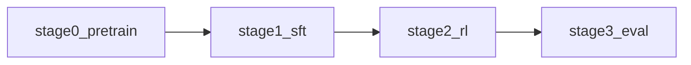

# Lightning 3.5 recipe overview

This file bridges the **report and model cards** to the **`nemotron lightning35` recipes** in this repo.

Use it when the question is:

- "How do I run Lightning 3.5 from this repo?"
- "Which config corresponds to which training stage?"
- "What is open-source vs only described in the report or model card?"

Before quoting exact CLI flags, check the current CLI tree (`uv run nemotron lightning35 --help`).

---

## Stage map

| Report stage | Repo stage | CLI | Notes |
|---|---|---|---|
| Base model (Nano 3 Base → MTP warm-up → distillation from Super 3 Base → long context; §2) | `stage0_pretrain` | `lightning35 data prep pretrain`, `lightning35 pretrain` | Megatron-Bridge `nemotron_3_5_lightning_pretrain_config` on open pretraining data, from random initialization (single open blend, no phase curriculum). The docs and stage README say the released base was not pretrained from scratch; the report's MTP warm-up, distillation from Super 3 Base, and long-context stage are not reproduced |
| SFT, single text-only stage (§3.1) | `stage1_sft` | `lightning35 data prep sft`, `lightning35 sft` | Megatron-Bridge `nemotron_3_5_lightning_sft_config`; packed Parquet from open SFT data |
| RLVR (§1, §3) | `stage2_rl` | `lightning35 data prep rl`, `lightning35 rl` | NeMo-RL GRPO (synchronous) over 6 NeMo Gym environments; no RLHF/DPO |
| MTP boosting (§3.7) | not included | — | |
| Quantization (§4.8) | not a stage | — | `docs/nemotron/lightning35/quantization.md` runs Model Optimizer's Megatron-Bridge examples |
| Evaluation | `stage3_eval` | `lightning35 eval` | NeMo Gym, vLLM-served; follows the Gym reproducibility flow used for the published Lightning results |

Other entry points: `lightning35 pipe` (pretrain → SFT), `lightning35 data import {pretrain,sft,rl}`, `lightning35 model import {pretrain,sft,rl}`, `lightning35 model eval`. DGX Station recipes (LoRA, SFT, GRPO on one or two Stations) live under `usage-cookbook/Nemotron-3.5-Lightning/`.

---

## Source layout

| Path | Role |
|---|---|
| `src/nemotron/recipes/lightning35/` | recipes (README per stage) |
| `src/nemotron/cli/commands/lightning35/` | CLI |
| `docs/nemotron/lightning35/` | user guides (README, pretrain, sft, rl, evaluate, quantization, import) |
| `usage-cookbook/Nemotron-3.5-Lightning/` | deployment and DGX Station recipes |

---

## Artifact chain

| Stage | Input model | Input data | Output |
|---|---|---|---|
| `pretrain` | — | `lightning35-pretrain-data` | `lightning35-pretrain-model` |
| `sft` | `lightning35-pretrain-model` | `lightning35-sft-data` | `lightning35-sft-model` |
| `rl` | `lightning35-sft-model` | `lightning35-rl-data` | `lightning35-rl-model` |
| `eval` | `lightning35-rl-model` | — | `summary.json` of Gym aggregate metrics |

Released checkpoints can be registered with `lightning35 model import` to skip stages.

---

## Reproduction caveats

1. **Open data only.** Every stage trains on the open-sourced subset; the stage READMEs say results will differ from the model-card benchmarks.
2. **Pretraining is not the report's.** The report builds the base from Nano 3 Base with an MTP warm-up and 1T tokens of distillation from Super 3 Base (`../paper/pretraining.md`); the repo stage pretrains with Megatron-Bridge on open data.
3. **Container.** Megatron-Bridge stages use `nvcr.io/nvidia/nemo:26.08` and mount a pinned Megatron-Bridge main revision over it (see `stage0_pretrain/config/default.yaml`); RL and eval use `nvcr.io/nvidia/nemo-rl:v0.4.0.nemotron_3_5_lightning`.
4. **Tested with Slurm only.** The recipe README and docs say this release was tested only with Slurm execution; the pretrain and SFT `${auto_mount:...}` mounts require the Slurm executor.

---

## Reproduce with nemotron-customize

Lightning 3.5 is listed in the `[[models]]` of `sft/megatron_bridge` only. Other catalog steps (`pretrain/megatron_bridge`, `rl/nemo_rl/rlvr`, `eval/model_eval`) match the stage shapes but do not list Lightning; ground those builds on the per-stage recipe directories (see the per-stage files).

## Best next file

| If the user asks… | Open… |
|---|---|
| "What does `lightning35 pretrain` train?" | `stage0_pretrain.md` |
| "How does SFT work here?" | `stage1_sft.md` |
| "What is the RL config?" | `stage2_rl.md` |
| "How do I evaluate?" | `stage3_eval.md` |
