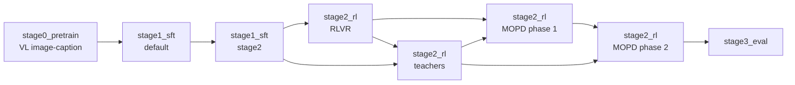

# Super 3.5 recipe overview

This file bridges the **paper methodology** to the **`nemotron super35` recipes** in this repo.

Use it when the question is:

- "How do I run Super 3.5 from this repo?"
- "Which config corresponds to the paper's stage?"
- "What is open-source vs only described in the paper?"

Before quoting exact CLI flags, check the current CLI tree (`uv run nemotron super35 --help`).

---

## Stage map

| Paper stage | Repo stage | CLI | Notes |
|---|---|---|---|
| Text-only pretraining pipeline (§2) | not reproduced | — | Needs Ultra 3 Base teacher logits and non-public data |
| — | `stage0_pretrain` | `super35 pretrain` | Megatron-Bridge **vision-language image-caption** pretraining (`nemotron_35_super_vl_pretrain_config`), warm-started from converted weights. Not the paper's pretraining |
| SFT stage 1 (§3.1) | `stage1_sft` `default` | `super35 sft` | Megatron-Bridge `nemotron_35_super_vl_sft_config`; defaults are the Megatron-Bridge verified layout (seq 4,096), not the paper's 524,288 |
| SFT stage 2 | `stage1_sft` `stage2` | `super35 sft -c stage2` | Continues from stage 1 on a re-weighted blend |
| — | `stage1_sft` `peft`, `long_context` | `super35 sft -c peft` / `-c long_context` | LoRA and long-context SFT variants from Megatron-Bridge |
| RLVR (§3.2) | `stage2_rl/stage1_rlvr` | `super35 rl rlvr` | From SFT; step 120 is the MOPD student and the root of most teachers |
| Teachers (§3.3–3.5) | `stage2_rl/stage2_teachers/*` | `super35 rl teacher <name> [-c variant]` | reasoning, vision, video, vision-reasoning (stage1/stage2), rlhf (teacher1/teacher2, two sub-stages each), agentic (config only) |
| MOPD (§3.6) | `stage2_rl/stage3_mopd` | `super35 rl mopd [-c phase2 \| single_stage]` | Phase 1 student = RLVR; phase 2 student = phase 1 step 30; `single_stage` = NeMo-RL's variant without the agentic teacher |
| MTP boosting (§3.7) | not included | — | |
| Quantization (§4) | not a stage | — | See `docs/nemotron/super35/quantization.md` |
| Evaluation (§3.8) | `stage3_eval` | `super35 eval` | NeMo Evaluator; five Table 10 benchmarks, not a Table 10 reproduction |

Checkpoint import: `super35 model import {pretrain,sft,rl}`. Data import: `super35 data import {sft,rl}` (the Super 3.5 blends are not public, so users register their own).

---

## Source layout

| Path | Role |
|---|---|
| `src/nemotron/recipes/super35/` | recipes (README per stage) |
| `src/nemotron/recipes/super35/stage2_rl/_nemo_rl.py` | shared RL runner: resolves artifacts, converts checkpoints to HF, launches NeMo-RL `examples/nemo_gym/run_grpo_nemo_gym.py` |
| `src/nemotron/recipes/super35/stage2_rl/Dockerfile` | RL container: NeMo-RL `super-v3.5-posttraining` @ `f299847f1` (NeMo Gym `e24db4e6`) |
| `src/nemotron/cli/commands/super35/` | CLI |
| `docs/nemotron/super35/` | user guides (README, pretrain, sft, rl/{index,rlvr,teachers,mopd}, evaluate, quantization) |
| `tests/recipes/super35/` | CLI, config-wiring, artifact-chain, and schema tests |

---

## Artifact chain

| Stage | Input model | Input data | Output |
|---|---|---|---|
| `pretrain` | converted checkpoint (`SUPER35_INIT_CHECKPOINT`) | Energon image-caption (`SUPER35_PRETRAIN_DATA`) | `super35-pretrain-model` |
| `sft` | `super35-pretrain-model` | `super35-sft-data` | `super35-sft-stage1-model` |
| `sft -c stage2` | `super35-sft-stage1-model` | `super35-sft-stage2-data` | `super35-sft-model` |
| `rl rlvr` | `super35-sft-model` | `super35-rl-rlvr-data` | `super35-rl-rlvr-model` |
| `rl teacher <name>` | `super35-rl-rlvr-model` (alignment teacher 1: `super35-sft-model`) | per teacher | `super35-rl-teacher-<name>-model` (RLHF: `rlhf1`/`rlhf2`; intermediate `-stage1-` artifacts for two-stage teachers) |
| `rl mopd` | `super35-rl-rlvr-model` + teachers | `super35-rl-mopd-phase1-data` | `super35-rl-mopd-phase1-model` |
| `rl mopd -c phase2` | `super35-rl-mopd-phase1-model` + teachers | `super35-rl-mopd-phase2-data` | `super35-rl-mopd-phase2-model` |
| `rl mopd -c single_stage` | `super35-rl-rlvr-model` + reasoning, RLHF-1, vision teachers | `super35-rl-mopd-phase1-data` | `super35-rl-mopd-single-stage-model` |
| `eval` | `super35-rl-mopd-phase2-model` | — | results |

Stages read `:latest` of their inputs. The reference run selected specific steps (RLVR 120, MOPD phase 1 and 2 at 30); pin artifact versions to reproduce that.

---

## Running without this repo

The `nemotron super35` CLI is the recommended path. Each framework also has its own launcher:

- **Pretrain / SFT / LoRA**: Megatron-Bridge `scripts/training/train.sh --recipe nemotron_35_super_vl_{pretrain,sft}_64gpu_h100_bf16_config` (or `..._peft_16gpu_h100_bf16_config`), after `scripts/conversion/convert.sh import`. See `docs/nemotron/super35/{pretrain,sft}.md → Direct Script Execution`.
- **RL**: NeMo-RL `examples/nemo_gym/nemotron-3.5-super/super35_launch.sh {student_rlvr,rlhf_teacher,reasoning_teacher,vision_teacher,mopd}` on branch `super-v3.5-posttraining`. This is the shorter lineage; see `docs/nemotron/super35/rl/index.md → Using super35_launch.sh (Direct)`.

Neither path writes W&B artifacts; register the outputs with `super35 model import` to continue in this repo.

## Reproduction caveats

1. **Data and reward models are not public.** The SFT, RLVR, teacher, and MOPD blends and the report's length-penalized GenRM variant are not released; the recipes run on user-registered data. NeMo-RL's guide says the RL data will be released later, and its public recipe uses `nvidia/NVIDIA-Nemotron-3-Ultra-550B-A55B-GenRM` as the GenRM.
2. **Agentic teacher cannot be launched**: its legacy Terminal-Bench agent is not in public NeMo Gym. Vision-reasoning stage 2 needs an unpublished structured-answer verifier. NeMo-RL's [Super 3.5 guide](https://github.com/NVIDIA-NeMo/RL/blob/super-v3.5-posttraining/docs/guides/models/nemotron/nemotron-3.5-super-vl.md) runs a shorter public lineage (Student RLVR, RLHF/reasoning/vision teachers, one MOPD stage that routes agentic environments to the general teacher); `docs/nemotron/super35/rl/index.md → Relation to NeMo-RL's Super 3.5 guide` maps it to these stages.
3. **Pretraining is not the paper's.** See the stage map.
4. **No GPU end-to-end run of this repo's wiring.** RL configs are ported from the reference-run configs and validated against the pinned NeMo-RL schema; CLI, config, and artifact-lineage unit tests pass on CPU. Megatron-Bridge separately verified conversion, pretrain, and SFT on GPUs. See `docs/nemotron/super35/README.md → Verification Status`.

---

## Best next file

| If the user asks… | Open… |
|---|---|
| "What does `super35 pretrain` actually train?" | `stage0_pretrain.md` |
| "How does SFT map to the paper?" | `stage1_sft.md`, `../paper/sft.md` |
| "Show me the RL chain / teacher configs" | `stage2_rl.md` |
| "How do I evaluate?" | `stage3_eval.md` |

---

## Reproduce with nemotron-customize

None of the catalog steps lists Super 3.5 VL in its `[[models]]` yet, and the Megatron-Bridge steps assume text data. For a Super 3.5 build:

- ground each stage on its `src/nemotron/recipes/super35/` directory (see the per-stage files for the matching step, if any);
- treat pretraining and SFT as **Explorer-mode** or direct recipe tasks;
- `rl/nemo_rl/rlvr` matches the RLVR stage shape, but the teachers and MOPD have no catalog step;
- `eval/model_eval` can evaluate a served checkpoint.

Adding Super 3.5 `[[models]]` entries to the step manifests is a separate task.
