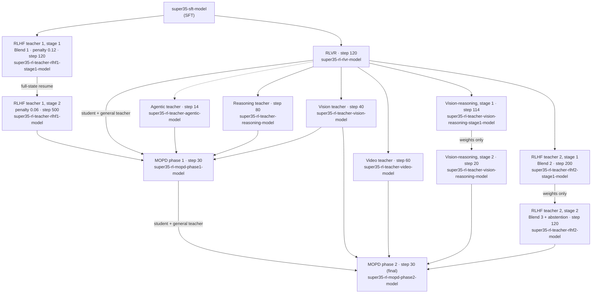

# Stage 2: Reinforcement Learning (RL)

This stage post-trains the Nemotron 3.5 Super VL SFT checkpoint in three
sub-stages, all run with [NeMo-RL](https://github.com/NVIDIA-NeMo/RL) and
[NeMo-Gym](https://github.com/NVIDIA-NeMo/Gym) environments:

1. **[RLVR](stage1_rlvr/README.md)** runs joint RLVR + RLHF over a broad
   multi-environment blend, starting from SFT. Its step-120 checkpoint is the
   shared trunk: every teacher except RLHF teacher 1 branches from it, and it
   is the MOPD phase-1 student.
2. **[Specialist teachers](stage2_teachers/README.md)** are trained by
   separate RL runs, one per capability: reasoning, vision tool use, video,
   vision reasoning, alignment (RLHF) and agentic.
3. **[MOPD](stage3_mopd/README.md)** is multi-teacher on-policy distillation.
   It merges the teachers back into one student in two phases. Phase 2
   produces the final model.

Every sub-stage runs the same upstream entry point
(`examples/nemo_gym/run_grpo_nemo_gym.py`) through the shared runner in
[`_nemo_rl.py`](_nemo_rl.py). MOPD is GRPO with an `on_policy_distillation`
block. Each config is a complete, flattened NeMo-RL config without
inheritance. It carries a `run:` section that names its input and output
artifacts.

## Lineage



The dashed arrow marks lineage that is assumed but not confirmed: the agentic
teacher's starting export may not be byte-identical to the selected RLVR
weights.

## Sub-stages

Node counts are GB200 nodes with 4 GPUs each, inside the Ray cluster.
External judge servers, which run outside the cluster, are listed separately.

| Sub-stage | CLI | Start checkpoint | Selected step | Nodes |
|---|---|---|---:|---|
| RLVR | `nemotron super35 rl rlvr` | `super35-sft-model` | 120 | 144 (+ 26 for external judges) |
| Reasoning teacher | `nemotron super35 rl teacher reasoning` | `super35-rl-rlvr-model` | 80 | 64 (hosted judge) |
| Vision tool-use teacher | `nemotron super35 rl teacher vision` | `super35-rl-rlvr-model` | 40 | 16 |
| Video teacher | `nemotron super35 rl teacher video` | `super35-rl-rlvr-model` | 60 | 32 |
| Vision-reasoning teacher, stage 1 | `nemotron super35 rl teacher vision-reasoning` | `super35-rl-rlvr-model` | 114 | 32 |
| Vision-reasoning teacher, stage 2 | `nemotron super35 rl teacher vision-reasoning -c stage2` | vision-reasoning stage 1 (weights only) | 20 | 32 (+1 Ray head) |
| RLHF teacher 1, stage 1 | `nemotron super35 rl teacher rlhf` | `super35-sft-model` | 120 | 32 (+ 32 GenRM) |
| RLHF teacher 1, stage 2 | `nemotron super35 rl teacher rlhf -c teacher1_stage2` | full-state resume of stage 1 at step 120 | 500 | 32 (+ 32 GenRM) |
| RLHF teacher 2, stage 1 | `nemotron super35 rl teacher rlhf -c teacher2_stage1` | `super35-rl-rlvr-model` | 200 | 64 (+ 64 GenRM) |
| RLHF teacher 2, stage 2 | `nemotron super35 rl teacher rlhf -c teacher2_stage2` | RLHF teacher 2 stage 1 (weights only) | 120 | 32 (+ 32 GenRM + 4 abstention judge) |
| Agentic teacher | `nemotron super35 rl teacher agentic` | `super35-rl-rlvr-model` | 14 | 128 (config only, see below) |
| MOPD phase 1 | `nemotron super35 rl mopd` | `super35-rl-rlvr-model` | 30 | 128 |
| MOPD phase 2 | `nemotron super35 rl mopd -c phase2` | `super35-rl-mopd-phase1-model` | 30 (final) | 128 |
| MOPD, single stage (NeMo-RL guide variant, no agentic teacher) | `nemotron super35 rl mopd -c single_stage` | `super35-rl-rlvr-model` | — (200-step budget) | 112 |

Each sub-stage writes `super35-rl-<...>-model` artifacts to W&B, and the next
sub-stage consumes them through its `run:` keys. The `run:` keys resolve
`:latest`, which is the last saved checkpoint. Where a config's step budget
runs past its selected step, pin the selected version explicitly, for example
`run.model=super35-rl-mopd-phase1-model:v<N>`. Each stage README says where
this applies. Stages never chain to new checkpoints automatically.

```bash
nemotron super35 rl rlvr --run <profile>
nemotron super35 rl teacher reasoning --run <profile>
nemotron super35 rl teacher rlhf -c teacher1_stage1 --run <profile>
nemotron super35 rl mopd -c phase2 --run <profile>
```

> **`--run <profile>`** names a profile in your `env.toml`. The profile sets
> the Slurm account, partition, mounts and other cluster settings. See the
> [env.toml setup guide](../../super3/README.md#envtoml-setup) for details.

All sub-stages share these settings: five repeated, detached MTP heads with
loss coefficient 0.3 (MTP decoding stays off in policy generation unless a
stage README says otherwise), policy serving with `max_num_seqs=256` and
`max_num_batched_tokens=32768`, and `load_replay_buffer: false`.

## Prerequisites

### Container

Every RL sub-stage runs in one container. It is built from NeMo-RL's
`super-v3.5-posttraining` branch with NeMo-Gym and the pre-built Gym
virtualenvs under `/opt/gym_venvs`:

```bash
nemotron kit slurm build <profile> --recipe super35 --stage rl
```

This writes `/home/${oc.env:USER}/.cache/nemotron/containers/super35-rl.sqsh`
on the cluster. That is the default `run.env.container` of every config. Set
`NEMO_GYM_VENV_DIR` (in `run.env.env_vars`) only to use a different
container-visible virtualenv directory.

### Judge, GenRM and teacher servers

Some environments are scored by models that run as separate, OpenAI-compatible
vLLM servers outside the Ray cluster. Start them before training and pass their
endpoints through `run.env.env_vars`. Each config reads one environment
variable per server (for example `${oc.env:GENRM_BASE_URL,...}`). The stage
READMEs list the exact variables and the reference run's serving flags.

| Server | Model | Used by | Reference-run fleet |
|---|---|---|---|
| GenRM (RLVR / RLHF) | Report: Nemotron 3 Ultra GenRM variant trained with a reasoning-length penalty (not public). NeMo-RL's public recipe uses [`nvidia/NVIDIA-Nemotron-3-Ultra-550B-A55B-GenRM`](https://huggingface.co/nvidia/NVIDIA-Nemotron-3-Ultra-550B-A55B-GenRM) | RLVR, RLHF teachers | RLVR: 8 × TP8; RLHF: 16 × TP8 (32 for RLHF teacher 2, stage 1) |
| Instruction / abstention judge | [Qwen3-235B-A22B-Instruct-2507-FP8](https://huggingface.co/Qwen/Qwen3-235B-A22B-Instruct-2507-FP8) | RLVR, RLHF teacher 2 stage 2 | RLVR: 8 × TP4; RLHF: 4 × TP4 |
| Safety judge | [Nemotron-Content-Safety-Reasoning-4B](https://huggingface.co/nvidia/Nemotron-Content-Safety-Reasoning-4B) | RLVR | 2 × TP4 |
| DeepSeek V4 Flash judge | Hosted endpoint (or self-hosted) | Reasoning teacher | Hosted |

Details are in [RLVR](stage1_rlvr/README.md),
[RLHF teachers](stage2_teachers/rlhf/README.md) and the
[teachers overview](stage2_teachers/README.md). MOPD skips reward
verification and needs no judge servers. Its teachers run inside the Ray
cluster as non-colocated inference fleets.

### Sandbox

Code-execution environments (RLVR, MOPD) need a
[NeMo-Skills](https://github.com/NVIDIA/NeMo-Skills) sandbox container:

```bash
nemotron super35 rl mopd --run <profile> run.env.sandbox.container=<sandbox-image>
```

The RLHF, vision and video teachers don't use a sandbox.

### Persistent cache

Set `run.env.persistent_cache` to a shared directory to reuse the vLLM,
DeepGEMM and FlashInfer compile caches across runs.

## Open-source status

- **Training stack.** Public: NeMo-RL `super-v3.5-posttraining` at commit
  `f299847f1`, which pins NeMo-Gym `e24db4e6` and Megatron-Bridge `3961f399`
  ([`Dockerfile`](Dockerfile), `ARG NEMO_RL_REF`). The agentic teacher is
  still config-only, because its Terminal-Bench agent environment is not in
  public Gym.
- **Datasets.** The RL datasets (RLVR blend, teacher datasets, RLHF Blends
  1–3, MOPD prompt blends) are not public yet. To run a sub-stage, register
  your own NeMo-Gym JSONL as the data artifact that the stage's `run.data`
  names:

  ```bash
  nemotron super35 data import rl ...
  ```

  Expected artifact names: `super35-rl-rlvr-data`,
  `super35-rl-teacher-<name>-data`, `super35-rl-mopd-phase1-data` and
  `super35-rl-mopd-phase2-data`. Each stage README lists its own.
- **Checkpoints.** Intermediate RL checkpoints and the RLHF GenRM are not
  published. The final post-trained model is released on Hugging Face as
  `nvidia/NVIDIA-Nemotron-3.5-Super-VL-120B-A12B-BF16`.

## Previous and next stages

- [Stage 1: SFT](../stage1_sft/README.md) produces `super35-sft-model`.
- [Stage 3: Evaluation](../stage3_eval/README.md) evaluates
  `super35-rl-mopd-phase2-model`.
