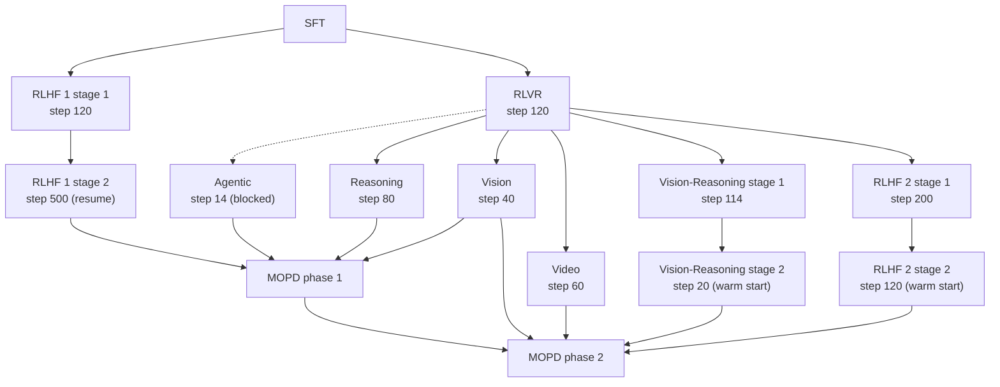

# Stage 2.2: Specialist Teachers

RL sub-stage 2.2 trains six **specialist teachers** for Nemotron 3.5 Super. MOPD (multi-teacher on-policy distillation, [Stage 2.3](../stage3_mopd/README.md)) later distills them into the student. Each teacher is a short, focused GRPO run that branches from the [RLVR](../stage1_rlvr/README.md) step-120 checkpoint. The exception is RLHF teacher 1, which branches from SFT. MOPD phase 1 and phase 2 use different subsets of the teachers.

All teachers run the same NeMo-RL entry point (`examples/nemo_gym/run_grpo_nemo_gym.py`) through the shared [`_nemo_rl.py`](../_nemo_rl.py) runner. Each has its own `train.py` and standalone config.

## Lineage



Dashed: unconfirmed lineage (see [Agentic](#agentic-blocked)).

| Teacher | CLI (`nemotron super35 rl teacher ...`) | Starts from | Selected step | Nodes (GB200, 4 GPU) | Distilled in | Output artifact |
|---------|-----------------------------------------|-------------|---------------|----------------------|--------------|-----------------|
| [Reasoning](#reasoning) | `reasoning` | RLVR step 120 | 80 | 64 (16 train + 48 gen) | MOPD 1 | `super35-rl-teacher-reasoning-model` |
| [Vision](#vision) | `vision` | RLVR step 120 | 40 | 16 (8 + 8) | MOPD 1 and 2 | `super35-rl-teacher-vision-model` |
| [Video](#video) | `video` | RLVR step 120 | 60 | 32 (16 + 16) | MOPD 2 | `super35-rl-teacher-video-model` |
| [Vision-Reasoning](#vision-reasoning) | `vision-reasoning -c stage1` / `-c stage2` | RLVR step 120 → stage 1 | 114 → 20 | 32 (16 + 16); stage 2 also used a dedicated Ray head | MOPD 2 | `...-vision-reasoning-stage1-model` → `super35-rl-teacher-vision-reasoning-model` |
| [RLHF](#rlhf) | `rlhf -c teacher1_stage1` ... `teacher2_stage2` | SFT (teacher 1), RLVR (teacher 2) | 500 / 120 | see configs | MOPD 1 (teacher 1), MOPD 2 (teacher 2) | `super35-rl-teacher-rlhf1-model`, `super35-rl-teacher-rlhf2-model` |
| [Agentic](#agentic-blocked) | `agentic` | RLVR step 120 | 14 | 128 (32 + 96) | MOPD 1 | `super35-rl-teacher-agentic-model` |

Every config sets `run.model: super35-rl-rlvr-model:latest` except RLHF teacher 1 (from SFT), RLHF teacher 2 stage 2 (from teacher 2 stage 1) and vision-reasoning stage 2 (from stage 1).

## Data Artifacts

The teacher datasets are not public yet. Each config reads its own data artifact through `run.data`; register your NeMo Gym JSONL (train split, plus an optional validation split) under exactly that name:

| Config | Data: import as | Command |
|--------|-----------------|---------|
| `reasoning` | `super35-rl-teacher-reasoning-data` | `nemotron super35 data import rl /data/reasoning/train.jsonl --val /data/reasoning/val.jsonl --name super35-rl-teacher-reasoning-data` |
| `vision` | `super35-rl-teacher-vision-data` | `nemotron super35 data import rl /data/vision/train.jsonl --val /data/vision/val.jsonl --name super35-rl-teacher-vision-data` |
| `video` | `super35-rl-teacher-video-data` | `nemotron super35 data import rl /data/video/train.jsonl --val /data/video/val.jsonl --name super35-rl-teacher-video-data` |
| `vision-reasoning -c stage1` | `super35-rl-teacher-vision-reasoning-stage1-data` | `nemotron super35 data import rl /data/vr1/train.jsonl --val /data/vr1/val.jsonl --name super35-rl-teacher-vision-reasoning-stage1-data` |
| `vision-reasoning -c stage2` | `super35-rl-teacher-vision-reasoning-data` | `nemotron super35 data import rl /data/vr2/train.jsonl --val /data/vr2/val.jsonl --name super35-rl-teacher-vision-reasoning-data` |
| `rlhf -c teacher1_stage1`, `teacher1_stage2` | `super35-rl-teacher-rlhf1-data` | `nemotron super35 data import rl /data/rlhf1/train.jsonl --val /data/rlhf1/val.jsonl --name super35-rl-teacher-rlhf1-data` |
| `rlhf -c teacher2_stage1` | `super35-rl-teacher-rlhf2-stage1-data` | `nemotron super35 data import rl /data/rlhf2a/train.jsonl --val /data/rlhf2a/val.jsonl --name super35-rl-teacher-rlhf2-stage1-data` |
| `rlhf -c teacher2_stage2` | `super35-rl-teacher-rlhf2-data` | `nemotron super35 data import rl /data/rlhf2b/train.jsonl --val /data/rlhf2b/val.jsonl --name super35-rl-teacher-rlhf2-data` |
| `agentic` (blocked) | `super35-rl-teacher-agentic-data` | `nemotron super35 data import rl /data/agentic/train.jsonl --val /data/agentic/val.jsonl --name super35-rl-teacher-agentic-data` |

The JSONL files are referenced in place, so keep them on storage the cluster can see. Image and video paths inside the rows must also resolve inside the container.

## Common Settings

These settings are shared across the teacher configs. Each config is a flattened port of the reference config, with every key and value kept. The only changes are artifacts, paths, endpoints and logger names, listed in each config header.

- **MTP**: five repeated, detached MTP heads are trained with loss coefficient 0.3 in every teacher. This replaces each reference run's own setting. Policy MTP speculative decoding is off, except for the reasoning teacher, which keeps one speculative token.
- **Policy serving**: vLLM with 256 concurrent sequences and 32,768 batched tokens.
- **Replay**: checkpoints save the replay buffer where enabled, but resumes never restore it (`load_replay_buffer: false`).
- **NeMo Gym connector limits**: both NeMo Gym aiohttp connector-limit keys are omitted, so NeMo Gym defaults apply.
- **Nodes**: each config sets the Slurm allocation in `run.env.nodes` (with `run.env.gpus_per_node: 4`), because the RL backend does not take the node count from `train.py`.
- **Software**: every teacher runs in the Super 3.5 RL container (NeMo-RL `super-v3.5-posttraining` with its pinned NeMo Gym; see [RL overview](../README.md#container)).
- **Logging**: W&B projects are named after the stage (e.g. `super35-rl-teacher-video`), with no entity set.

## Reasoning

`reasoning/config/default.yaml` contains math, STEM and competitive-coding prompts, with 128K-token generations and 262,144 context.

- **Training**: 256 prompts × 16 generations; TP4 / CP16 / EP32; LR 4e-6; async age 2; 80 steps.
- **Grading**: an LLM judge (DeepSeek V4 Flash) grades math and STEM. It uses temperature 0, 8,192 output tokens, medium reasoning effort and up to 256 concurrent requests. The competitive-coding-challenges verifier grades code in a NeMo-Skills sandbox (`run.env.sandbox.container`).
- **Differences from the reference run**:
  - The DeepSeek judge is used throughout. In the reference run, the judge changed at step 30.
  - Reasoning is kept on for coding prompts.

| Env var | Purpose |
|---------|---------|
| `DSV4_JUDGE_BASE_URL` | OpenAI-compatible endpoint serving DeepSeek V4 Flash (hosted API or your own vLLM server; default `http://127.0.0.1:8000/v1`) |
| `DSV4_JUDGE_MODEL` | Model name at that endpoint (default `deepseek-ai/DeepSeek-V4-Flash`; hosted providers often use a prefixed name) |
| `NVIDIA_API_KEY` | API key for the endpoint. It is **required**; use any non-empty value for a local server. Never write it into the config. |
| `REASONING_JUDGE_PROMPT_FILE` | STEM semantic-equivalence judge prompt (default: NeMo-RL's `examples/nemo_gym/nemotron-3.5-super/prompts/reasoning_semantic.txt` inside the RL container) |
| `CCC_TEST_FILE`, `CCC_SHARED_TEMP_DIR` | Competitive-coding metadata and a compile dir mounted in both the policy and sandbox containers |

Note: the shared runner (`stage2_rl/_nemo_rl.py`) resolves only `${art:...}` references and leaves `${oc.env:NVIDIA_API_KEY}` as an interpolation, so NeMo-RL reads the key from the environment at load time and it is never written to the handed-off config.

**Self-hosting the judge.** The reference run also tested a self-hosted variant: 4 judge replicas at TP4/EP4 on dedicated nodes, with FP8 KV cache. In that variant the policy kept 44 of its 48 generation nodes to stay within 64 nodes. That variant also set `chat_template_kwargs.thinking=true` and `reasoning_effort=high` on judge requests, because a local DeepSeek V4 tokenizer does not enable thinking from the reasoning-effort field alone. Add these settings with:

```bash
++env.nemo_gym.deepseek_v4_flash_judge_model.responses_api_models.inference_provider.extra_body.chat_template_kwargs.thinking=true
++env.nemo_gym.deepseek_v4_flash_judge_model.responses_api_models.inference_provider.extra_body.chat_template_kwargs.reasoning_effort=high
```

The self-hosted judge is not guaranteed to grade identically to the hosted one.

## Vision

`vision/config/default.yaml` trains image tool use. An image-tools agent issues crop and zoom tool calls, and string-match, math (no judge), MCQA and GUI-coordinate verifiers score the results.

- **Training**: 16 prompts × 8 generations; 32K context; TP8 / CP2 / EP16.
- **Trainable modules**: the vision encoder and projector are trainable, so vLLM starts with `load_format: dummy` and receives every weight by refit.
- **Agent limits**: the agent keeps the original 8-step / 6-tool-call limits and the tool success, invalid and duplicate rewards, rather than newer Gym defaults.
- **External services**: none (no sandbox, no external judges).
- **Data**: image paths in the training JSONL must be readable inside the container. Mount the image store through your `env.toml` profile.

## Video

`video/config/default.yaml` trains video QA and object tracking.

- **Data**: CapRL video QA uses 64 ordered frames rebuilt as native video. SA-V object tracking uses ordered images. Keep the dataset's `_is_video_frame` / `_video_source` metadata. Both paths use video temporal patch size 2 and 1,024 target patches.
- **Training**: 128 prompts × 16 generations; TP2 / CP1 / EP16 training; TP4 generation. Ray router replay is on. Vision modules and the MoE router are frozen.
- **Weight loading**: frozen vision weights are never refitted, so `policy.generation.vllm_cfg.load_format` **must stay `auto`**. The reference run's launcher checked this before training.
- **Media access**: `NEMO_RL_VIDEO_MEDIA_ROOT=/` and `allowed_local_media_path: /` let vLLM read media at the absolute paths stored in the data.
- **SA-V verifier**: the `sav_tracks` resources server is in public NeMo Gym at `e24db4e6`.
- **Run length**: checkpoints are saved every 5 steps and all are kept (`keep_top_k: 1000000`), which can use a lot of storage. Append `grpo.max_num_steps=60` to stop at the selected step.

## Vision-Reasoning

These are two GRPO stages on chart, document and OCR visual reasoning. Run them separately; they do not chain automatically. Both use 16 training + 16 generation nodes, 256 prompts × 16 generations, 32K context, a frozen vision encoder/projector, shuffled data and `load_format: auto`.

- **`stage1`** starts from RLVR step 120 (a recipe choice; the report starts from a multimodal RLVR checkpoint) and uses TP2 / CP1 / EP16 without router replay. It stops at 125 steps. Step 114 is selected; the config is ported from the reference run's saved step-110 config.
- **`stage2`** is a **native policy-weights warm start**, not a resume. It runs with TP2 / CP2 / EP16 plus router replay, for 54 steps, and step 20 is selected.
  - `run.model` (`super35-rl-teacher-vision-reasoning-stage1-model:latest`) feeds `policy.pretrained_checkpoint` (Megatron-Bridge format). Optimizer, dataloader and step counter start fresh.
  - `run.base_model` (RLVR step 120) still provides the HF architecture, tokenizer and frozen vision weights through `policy.model_name`.
  - The shared runner maps a NeMo-RL `step_N` artifact to its native weights directory (`step_N/policy/weights`, which holds `iter_*/`) before NeMo-RL loads it.
  - The reference run added a dedicated Ray head node (33 nodes).
- **Structured-answer verifier**: stage 2 grades set, ordered-list and interval answers with a custom `string_match` entrypoint (`structured_answer_app.py`). That code is not in public NeMo Gym yet, so stage 2 cannot run until the verifier is published.

## RLHF

`rlhf/config/{teacher1_stage1,teacher1_stage2,teacher2_stage1,teacher2_stage2}.yaml` trains two GenRM-driven alignment teachers (RLHF teachers 1 and 2), each in two stages. See `rlhf/train.py` and the config headers for details.

- **Teacher 1** starts from SFT. Stage 1 runs to step 120. Stage 2 is a full-state resume to step 500 with a lower reasoning-length penalty (500 total steps). Teacher 1 is distilled in MOPD phase 1.
- **Teacher 2** starts from RLVR step 120. Stage 1 runs to step 200 on Blend 2. Stage 2 is a weights-only warm start on Blend 3 with an abstention reward, for 120 steps. Teacher 2 is distilled in MOPD phase 2.

## Agentic (Blocked)

> **This teacher cannot run yet.** `agentic/config/default.yaml` is published for reference only.

The config covers end-to-end agentic RL on mixed Terminal-Bench (containerized shell tasks) and BrowseComp (web search with an LLM judge) prompts, with 192K context. It uses 128 nodes (32 training at TP8 / CP8 / EP8, 96 generation) and 64 prompts × 16 generations. Step 14 was selected; the config is the recovered neighboring step-15 config.

Why it is blocked:

- **Missing Terminal-Bench agent.** The Terminal-Bench half uses a legacy agent (`responses_api_agents/swe_agents_orig` plus `responses_api_agents/swe_agents/configs/terminalbench.yaml`) that is not in public NeMo Gym. No equivalent built on current NeMo Gym has been validated, and swapping in a different Terminal-Bench implementation would change the environment. The recipe therefore does **not** substitute one silently.
- **Unconfirmed agent bundle.** The complete agent and dependency bundle used by the reference run is unconfirmed.
- **Uncertain starting checkpoint.** The reference run started from a text-only RLVR export whose identity with RLVR step 120 is unconfirmed. This port starts from `super35-rl-rlvr-model:latest`.

Inputs the config expects once unblocked (all supplied through env vars, never written into the file):

| Env var | Purpose |
|---------|---------|
| `TB_SIF_DIR`, `SWE_SIF_DIR` | Apptainer images per task instance (Terminal-Bench / SWE) |
| `SEARCH_JUDGE_BASE_URL`, `SEARCH_JUDGE_MODEL`, `SEARCH_JUDGE_API_KEY` | BrowseComp answer judge (the reference run used a hosted GLM-5.1 endpoint) |
| `EXA_API_KEYS`, `TAVILY_API_KEYS` | Search-provider keys, as a YAML list string (e.g. `"[key1,key2]"`) |
| `BROWSECOMP_SEARCH_CACHE_DIR`, `BROWSECOMP_EXCLUDE_DOMAINS_FILE` | Search cache and the list of domains excluded from search |

## Usage

```bash
nemotron super35 rl teacher reasoning --run <profile> run.env.sandbox.container=<sandbox-image>
nemotron super35 rl teacher vision --run <profile>
nemotron super35 rl teacher video --run <profile>
nemotron super35 rl teacher vision-reasoning -c stage1 --run <profile>
nemotron super35 rl teacher vision-reasoning -c stage2 --run <profile>
nemotron super35 rl teacher rlhf -c teacher1_stage1 --run <profile>
```

Any config value can be overridden with trailing Hydra-style arguments. For example, `grpo.max_num_steps=40` shortens a run, and `run.model=<artifact>:<alias>` picks another starting checkpoint.
