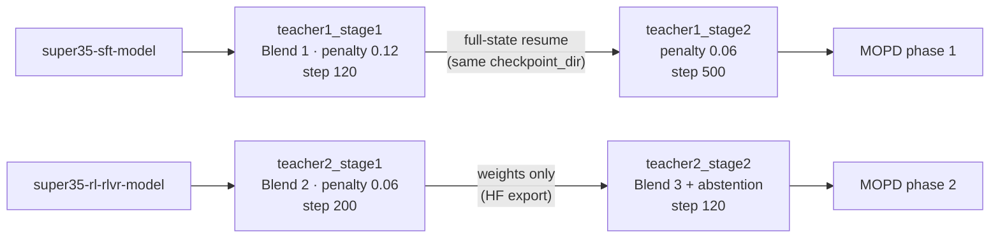

# RLHF Teachers (Alignment)

Two alignment teachers for Nemotron 3.5 Super (RLHF teachers 1 and 2), trained
with RLHF against a Generative Reward Model (GenRM). The report describes a single alignment teacher (§3.5); the split
into two teachers is the reference run's. Teacher 1 is distilled into the student in
[MOPD phase 1](../../stage3_mopd/README.md); teacher 2 in MOPD phase 2.
Each teacher is trained in two stages, and each stage is a config variant of
the same recipe.

## Approach

Training is close to the Nemotron 3 Ultra RLHF recipe, with three changes
(tech report §3.5):

- **Fixed-baseline comparisons.** The GenRM compares each policy response with
  a fixed response from **Gemma-4-31B-it** for the same prompt, not with the
  policy's other rollouts in a circular self-comparison
  (`genrm_compare.comparison_mode: fixed_baseline`). The baseline response
  and the prompt's rubric ids come with each data row.
- **Rubric-mean scoring.** Responses are scored with the mean of the
  per-rubric scores, not one overall score (`score_source: rubric_mean`).
- **A token-efficient GenRM.** The GenRM is a variant of the Nemotron 3 Ultra
  GenRM that was trained with a reasoning-length penalty. It is served with
  MTP speculative decoding (3 tokens).

The policy also gets a small group reasoning-length penalty
(`group_reasoning_length_penalty_coeff`). Teacher 2's stage 2 adds the
Nemotron 3 Ultra abstention environment.

The data is text-only, with reasoning-on and reasoning-off prompts routed to
`genrm_simple_agent` / `genrm_simple_agent_reasoning_off`. The policy loads the
full omni checkpoint (`policy.is_vlm: true`) and freezes the vision towers,
whose weights are kept in the saved checkpoints. (The `freeze_sound_*` flags
are no-ops; the model has no audio.)

## Stages

| Variant | Start | Data | Length penalty | Selected step | Output artifact |
|---|---|---|---|---|---|
| `teacher1_stage1` (default) | SFT (`super35-sft-model`), fresh state | Blend 1 | 0.12 | 120 | `super35-rl-teacher-rlhf1-stage1-model` |
| `teacher1_stage2` | **Full-state resume** of `teacher1_stage1` at step 120 | Blend 1 | 0.06 | 500 (500 RLHF steps in total, not 620) | `super35-rl-teacher-rlhf1-model` |
| `teacher2_stage1` | RLVR (`super35-rl-rlvr-model`), fresh state | Blend 2 | 0.06 | 200 | `super35-rl-teacher-rlhf2-stage1-model` |
| `teacher2_stage2` | **Weights-only** warm start from `teacher2_stage1` step 200 | Blend 3 + abstention reward 0.2 | 0.06 | 120 (320 RLHF steps in total) | `super35-rl-teacher-rlhf2-model` |



| Data blend | Reasoning on | Reasoning off | Abstention | Total |
|---|---:|---:|---:|---:|
| Blend 1 | 20,209 | 8,542 | 0 | 28,751 |
| Blend 2 | 19,973 | 8,778 | 0 | 28,751 |
| Blend 3 | 19,973 | 8,778 | 1,716 | 30,467 |

`grpo.max_num_steps` in each variant stops at its selected checkpoint. Append
`grpo.max_num_steps=<n>` to continue past it.

### Teacher 1: Full-State Resume

`teacher1_stage2` continues the same optimization as `teacher1_stage1`. It
restores the weights, the optimizer and scheduler state (including the Adam
moments), the step counter and the dataloader position. Only the
reasoning-length penalty (0.12 → 0.06) and the step limit (120 → 500) change.
An HF export of step 120 is **not** enough, because it holds no optimizer
state. A weights-only start would begin a new optimizer, which is a
different run.

Both variants use the same `checkpointing.checkpoint_dir`
(`results/super35-rl-teacher-rlhf1/checkpoints`). NeMo-RL resumes from the
latest `step_N` in that directory, so stage 2 picks up at step 120. Replay
buffers are not restored (`load_replay_buffer: false`), and rollouts are
regenerated.

```bash
nemotron super35 rl teacher rlhf -c teacher1_stage1 --run <profile>   # stops at step 120
nemotron super35 rl teacher rlhf -c teacher1_stage2 --run <profile>   # resumes step 120 → 500
```

Check that `step_120` contains the full training state (`training_info.json`
with `current_step: 120`, `train_dataloader.pt`, `config.yaml` and
`policy/weights` with the optimizer state) before you launch stage 2.

To run stage 2 in a **separate** checkpoint directory, override
`checkpointing.checkpoint_dir`. Then seed `<new_dir>/step_120` with the
complete stage-1 `step_120` before the first launch. The reference run's
helper made `<new_dir>/step_120` a real directory and filled it with symlinks
to each child of the source step. Checkpoint retention could then delete the
seed without following the links into the source. The helper also refused to
run if the destination already held a step below 120. If you use symlinks,
keep the source checkpoint until stage 2 has saved its own first checkpoint.

### Teacher 2: Weights-Only Warm Start

`teacher2_stage2` is a fresh run that starts from step 0. It uses its own
`checkpoint_dir` and a new optimizer and replay state. `run.model` points at
the `teacher2_stage1` model artifact, which is the omni HF export of step 200.
Do **not** seed the new checkpoint directory with step-200 training state.

```bash
nemotron super35 rl teacher rlhf -c teacher2_stage1 --run <profile>   # 64 Ray nodes
nemotron super35 rl teacher rlhf -c teacher2_stage2 --run <profile>
```

The reference run continued `teacher2_stage1` on a smaller allocation once
it had saved a checkpoint: the same experiment and `checkpoint_dir`, on 16
training and 16 generation nodes, with 16 GenRM replicas. The exact step of
the scale-down is not recorded. To do the same:

```bash
nemotron super35 rl teacher rlhf -c teacher2_stage1 --run <profile> \
    cluster.num_nodes=32 policy.generation.colocated.resources.num_nodes=16 run.env.nodes=32
```

Without an existing checkpoint, this command starts a fresh, smaller run
instead of a continuation.

## External Judge Servers

The judges run as separate OpenAI-compatible vLLM servers **outside** the Ray
cluster. Start them before training and pass their endpoints through
`run.env.env_vars`. The GenRM and abstention judge blocks also contain
`vllm_serve_*` settings, but these are inactive while `base_url` points at an
external server.

| Env var | Used by | Default | Meaning |
|---|---|---|---|
| `GENRM_BASE_URL` | all variants | `http://127.0.0.1:8000/v1` | GenRM endpoint (load-balanced across replicas) |
| `GENRM_MODEL` | all variants | `model` | Served model name of the GenRM |
| `GENRM_API_KEY` | all variants | `dummy_key` | API key, if your server needs one |
| `ABSTENTION_JUDGE_BASE_URL` | `teacher2_stage2` | `http://127.0.0.1:8100/v1` | Abstention judge endpoint |
| `ABSTENTION_JUDGE_MODEL` | `teacher2_stage2` | `Qwen/Qwen3-235B-A22B-Instruct-2507-FP8` | Served model name of the abstention judge |

```bash
nemotron super35 rl teacher rlhf -c teacher2_stage2 --run <profile> \
    run.env.env_vars.GENRM_BASE_URL=http://genrm-lb:9216/v1 \
    run.env.env_vars.ABSTENTION_JUDGE_BASE_URL=http://abstention-lb:9217/v1
```

**GenRM.** The reference run used 16 independent TP8 replicas (32 for the initial
`teacher2_stage1` allocation) behind a load balancer, with these serving flags:

```text
--trust-remote-code --dtype bfloat16 --kv-cache-dtype fp8 --tensor-parallel-size 8
--max-num-seqs 256 --gpu-memory-utilization 0.95 --enable-prefix-caching
--enable-expert-parallel --enable-auto-tool-choice --tool-call-parser qwen3_coder
--reasoning-parser nemotron_v3 --served-model-name model
--compilation-config '{"pass_config":{"fuse_allreduce_rms":false}}'
--speculative-config '{"method":"mtp","num_speculative_tokens":3}'
env: VLLM_FLASHINFER_ALLREDUCE_BACKEND=trtllm VLLM_ALLREDUCE_USE_SYMM_MEM=0
```

For which GenRM model to serve, see [RL overview → Judge, GenRM and Teacher Servers](../../README.md#judge-genrm-and-teacher-servers).

**Abstention judge** (`teacher2_stage2` only). The reference run used
[Qwen3-235B-A22B-Instruct-2507-FP8](https://huggingface.co/Qwen/Qwen3-235B-A22B-Instruct-2507-FP8),
with four TP4 replicas and these flags:

```text
--dtype bfloat16 --tensor-parallel-size 4 --max-model-len 131072 --max-num-seqs 256
--gpu-memory-utilization 0.85 --enable-prefix-caching --enable-chunked-prefill
--enable-auto-tool-choice --tool-call-parser hermes --attention-backend TRITON_ATTN
--enable-expert-parallel
--compilation-config '{"cudagraph_capture_sizes":[1,2,4,8,16,32,64,128,256]}'
env: VLLM_USE_FLASHINFER_MOE_FP16=0 VLLM_USE_FLASHINFER_MOE_FP8=0
     VLLM_USE_DEEP_GEMM=0 VLLM_MOE_USE_DEEP_GEMM=0
```

If you serve it without `--served-model-name`, vLLM uses the HF id as the
model name, and that matches the `ABSTENTION_JUDGE_MODEL` default.

## Resources

| Variant | Ray cluster (training + generation) | GenRM | Abstention judge | Total in the reference run |
|---|---:|---:|---:|---:|
| `teacher1_stage1`, `teacher1_stage2` | 32 (16 + 16) | 32 nodes (16 × TP8) | — | 64 |
| `teacher2_stage1` | 64 (32 + 32) | 64 nodes (32 × TP8) | — | 128 |
| `teacher2_stage1`, smaller continuation | 32 (16 + 16) | 32 nodes (16 × TP8) | — | 64 |
| `teacher2_stage2` | 32 (16 + 16) | 32 nodes (16 × TP8) | 4 nodes (4 × TP4) | 68 |

All nodes are GB200 with 4 GPUs each.

| Setting | Value |
|---|---|
| Training parallelism | TP8 / CP8 / EP16 / PP1, expert TP1 (the reference run's launch scripts use TP4 / CP2 / EP16) |
| Batch | 32 prompts × 32 generations = 1,024; LR 2e-6 constant, 10 warmup steps |
| Context | 49,152 total, 16,384 max new tokens |
| Policy generation | vLLM TP4 / EP4, max sequences 256, max batched tokens 32,768, `load_format: auto` |
| MTP | 5 repeated, detached heads, loss coefficient 0.3; no MTP decoding |
| Checkpointing | every 10 steps, plus a fault-tolerance save every step |

Before you resume a checkpoint that was saved with a different parallel
layout, check that the two layouts are compatible.

## Data

The RLHF datasets are not public yet. Register your own NeMo Gym JSONL as the
data artifacts with `nemotron super35 data import rl ...`. Each row must carry
the Gemma-4-31B-it baseline response and the rubric ids that `genrm_compare`
expects.

| Artifact | Blend | Used by |
|---|---|---|
| `super35-rl-teacher-rlhf1-data` | Blend 1 | `teacher1_stage1`, `teacher1_stage2` |
| `super35-rl-teacher-rlhf2-stage1-data` | Blend 2 | `teacher2_stage1` |
| `super35-rl-teacher-rlhf2-data` | Blend 3 (Blend 2 + abstention) | `teacher2_stage2` |

## Differences from the Reference Run

- The reference run's teachers used a text-only architecture. These recipes train
  the omni architecture with frozen vision towers. They are
  training-input ports, not claims of bitwise-identical trajectories.
- Training uses TP8 / CP8 / EP16 instead of the reference run's TP4 / CP2 / EP16.
- Validation is off (`val_period` is effectively never reached). Replay
  restoration is disabled, which matches the reference configs.
- The reference run's launchers set a 100,000-step ceiling. These configs stop at
  the four selected checkpoints (120 / 500 / 200 / 120).

## Requirements

- The Super 3.5 RL container (see [RL overview](../../README.md#container)).
- The external GenRM server and, for `teacher2_stage2`, the abstention judge.
- No code-execution sandbox is needed.

## References

- [RL overview](../../README.md) · [Teachers overview](../README.md) · [MOPD](../../stage3_mopd/README.md)
- [NeMo RL](https://github.com/NVIDIA-NeMo/RL) · [NeMo Gym](https://github.com/NVIDIA-NeMo/Gym)
- [RL-BFF](https://arxiv.org/abs/2505.18849) (principle-following GenRM)
