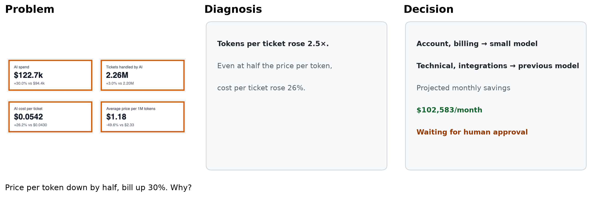
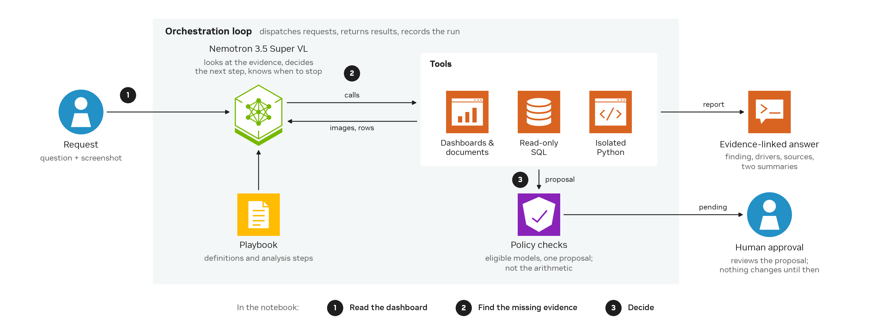

<!--
SPDX-FileCopyrightText: Copyright (c) 2026 NVIDIA CORPORATION & AFFILIATES. All rights reserved.
SPDX-License-Identifier: Apache-2.0
-->

# Build a visual investigation agent with Nemotron 3.5 Super VL

Build an agent that reads dashboards and scanned documents, works out why a metric moved, and proposes a fix for a person to approve.



A help desk switched its AI agent to a cheaper model, and its AI bill went up 30%. Super VL starts from the question ("Our help-desk AI bill is up about 30% this month. What happened?") and a dashboard screenshot; nothing it is given says what caused the increase. It reads the dashboard, checks its numbers against the help-desk database, finds the model switch in the change log, and opens a scanned price list and a two-page evaluation report to price a fix. It then proposes, for each ticket type, the cheapest model that resolves tickets within 2 percentage points of the previous model in offline tests, and the proposal waits for a person to approve it.

## What you'll build

- **Read the dashboard:** Super VL turns a pasted screenshot into a hypothesis and a plan of queries before it touches the data.
- **Find the missing evidence:** it decides which scanned and multi-page documents to open, and reads exact values from the images.
- **Decide:** it ties the cost rise to its cause, prices the models that meet the quality bar for each ticket type, picks the cheapest as its instructions ask, and files one proposal for approval.

## Quick start

Replay needs no GPU, API key, or Chrome. Tested with Python 3.12 on macOS; the sandbox for the agent's Python is also tested on Linux. From this folder:

```bash
uv venv --python 3.12 && source .venv/bin/activate
uv pip install -r requirements.txt
jupyter lab visual_investigation_agent.ipynb
```

Run all cells; replay takes under a minute. It shows a recording of a live Super VL run. We chose it from a batch of live runs: of the runs that passed every check, needed no reminders or retries, hit no tool errors, never contradicted the dashboard, opened no page twice, and finished within 10 minutes, it's the one closest to the batch's median time. The recording is shown as it happened: where the report's wording slips, we point it out beside the data.

## Run it live

1. Get an API key from [NVIDIA Build settings](https://build.nvidia.com/settings).
2. Copy `.env.example` to `.env`. The file already sets
   `MODEL_BASE_URL=https://integrate.api.nvidia.com/v1` and
   `MODEL_NAME=nvidia/nemotron-3.5-super-vl-120b-a12b`
   ([model page](https://build.nvidia.com/nvidia/nemotron-3.5-super-vl-120b-a12b));
   paste your key after `NVIDIA_API_KEY=`.
3. Install Chrome or Chromium, which renders the dashboard and documents. If it's installed somewhere unusual, set `CHROME_PATH` in `.env`.
4. Set `RUN_LIVE = True` in the notebook's setup cell and run all cells.

You can also download the checkpoint from Hugging Face and serve it from your own OpenAI-compatible vLLM endpoint.

Before Super VL starts, we check that your endpoint handles text, thinking, images, and tool calls, and stop if any check fails. A live run takes a few minutes, and its wording, and sometimes its conclusion, will differ from the recording. To run a batch from the command line: `python -m evals.run_suite --scenario model-switch-visual --trials 3`.

Model-written Python runs in a sandbox with no network and no writes outside a scratch folder: `sandbox-exec` on macOS, or [bubblewrap](https://github.com/containers/bubblewrap) on Linux, which mounts only the system libraries, the Python interpreter, and the scenario's data, read-only. Where neither is available, the agent's Python calls are refused rather than run unsandboxed.

## How it works



Super VL decides what to look at and what to compute; deterministic code executes and enforces; a person approves.

- **The orchestration loop** (`investigator/harness.py`) sends the conversation to Super VL, runs the tools it asks for, and stops when it submits a report.
- **Bounded tools** (`investigator/tools.py`): dashboards and scanned documents come back as images, SQL is read-only, Python runs in a sandbox, and `propose_change` only records a proposal.
- **The playbook** (`playbook/helpdesk.md`) holds the team's metric definitions and analysis steps. It says how to investigate, not what happened.
- **The policy** (`policy/helpdesk.json`) holds the rules the tools enforce, such as the quality bar and one proposal per run.
- **The contract** (`investigator/contract.py`) assembles the system prompt from the playbook and the policy, adds the routing objective, and defines the report, which Super VL submits as a tool call.

`agent.json` records hashes of everything the model sees, plus the sampling settings and limits; `investigator.check_config()` reports whether each still matches.

## Adapt it to your dashboards

- **Replace `world/`** with your systems: your BI tool's image export for dashboards, a read-only connection to your data, and your document store. `investigator/tools.py` serves the agent's tool calls from it; `harness.py`, `contract.py`, `policy.py`, and `sandbox.py` also read from it.
- **Rewrite the playbook and policy** for your metrics, tables, and decision rules.
- **Keep the loop**, and test the new setup on your own cases with `evals/run_suite.py`, which scores each run step by step against ground truth the agent never sees.

## What's in this folder

| Path | What it is |
|---|---|
| `visual_investigation_agent.ipynb` | The walkthrough; replays the recording by default |
| `investigator/` | The agent: the loop (`harness.py`), tools, report contract, policy checks, sandbox, endpoint checks, and the notebook's views |
| `playbook/helpdesk.md` | The playbook: metric definitions, tables, and analysis steps |
| `policy/helpdesk.json` | The policy: quality bar, one proposal per run, report requirements |
| `world/` | Fernledger, the synthetic company: data, dashboard tabs, and documents; `generator.py` builds more synthetic scenarios |
| `replay/` | Saved agent-run data for replay mode: model messages, tool results, report, proposal, and the images the agent saw; no demo video or audio |
| `evals/` | Ground truth, step-by-step scoring, and the batch runner |
| `agent.json` | The agent's configuration: hashes of everything the model sees, sampling settings, and limits |
| `tests/` | Deterministic tests, including a replay of the recording through the loop |

The playbook and policy carry no license header on purpose: any edit, even a comment, changes what the model sees and makes a new agent version.

## Limits

- One synthetic company with one dashboard style. It shows a pattern, not that the agent works on any dashboard.
- Results vary between runs, sometimes in the conclusion. Run it several times on your own cases before relying on it.
- In this example the cause can also be found from the database alone; the scanned price list and the report are what make it possible to price and choose the fix.
- The tools are read-only except `propose_change`, which only records a proposal. The policy checks eligibility and limits, not arithmetic.
- Orange boxes in the notebook were added after the run to guide the reader; the model did not draw them.
- The company, data, and documents are generated by `world/`; the scanned price list was generated from HTML. The notebook writes its files only inside this folder (`.world/` and, for live runs, `runs/`). Delete both to reset.

## Troubleshooting

- **"Copy .env.example to .env and set NVIDIA_API_KEY".** There is no `.env` yet. Create it from `.env.example`, paste your key after `NVIDIA_API_KEY=`, and rerun the setup cell.
- **"HTTP 401" or "HTTP 403: NVIDIA Build rejected the API key".** The key is missing or invalid. Generate one at [NVIDIA Build settings](https://build.nvidia.com/settings) and set `NVIDIA_API_KEY` in `.env`.
- **"HTTP 404: the endpoint or model was not found".** Check `MODEL_BASE_URL` and `MODEL_NAME` in `.env` against the [model page](https://build.nvidia.com/nvidia/nemotron-3.5-super-vl-120b-a12b).
- **"Could not reach MODEL_BASE_URL".** Check your network connection and the URL in `.env`.
- **"Chrome or Chromium is needed to render images".** Install one. If it's installed somewhere unusual, set `CHROME_PATH` in `.env`.
- **"No sandbox for the agent's Python on this machine", or the agent's Python calls return "Python is unavailable".** No sandbox is available. On Linux, install bubblewrap and check that unprivileged user namespaces are allowed (Ubuntu 24.04 restricts them by default unless an AppArmor profile allows bubblewrap).

## Related Nemotron resources

- [Nemotron usage cookbook](https://github.com/NVIDIA-NeMo/Nemotron/tree/main/usage-cookbook)
- [NVIDIA Build](https://build.nvidia.com/)
- [Nemotron 3.5 Super VL fine-tuning guide](https://docs.nvidia.com/nemo/automodel/model-coverage/omni/nvidia/NVIDIA-Nemotron-3.5-Super-VL-120B-A12B-BF16)
- [Build a Bash computer-use agent with NVIDIA Nemotron](https://developer.nvidia.com/blog/create-your-own-bash-computer-use-agent-with-nvidia-nemotron-in-one-hour/)

## License

The code, scripts, and documentation in this folder are licensed under Apache-2.0. The model is governed by its own license.
