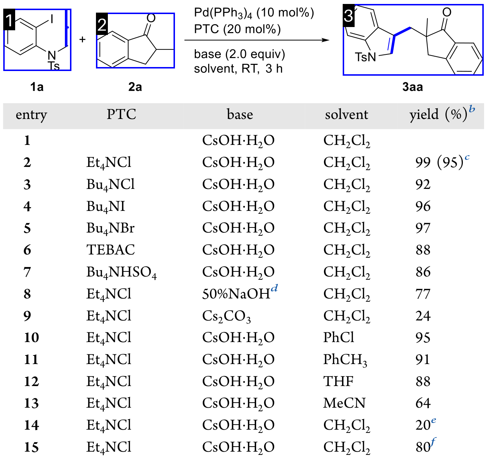

# Parse Chemical Reaction Diagrams with NVIDIA Nemotron 3.5 Super VL: Full SFT

Fine-tune [Nemotron 3.5 Super VL (BF16)](https://huggingface.co/nvidia/NVIDIA-Nemotron-3.5-Super-VL-120B-A12B-BF16)
on four nodes to turn reaction diagrams into JSON describing reactants,
conditions, and products.

[RxnCaption](https://arxiv.org/abs/2511.02384) represents molecules with numbered
boxes and asks the model to describe the reactions. The supplied converter
creates these numbered images from the public annotations.

- **Requirements:**
  - Four Linux nodes with four GB200 GPUs each and working GPU networking.
  - Docker with NVIDIA Container Toolkit on every node.
  - Git on the host that performs the download stage.
  - A shared filesystem mounted at the same absolute path on all nodes, with about 3 TiB free.
  - Plan for roughly 1.4 TiB host RAM per node for this recipe; needs depend on your platform.
- **Files:**
  - Keep `super_vl_rxncaption_sft/` and `super_vl_rxncaption/` beside each other on all nodes.
  - The neighboring directory contains local support code; `pipeline` is not a package to install.
- **Inputs:**
  - The public BF16 model and revision are preconfigured, matching the LoRA notebook.
  - Supply the prepared-data URLs, checksums, AutoModel revision, and container images.
- **First run:**
  - Use `--smoke-steps 5` on every stage; omit it everywhere for one epoch.
  - Both modes load the full model, export weights, and evaluate all 400 images.

## Agenda

1. [Install dependencies](#step-1-install-dependencies)
2. [Configure the run](#step-2-configure-the-run)
3. [Download the model and data](#step-3-download-the-model-and-data)
4. [Prepare the data](#step-4-prepare-the-data)
5. [Set up full SFT](#step-5-set-up-full-sft)
6. [Train on four nodes](#step-6-train-on-four-nodes)
7. [Export the model](#step-7-export-the-model)
8. [Set up evaluation](#step-8-set-up-evaluation)
9. [Evaluate the model](#step-9-evaluate-the-model)
10. [Read the results](#step-10-read-the-results)

## A training example

The model receives this image and a prompt. Its target is the annotated reaction
JSON: `mol` refers to a numbered box, `txt` to text, and `idt` to a compound label.


**Prompt excerpt:**

> Please extract the list of reactions from the image. Return only the JSON reaction list without adding any other content.

**Dataset target** (annotations can omit visible details):

```json
[
  {
    "reactants": [{"type": "mol", "index": 1}, {"type": "mol", "index": 2}],
    "conditions": [{"type": "txt", "content": "base (2.0 equiv) solvent, RT, 3 h"}],
    "products": [{"type": "mol", "index": 3}]
  }
]
```

## Step 1: Install dependencies

From `super_vl_rxncaption_sft/`, run on each node:

```bash
python3 -m venv .venv
source .venv/bin/activate
python -m pip install -r ../super_vl_rxncaption/requirements.txt
git --version
```

PyTorch, AutoModel, and vLLM run in containers.

## Step 2: Configure the run

Copy the settings once on the shared filesystem:

```bash
cp settings.example.yaml settings.yaml
```

- Set `workspace` to a shared absolute path and choose a new `run_id`.
- Fill in the copied `settings.yaml` using [settings.example.yaml](settings.example.yaml) as the template, or set its environment variables.
- **Container images:**
  - **Training and export:** `AUTOMODEL_IMAGE` = `nvcr.io/nvidia/nemo-automodel:<tag>` from the [NeMo AutoModel NGC catalog](https://catalog.ngc.nvidia.com/orgs/nvidia/containers/nemo-automodel).
  - **Evaluation:** `VLLM_IMAGE` = a vLLM image supporting Nemotron 3.5 Super VL.
- Pin `AUTOMODEL_REVISION` to a compatible source commit; prefer container image digests.
- Use identical settings and environment variables on all four nodes. To override the model, set both `SUPER_VL_MODEL_ID` and `SUPER_VL_MODEL_REVISION`.
- Increase `ready_timeout_seconds` if first-time model/data downloads can exceed six hours. The shared-filesystem and peer-completion timeouts are also configurable.

The launcher mounts your workspace at `/workspace` inside Docker. `train_python`
and `eval_python` refer to Python inside the selected containers.

## Step 3: Download the model and data

Run once on node 0:

```bash
python run_sft.py download --settings settings.yaml --smoke-steps 5
```

The commented [download helpers](../super_vl_rxncaption/assets.py) fetch the pinned
HF model, verify/extract both ZIPs, check out AutoModel, and pull the containers.
Completed downloads are reused.

| Archive | Required files |
|---|---|
| Training data | `train/dataset.jsonl`, `train/images/`, `test/dataset.jsonl`, `test/images/` |
| Benchmark | `images/gt_bivp/` (400 PNGs), `ground_truth/ground_truth.json`, `mapdicts/mapdict_gt.json` |

The [data guide](../super_vl_rxncaption/README.md#training-archive-layout) describes
the JSONL and benchmark schemas. Use the
[public data conversion guide](../../README.md#public-dataset-and-license) to
download U-RxnDiagram-15k and create both archives.

U-RxnDiagram-15k and the converted artifacts are **CC BY-NC 4.0**. Retain the
generated attribution notice. Commercial use is prohibited without separate
permission from the dataset rights holder. The included `reaction_example.png`
is also an adaptation of the dataset; see
[DATA_LICENSE.md](../../DATA_LICENSE.md).

## Step 4: Prepare the data

Run once on node 0:

```bash
python run_sft.py prepare --settings settings.yaml --smoke-steps 5
```

- Clean empty text and contaminated labels.
- Reserve 400 validation images using a seed-42 hash split.
- Repeat training examples with 5–8 reactions twice and those with 9+ reactions three times.
- Verify that training, validation, and the benchmark do not overlap.

Inspect `example.png`, `split_ids.json`, and `prepared.json` in your run directory.
The weighted training rows determine one epoch's update count at global batch 16.

## Step 5: Set up full SFT

The [AutoModel recipe](sft_config.yaml) is separate from the launcher so it is easy to edit.

- **Trainable:** language model, vision tower, and vision projector.
- **Frozen:** token embeddings, output head, audio, and video components.
- **Training:** learning rate 3e-6, no warmup, sequence length 6,144, global batch 16.
- **Memory:** BF16 model weights, FP32 optimizer state, FSDP2, expert parallelism 4, activation checkpointing.
- **Topology:** four nodes × four GPUs, EP=4 and inferred DP=4. Local batch 1 with global batch 16 produces four gradient-accumulation microsteps per optimizer update.

Each GPU audits its trainable parameters before training starts.

## Step 6: Train on four nodes

Run on **each node**, setting `NODE_RANK` to 0, 1, 2, or 3:

```bash
export MASTER_ADDR="<first-node-hostname-or-IP>"  # reachable from every node
export NODE_RANK=0                              # change on each node
python run_sft.py train --settings settings.yaml --smoke-steps 5 \
  --node-rank "$NODE_RANK" --master-addr "$MASTER_ADDR"
```

Keep all four sessions alive. Docker pulls the training image on each node as
needed. Use `plan` instead of `train` to inspect the command without starting a job.
Before Docker training starts, every node writes and reads a marker in the run
directory. Failure here means the configured workspace is not shared at the same
absolute path, or not every node command was launched.
Wait for all four training commands to succeed before exporting.

**End-to-end shortcut:** use `all` instead of `train` on each node to run Steps 3–9
automatically. Node 0 downloads/prepares first; other nodes wait. After training,
node 0 exports and evaluates. Manual export/evaluation commands are then unnecessary.

## Step 7: Export the model

Run once on node 0:

```bash
python run_sft.py export --settings settings.yaml --smoke-steps 5
```

This checks all 16 trainability audits and verifies the consolidated model's
shards and index. Export runs in the AutoModel container.

## Step 8: Set up evaluation

The reaction-specific scorer is included in the support directory.

- **SoftMatch** follows the paper: it ignores text, merges molecular conditions
  into reactants, and keeps products direction-aware.
- **HybridMatch** uses role-aware molecular matching, exact reactant/product
  text, and normalized edit distance up to 0.2 for condition text.
- Malformed JSON counts as an empty prediction and remains in the score.
- vLLM serves on two GPUs on node 0; scoring runs on CPU.

Use the same benchmark as the LoRA run to compare results.

## Step 9: Evaluate the model

Run once on node 0:

```bash
python run_sft.py eval --settings settings.yaml --smoke-steps 5
```

This starts vLLM, processes all 400 images, saves predictions and scores, and
stops the server. Decoding uses BF16, temperature 0, thinking disabled, and up to
2,048 output tokens. Failed inference requests are recorded and cause a nonzero exit.

## Step 10: Read the results

- F1 percentages print when evaluation finishes; higher is better.
- Results: `workspace/runs/<run_id>/evaluation/metrics.json`.
- Predictions: `evaluation/raw.json`; server startup: `evaluation/server.log`.
- Stage logs: `logs/`; training checkpoints: `checkpoints/`; exported model: `export/`.

Choose a new run ID after changing settings or starting a new training run.
Stages are write-once within a run directory: export and evaluation refuse to
overwrite existing output. Inspect failed artifacts, then choose a new run ID
instead of deleting evidence from a partial run.

### Reference results

Earlier one-epoch runs (1,171 updates) on GB200 GPUs, evaluated on the same
400 images. Scores are F1 (%). These used a pre-release checkpoint and have not
been remeasured with the GA model.

| Training | Hardware | SoftMatch | HybridMatch |
|---|---|---:|---:|
| LoRA | 1 node × 4 GPUs | 81.04 | 64.01 |
| Full SFT | 4 nodes × 4 GPUs | 85.73 | 69.86 |

LoRA used rank 64, learning rate 2e-4, and frozen vision weights. Full SFT used
learning rate 3e-6 and trainable vision weights. A five-step run checks the
workflow, not final model quality.

**Validation:** CPU checks cover downloads, preparation, launch configuration,
export validation, and scoring. Container stages use mocks in those checks; a
full GPU run with the GA checkpoint remains unverified.
